

  

    

      <Icon icon="wrench" size={32} />
      
Agent setup guide

    

    
Create your first AI agent with the visual flow builder

  

## Prerequisites

Before creating an agent, ensure you have:

1. **AI models configured** - At least one LLM provider set up in your organization. Agent mode in chat needs a reasoning-capable model; configure it under **Workspace > AI models**
2. **Actions Configured** (optional) - Any external actions you want the agent to use
3. **Knowledge Sources** (optional) - Connectors or collections for document search

<Warning>
  Actions must be authenticated before they can be added to an agent. If you plan to use Jira, Slack, or other external actions, configure them first in **Workspace > Actions** (or **Your actions** for your own sign-in).
</Warning>

---

## Step 1: Find your agents

Agents live in the chat sidebar. Open **Chat** and look under **My agents**: it lists the agents you can use.

<Frame>
  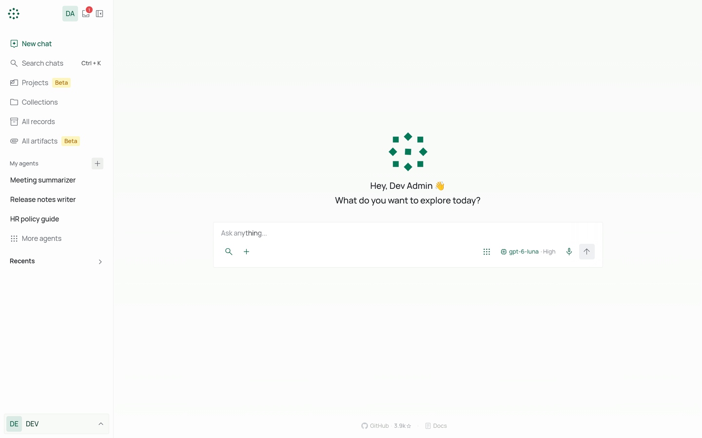
  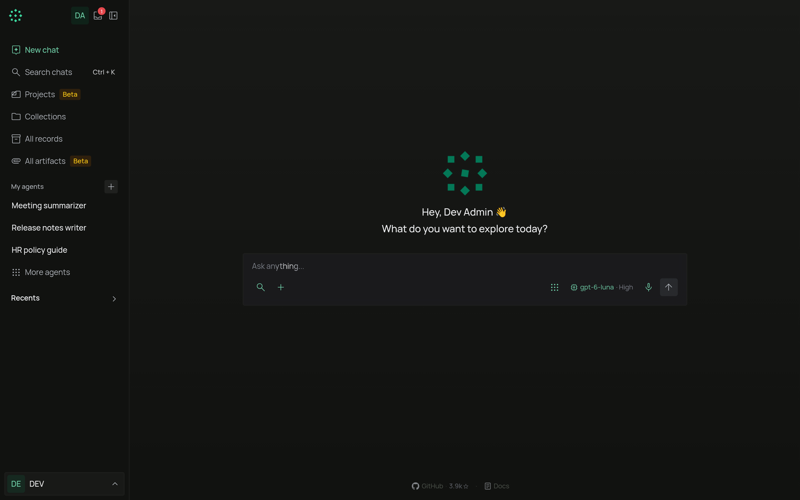
</Frame>

---

## Step 2: Create New Agent

1. In the chat sidebar, click **+** next to **My agents**. The **Agent Builder** opens with the **Create agent** dialog.
2. Enter a **Name** and choose the **Agent type**:
   - **User agent**: a personal agent. Each user signs in to the actions with their own account.
   - **Service agent**: an org-wide agent that uses action credentials stored on the agent. It searches knowledge with its creator's access.
3. Click **Create agent**.

<Frame>
  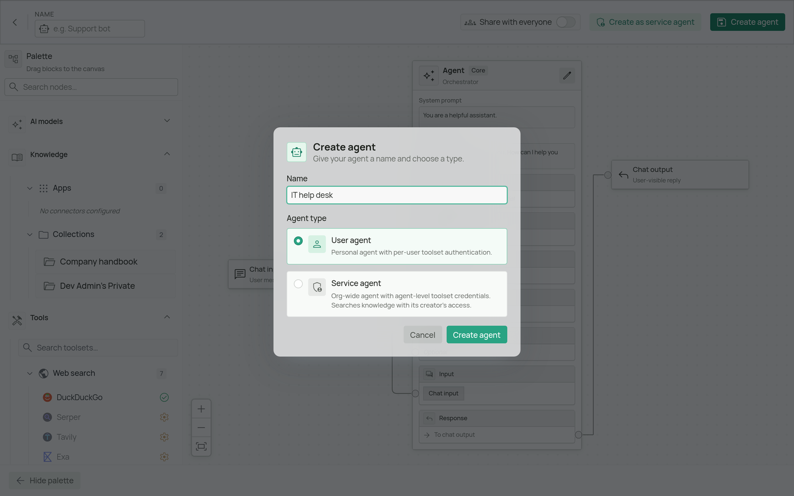
  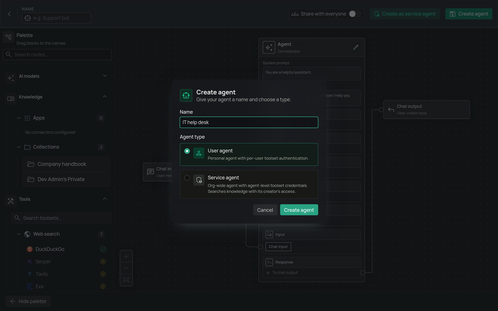
</Frame>

---

## Step 3: Configure the Agent node

The **Agent Builder** opens with a visual flow canvas. You'll see the **Agent** node (labeled **Core** and **Orchestrator**) already placed on the canvas.

<Frame>
  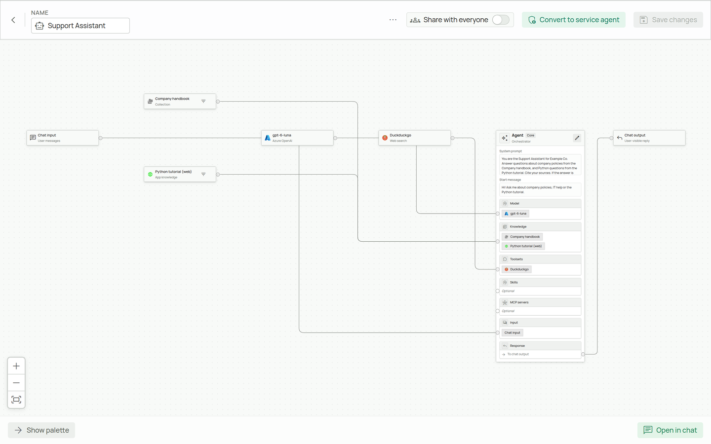
  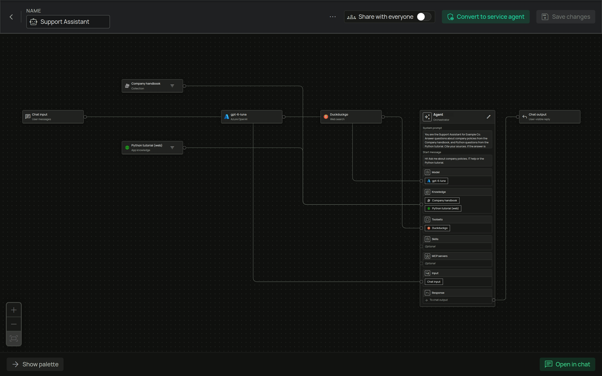
</Frame>

### Configure the Agent node

1. Click **Edit prompts** (the pencil icon) on the Agent node to open the **Configure agent prompts** dialog
2. Fill in the following fields:

| Field | Description | Example |
|-------|-------------|---------|
| **System prompt** | Instructions that define the agent's behavior | "You are a helpful project management assistant..." |
| **Starting message** | Initial greeting when users start a conversation | "Hi! I can help you manage your projects. What would you like to do?" |
| **Instructions** | Detailed instructions for the agent's behavior and capabilities | "You can create Jira tickets, search documentation, and answer questions about projects." |

<Frame>
  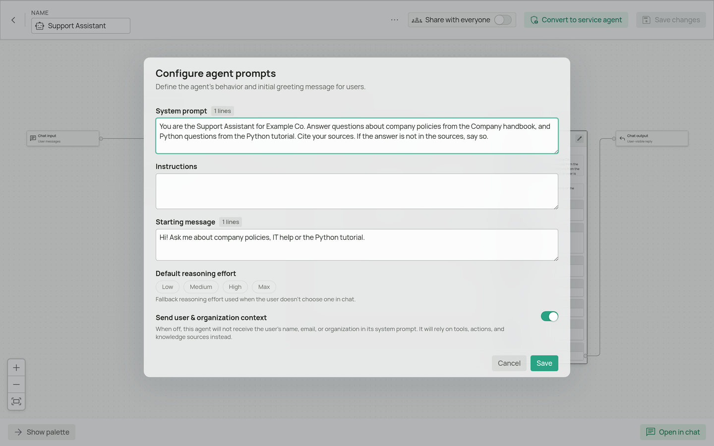
  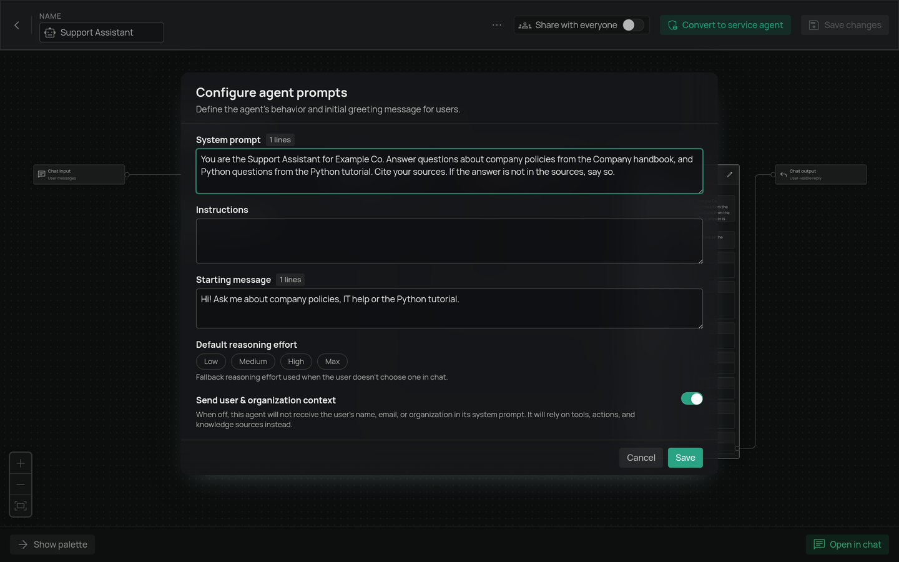
</Frame>

3. If a connected model supports reasoning, set **Default reasoning effort**. It is the fallback used when the user does not choose one in chat.
4. Optionally turn **Send user & organization context** off if the agent should not receive the user's name, email or organization.
5. Click **Save** in the dialog. The builder's **Save changes** button then saves the agent

<Info>
  The **System prompt** defines your agent's behavior. Be specific about what the agent should and shouldn't do, its tone, and any constraints.
</Info>

---

## Step 4: Add a Model (Optional)

The agent's model powers its intelligence. If you do not connect one, the Agent node shows **Using organization default model** and uses your organization's default.

1. In the left palette, expand the **"AI models"** section
2. Drag a model node onto the canvas

<Frame>
  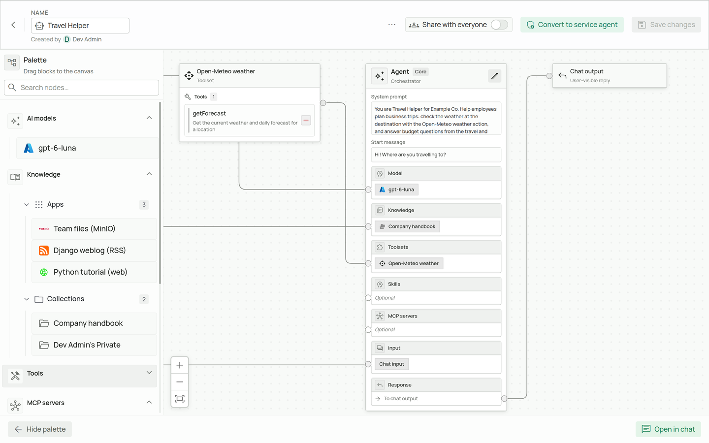
  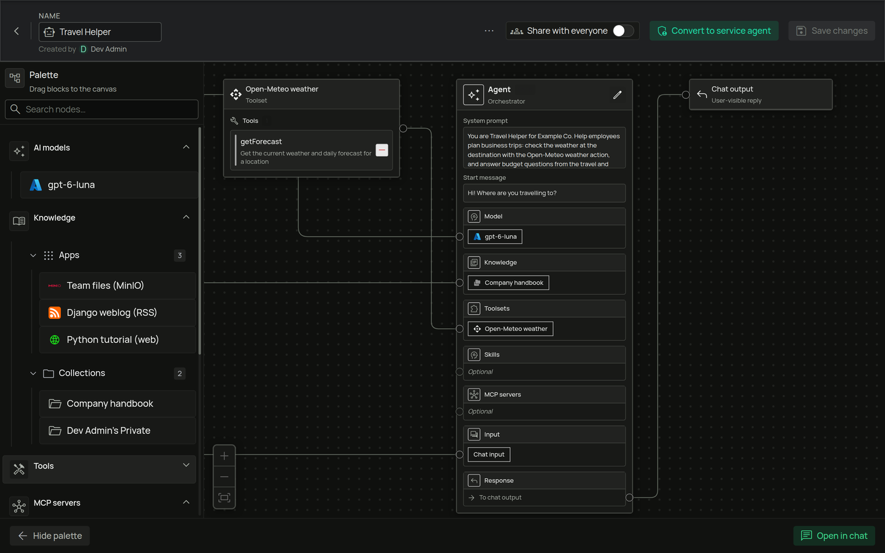
</Frame>

3. **Connect** the model node to the **Model** section of the Agent node by dragging a link to its model handle

<Frame>
  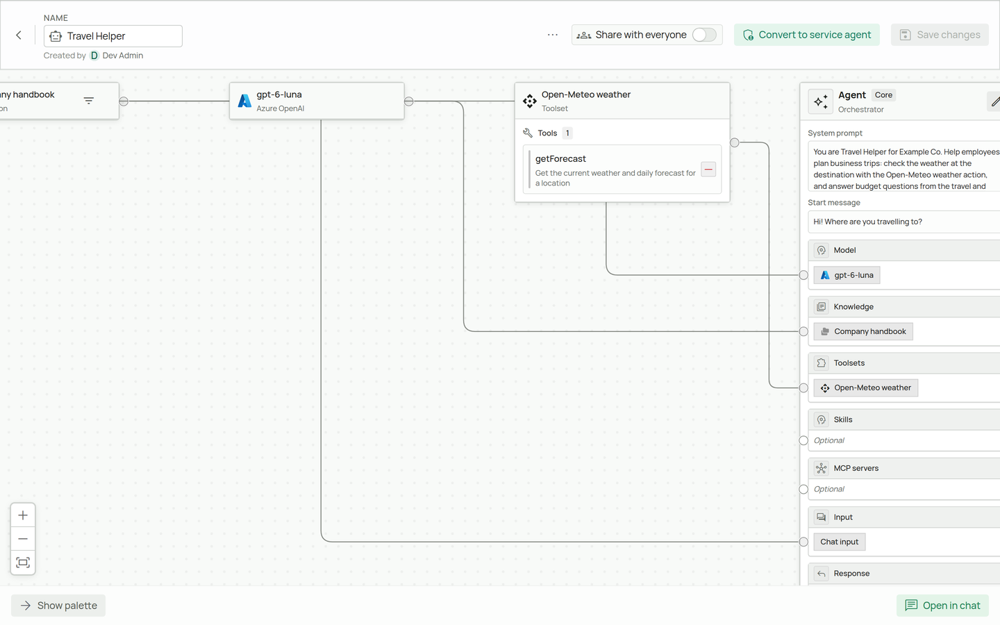
  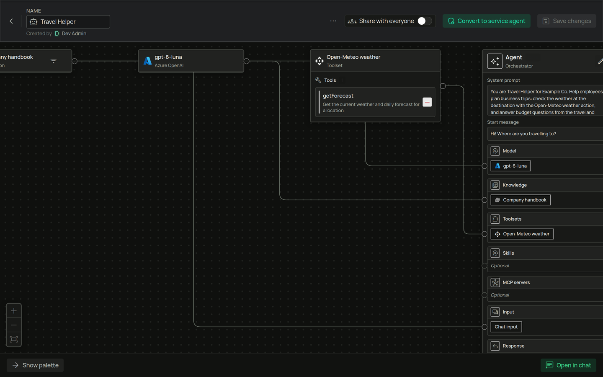
</Frame>

<Info>
  **Reasoning models** are models with reasoning capabilities enabled, allowing the agent to think through complex problems step-by-step before responding. Agent mode in chat and the **Default reasoning effort** setting need one.
</Info>
---

## Step 5: Add Actions (Optional)

Actions give your agent the ability to interact with external applications.

### Viewing Available Actions

1. In the left palette, expand the **"Tools"** section
2. Web search providers and actions are listed with the number of tools each provides. A check mark means it is ready to use, and a settings icon means it still needs to be set up:

<Frame>
  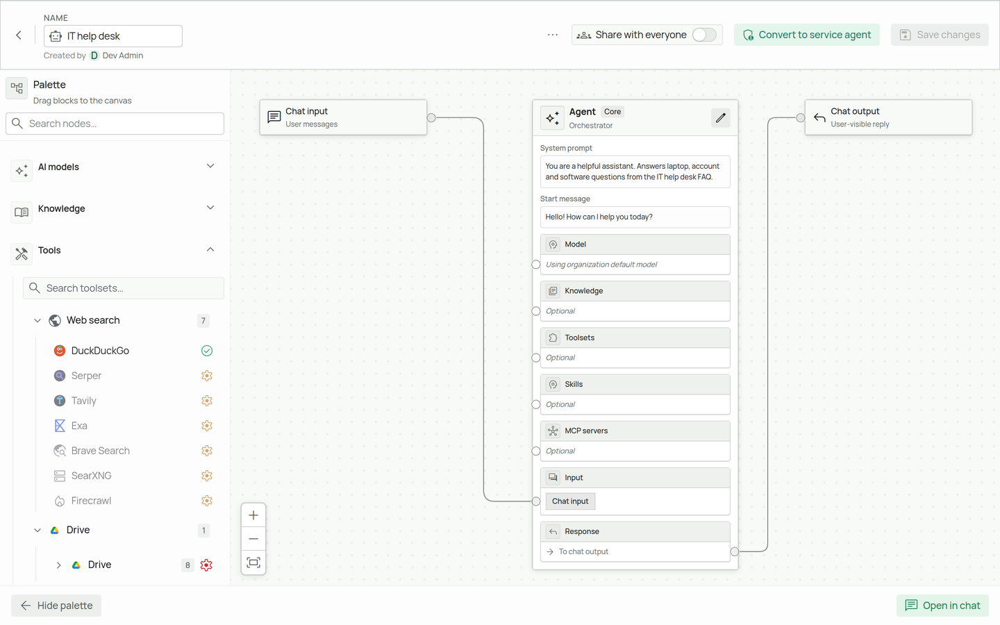
  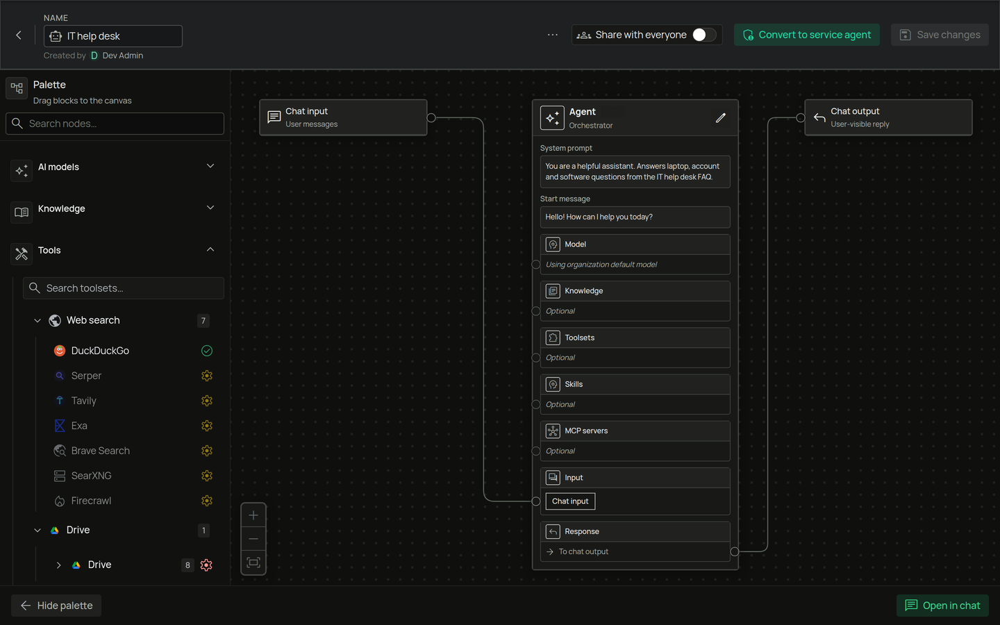
</Frame>

### Adding Actions to Your Agent

You have two options for adding tools:

**Option 1: Drag Entire Action**
- **Drag** the entire action onto the canvas to add all its tools
- **Connect** the action node to the **Toolsets** section of the Agent node (the builder still uses that label)

**Option 2: Drag Individual Tools**
- Expand an action to see its individual tools
- **Drag** specific tools you need onto the canvas
- This gives you more control over which tools the agent can use

<Frame>
  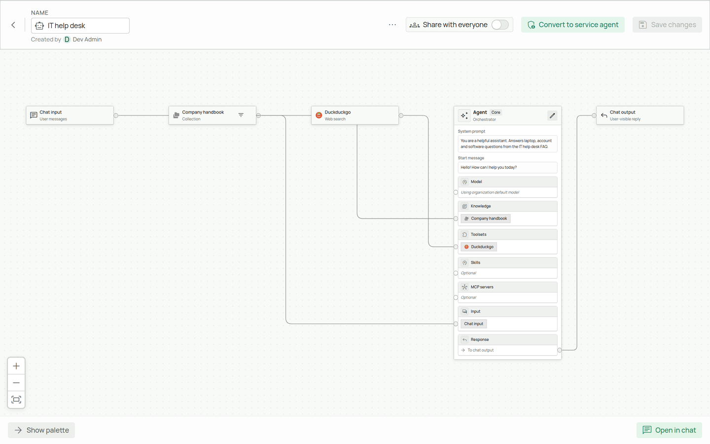
  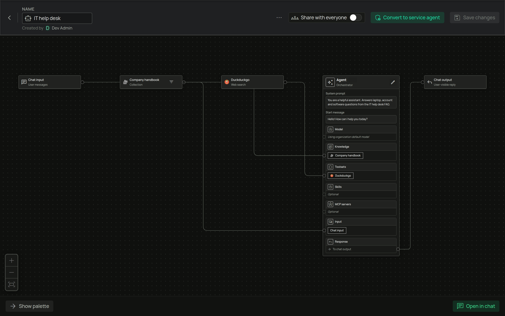
</Frame>

### Managing Tools

- **Remove individual tool**: Click the remove button on the right side of any tool in the action node
- **Remove entire action**: Click the delete button in the top-right corner of the action node

### Adding MCP servers, skills and API actions (Optional)

The palette also has **MCP servers** and **Skills** sections, and API actions appear under **Tools** next to the app actions. Drag them onto the canvas and connect them to the matching **MCP servers**, **Skills** or **Toolsets** section of the Agent node. Skills come from **Your skills**; if a section is empty, create or set up the item first.

### Service agents

In the create dialog you can choose **Service agent** instead of **User agent**. A service agent is shared with your whole organization and uses agent-level action credentials, so set each action's credentials with the key icon in the palette. An existing agent can be converted with **Convert to service agent** (this cannot be undone).

<Info>
  See the individual [Action Documentation](/toolsets/overview) for complete details on each action's tools and capabilities.
</Info>

---

## Step 6: Add Knowledge Sources (Optional)

Give your agent access to your indexed documents and collections.

1. In the left palette, expand the **"Knowledge"** section
2. You'll see:
   - **Apps** - Indexed content from connected applications
   - **Collections** - Your custom document collections

<Frame>
  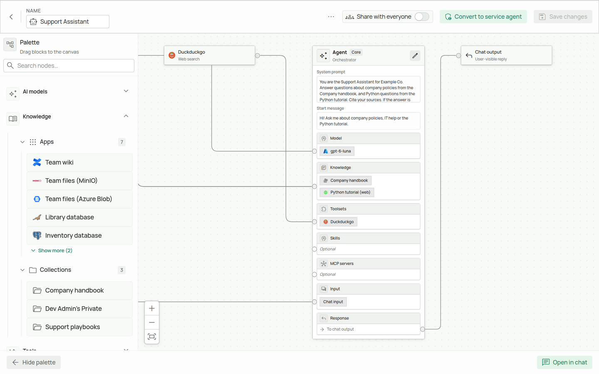
  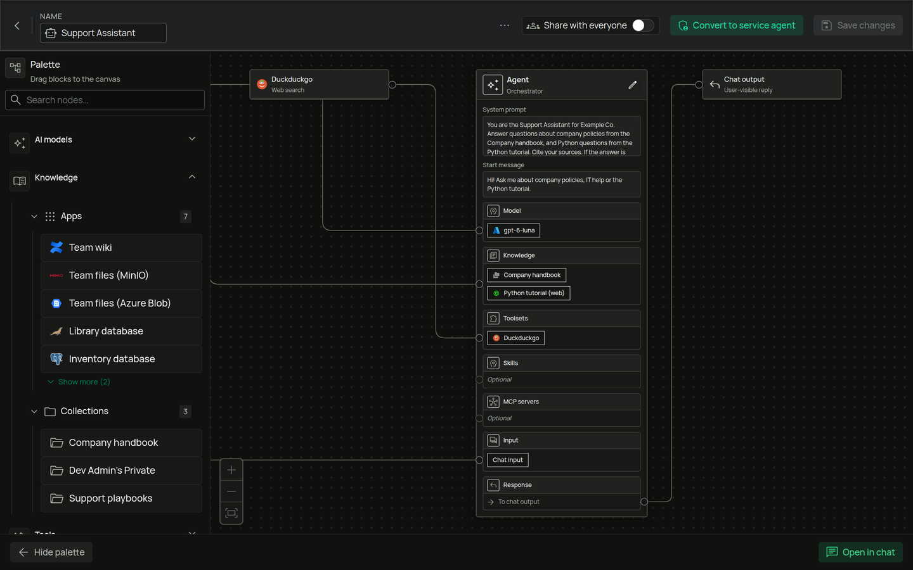
</Frame>

3. **Drag** the knowledge source onto the canvas
4. **Connect** it to your agent flow

Once a knowledge source is connected, the agent gets the built-in **Knowledge Graph** tools to search it. They need no setup. An agent with no knowledge has no search tools.

## Step 7: Save Your Agent

1. Enter a name for your agent in the **header input field** (top of the page)
2. Click **"Create agent"** (or **"Save changes"** for an existing agent)

<Frame>
  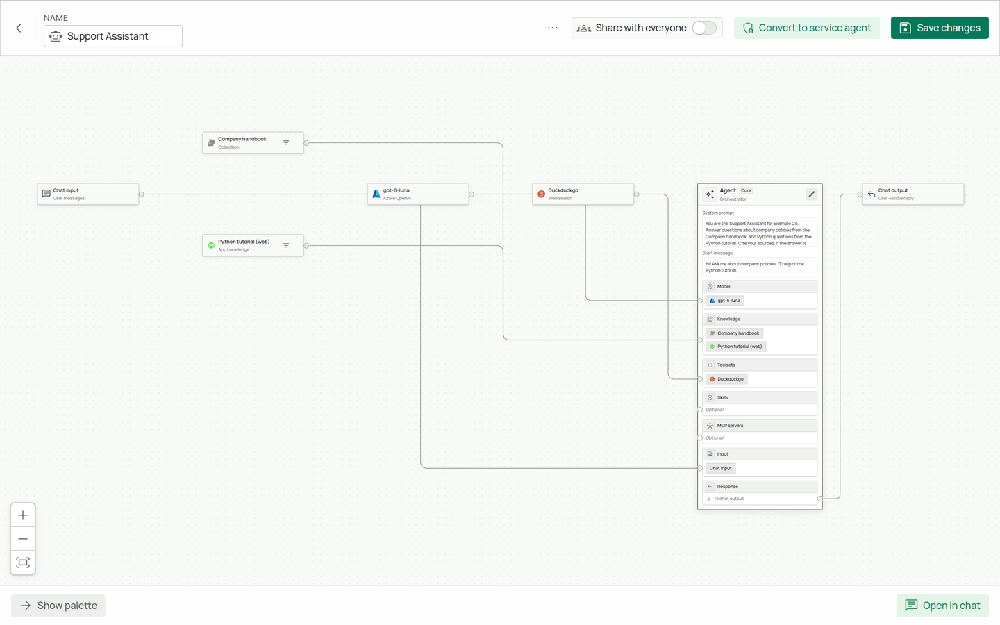
  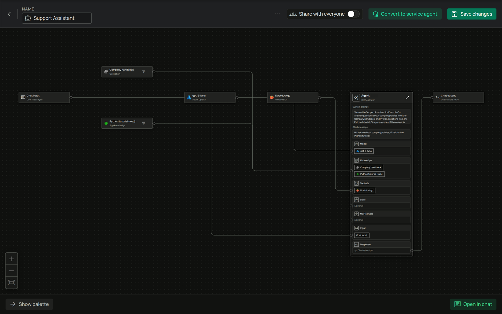
</Frame>

3. Your agent is now saved and ready to use!

A finished agent with a model, a collection and an API action looks like this on the canvas:

<Frame>
  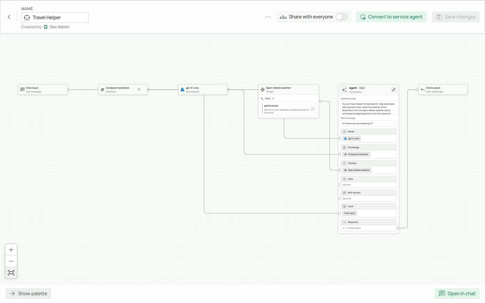
  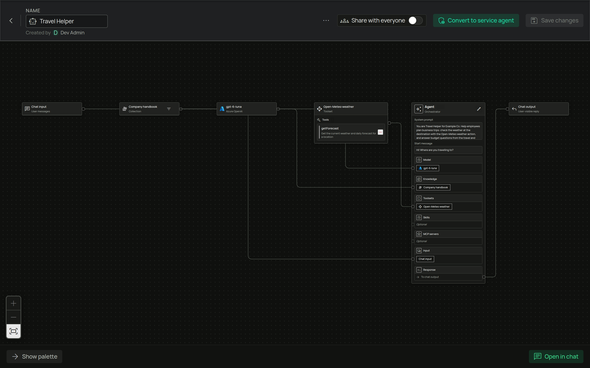
</Frame>

---

## Step 8: Test Your Agent

1. After saving, click **Open in chat** at the bottom of the builder, or click your agent under **My agents** in the chat sidebar
2. The agent's name shows in the chat header
3. Start a conversation to test its capabilities

<Frame>
  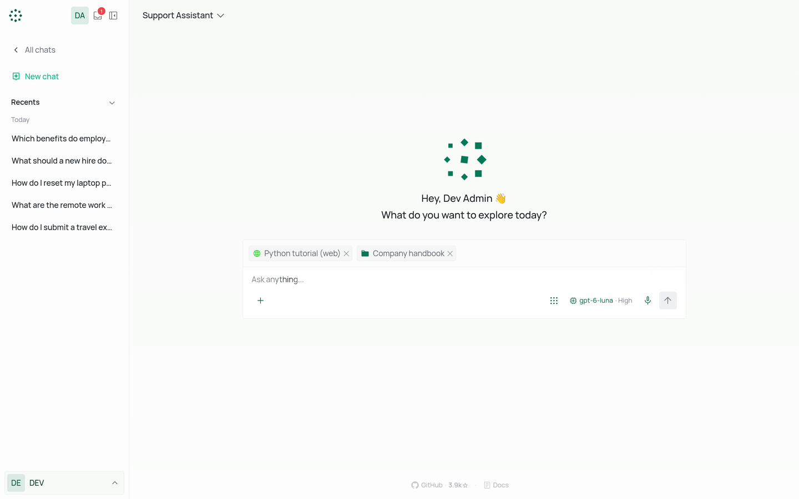
  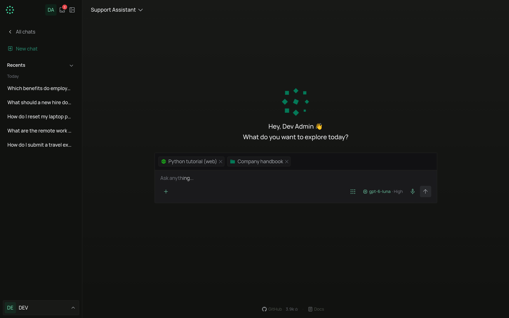
</Frame>

---

## Troubleshooting

<AccordionGroup>

<Accordion title="Action not appearing in sidebar">

**Possible causes:**
- The action is not configured in Workspace > Actions
- The action is not authenticated (OAuth flow not completed)

**Solution:**
1. Go to **Workspace > Actions** (or **Your actions**)
2. Find the action and configure it
3. Complete the authentication flow
4. Return to the Agent Builder - the action should now appear

</Accordion>

<Accordion title="Agent not responding or timing out">

**Possible causes:**
- Reasoning model not properly configured or reasoning not enabled
- Action authentication expired
- System prompt causing issues

**Solution:**
1. Check that your LLM provider is properly configured with reasoning enabled in **Workspace > AI models**
2. Re-authenticate any actions that may have expired tokens
3. Simplify the system prompt and test again

</Accordion>

<Accordion title="Knowledge retrieval returning no results">

**Possible causes:**
- No content indexed for the connected sources
- Filters too restrictive
- Indexing still in progress

**Solution:**
1. Check **Connector Settings** to verify connectors are synced
2. Verify collections have content
3. Wait for indexing to complete if recently added

</Accordion>

<Accordion title="Cannot save agent">

**Possible causes:**
- Missing required fields (name)
- Invalid node connections

**Solution:**
1. Ensure the agent has a name
2. Verify the Agent node is connected to the chat input and chat output
3. Check all node connections are valid

</Accordion>

</AccordionGroup>

---

## Next Steps

  <a href="/toolsets/overview" className="block p-4 border rounded-lg hover:bg-gray-50 dark:hover:bg-gray-800 transition-colors">
    <h3 className="text-lg font-semibold mb-2">Configure Actions</h3>
    
Set up external service integrations

  </a>
  <a href="/agent-guide/overview" className="block p-4 border rounded-lg hover:bg-gray-50 dark:hover:bg-gray-800 transition-colors">
    <h3 className="text-lg font-semibold mb-2">Agents Overview</h3>
    
Learn more about agent capabilities

  </a>

