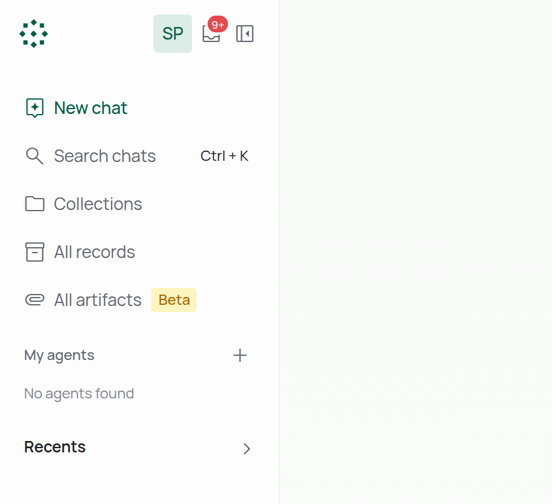
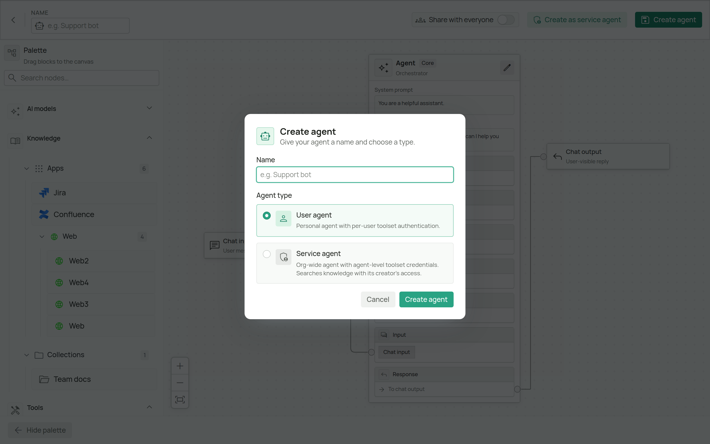
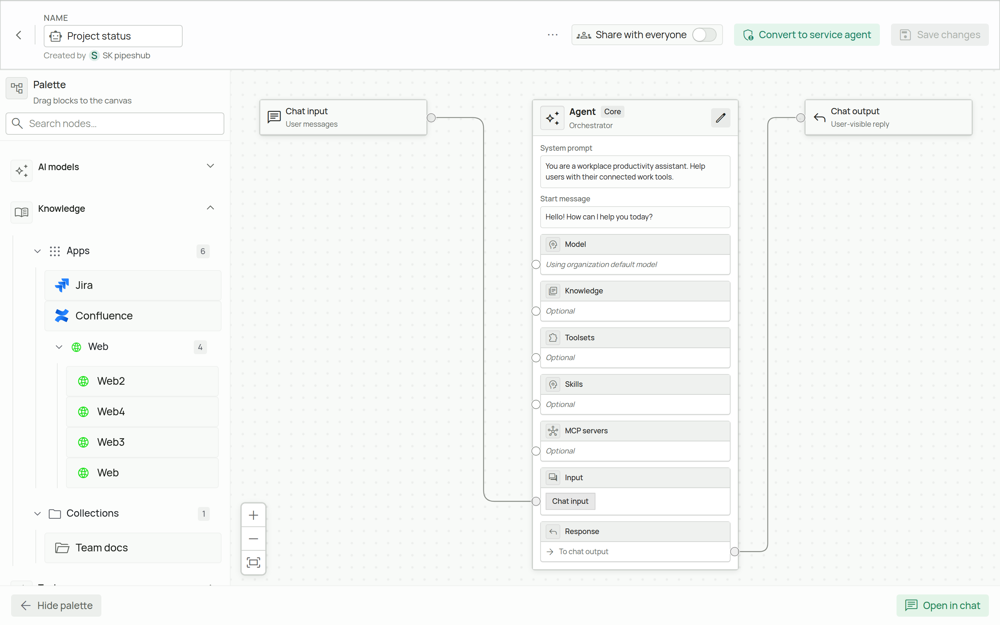
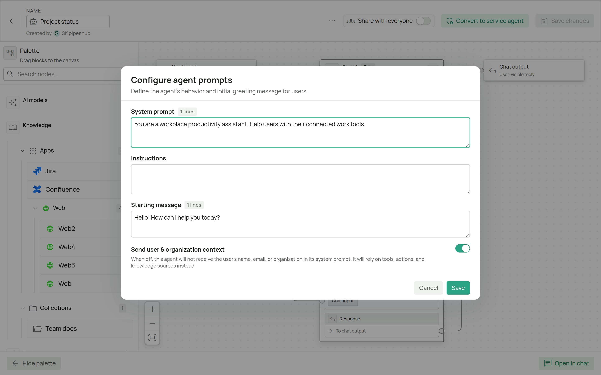
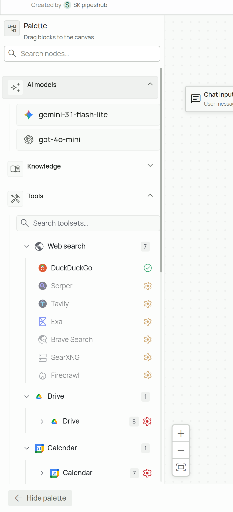

  

    

      🛠️
      
Agent Setup Guide

    

    
Create your first AI agent in Agent Builder

  

## Prerequisites

Before creating an agent, make sure you have:

1. **An AI model** - At least one LLM configured under **Workspace → AI models**. An agent without its own model uses the organization's default.
2. **Actions set up** (optional) - Any toolsets you want the agent to use, authorized under **Workspace → Actions** (organization-wide) or **Your actions** (your own sign-in). See [Toolsets Overview](/toolsets/overview).
3. **Knowledge sources** (optional) - Connectors or collections with indexed content.
4. **MCP servers or skills** (optional) - Added under **MCP servers** / **Your MCP servers** and **Your skills** in Workspace settings.

---

## Step 1: Start a new agent

1. Open **Chat**.
2. In the left sidebar, find **My agents** and click **+** (**New agent**).

Agent Builder opens with the **Create agent** dialog.

<Frame caption="Chat sidebar: **+** next to **My agents** starts a new agent.">
  
</Frame>

---

## Step 2: Name the agent and choose its type

1. Enter a **Name**, for example "Project status".
2. Choose an **Agent type**:

| Type | Who it's for | Toolset credentials | Knowledge it can search |
|------|--------------|---------------------|-------------------------|
| **User agent** | A personal agent you can later share | Each person who chats uses their own sign-in for each toolset | What the person chatting can read |
| **Service agent** | An organization-wide agent, for example one that runs unattended from a script or CI | Stored on the agent and used for everyone | What its creator can read, or a service account an admin grants |

3. Click **Create agent** (or **Continue** for a service agent).

<Frame caption="The **Create agent** dialog.">
  
</Frame>

You can also turn a user agent into a service agent later with **Convert to service agent** at the top of the builder.

<Warning>
  Converting a user agent to a service agent is permanent. A service agent is always shared with the whole organization, and everyone who uses it sees search results from what its search identity can read.
</Warning>

---

## Step 3: Set the agent's prompts

The canvas shows the **Agent** node (the core), with **Chat input** and **Chat output** already connected.

<Frame caption="A new agent: palette on the left, the **Agent** node in the middle with a handle for each kind of block.">
  
</Frame>

1. On the Agent node, click the pencil icon (**Edit prompts**).
2. Fill in:

| Field | What it does | Example |
|-------|--------------|---------|
| **System prompt** | Who the agent is and how it behaves | "You are a project status assistant for non-technical readers." |
| **Instructions** | Rules for how it works and answers | "Answer in three sentences. Say where the feature is, what blocks it, and link the Jira tickets." |
| **Starting message** | The greeting shown when someone opens a chat with the agent | "Ask me where any feature stands." |
| **Default reasoning effort** | The effort used when the person chatting doesn't choose one. Shown only once a model that supports reasoning is connected (Step 4) | |
| **Send user & organization context** | When on, the agent receives the user's name, email and organization in its prompt | |

3. Click **Save**.

<Frame caption="The **Configure agent prompts** dialog.">
  
</Frame>

<Info>
  Organization-wide [Custom Instructions](/custom-instructions) don't apply to agents. Put everything this agent should follow in its own prompts.
</Info>

---

## Step 4: Add blocks from the palette

The **Palette** on the left lists everything you can add. Drag a block onto the canvas, or tap **+** on a touch screen, then connect it to the matching handle on the Agent node. The builder refuses connections to the wrong handle and says why.

<Frame caption="The palette. Under **Tools**, a check mark means the toolset is ready to use; a gear means it needs setting up or signing in to first.">
  
</Frame>

| Palette section | What it adds | Connect to |
|-----------------|--------------|------------|
| **AI models** | One or more models the agent can use. With none, the organization's default model is used | **Model** |
| **Knowledge** | **Apps** (connectors) and **Collections** the agent searches | **Knowledge** |
| **Tools** | Toolsets that let the agent take actions, such as creating a Jira issue or updating a Confluence page. On a toolset's node, use **+** to choose which of its tools the agent gets. Web search is also here | **Toolsets** |
| **MCP servers** | Tools from external MCP servers you or your admin added | **MCP servers** |
| **Skills** | Custom skills from **Your skills** | **Skills** |

When you remove a block or a connection, the builder asks you to confirm.

<Note>
  **Search and act in one agent:** add nodes from **Knowledge** for finding information and nodes from **Tools** for taking actions. The agent can then search and act in the same conversation.
</Note>

### Toolset credentials

- **User agent:** each person signs in to each toolset with their own account. If a toolset isn't authorized for you yet, use **Configure toolset** from the palette.
- **Service agent:** set the agent's own credentials with the key icon next to each toolset in the palette. They're stored for this agent only and used for everyone.

---

## Step 5: Save

Click **Save changes** at the top of the builder.

To share a user agent with your whole organization, turn on **Share with everyone** at the top of the builder. Service agents are always shared with the organization.

---

## Step 6: Chat with the agent

Click **Open in chat**, or pick the agent under **My agents** in the chat sidebar.

While chatting you can choose:

- **Strategy** - **Auto** (balanced), **Quick** (fast answers with fewer refinement steps), **Plan & Execute** (plans every step, then runs them), or **Deep** (longer reasoning when accuracy matters most).
- **Model** - any of the models connected to the agent.

To change the agent later, open it from **My agents** and choose **Edit agent** from its menu.

---

## Troubleshooting

<AccordionGroup>

<Accordion title="A toolset can't be added to the canvas">

**Possible causes:**
- The toolset hasn't been set up by an admin under **Workspace → Actions**
- You haven't signed in to it yet
- That toolset is already on the canvas (only one of each is allowed)

**Solution:**
1. If the toolset is already on the canvas, use **+** on its node to choose more of its tools instead of adding it again
2. Otherwise, ask an admin to add the toolset, or sign in to it under **Your actions** or from the palette, then add it from the palette

</Accordion>

<Accordion title="A connector is missing under Knowledge">

**Knowledge → Apps** lists the connectors you can see. A connector is missing when it hasn't been set up, or isn't visible to you, under **Workspace → Connectors** or **Your connectors**. Each connector can be added once, so it also can't be added again when it's already on the canvas.

If it's on the canvas but answers find nothing, see the next item.

</Accordion>

<Accordion title="Agent not responding or timing out">

**Possible causes:**
- The model isn't configured correctly
- A toolset sign-in expired
- The prompts are very long or contradictory

**Solution:**
1. Check the model under **Workspace → AI models**
2. Sign in to the toolset again
3. Simplify the prompts and test again

</Accordion>

<Accordion title="Knowledge search returns no results">

**Possible causes:**
- No content indexed yet for the connected sources
- The person chatting (or, for a service agent, its search identity) can't read that content

**Solution:**
1. Check that connectors have synced and collections have content
2. For a service agent, check which identity it searches as

</Accordion>

<Accordion title="I can't edit an agent">

Agents shared with you are view-only: you can look at the setup and sign in to their toolsets with your own account, but only the owner can change them. An organization service agent you don't own works the same way in chat, but its setup is locked: you can look at it, not change it.

</Accordion>

</AccordionGroup>

---

## Next Steps

  <a href="/toolsets/overview" className="block p-4 border rounded-lg hover:bg-gray-50 dark:hover:bg-gray-800 transition-colors">
    <h3 className="text-lg font-semibold mb-2">Configure Toolsets</h3>
    
Set up external service integrations

  </a>
  <a href="/agent-guide/overview" className="block p-4 border rounded-lg hover:bg-gray-50 dark:hover:bg-gray-800 transition-colors">
    <h3 className="text-lg font-semibold mb-2">Agents Overview</h3>
    
Learn more about agent capabilities

  </a>

