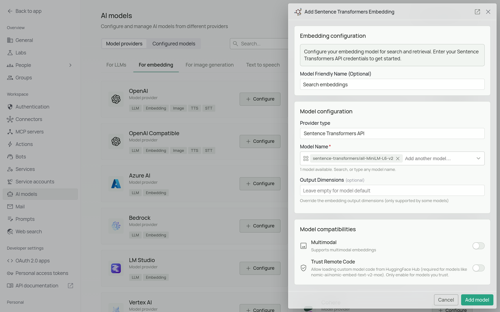
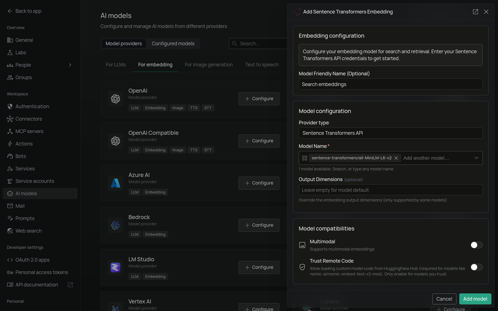

<Frame>
  
  
</Frame>

*The Sentence Transformers configuration screen in PipesHub where you'll enter your Model Name*

PipesHub allows you to use Sentence Transformer embedding models to enable semantic search and document retrieval in your workspace. These models run locally inside PipesHub — no external API, no API key, and no usage costs.

## Required Fields

### Model Name *

The Model Name is the only required field. It defines which Sentence Transformer model you want to use. Enter the full HuggingFace repository name, including the owner, such as `sentence-transformers/all-MiniLM-L6-v2`. A name without the owner is not found.

**Popular Sentence Transformer models include:**
- `sentence-transformers/all-MiniLM-L6-v2` - Lightweight general-purpose model, good balance of speed and quality
- `sentence-transformers/all-mpnet-base-v2` - Higher accuracy general-purpose model
- `sentence-transformers/paraphrase-multilingual-mpnet-base-v2` - Supports 50+ languages for multilingual applications

**How to choose a model:**
- For general purpose use, select `sentence-transformers/all-MiniLM-L6-v2`
- For higher accuracy when speed is less critical, select `sentence-transformers/all-mpnet-base-v2`
- For multilingual content, select `sentence-transformers/paraphrase-multilingual-mpnet-base-v2`
- Check the [Sentence Transformers documentation](https://www.sbert.net/docs/pretrained_models.html) for the full list of available models

## Optional Fields

### Trust Remote Code

Off by default. Turn it on only for a model that needs its own code from HuggingFace Hub, such as `nomic-ai/nomic-embed-text-v2-moe`, and only for a model you trust.

## Configuration Steps

As shown in the image above:

1. Click **Configure** on the Sentence Transformers provider card
2. Specify your desired Model Name (marked with *)
3. Click **Add model** to save and validate

> Model Name is the only required field. No API key or external service is needed — the model runs locally inside PipesHub.

## Usage Considerations

- No external API calls are made — all embedding happens locally inside PipesHub
- No API key or billing setup required
- Larger models provide better quality but require more memory and are slower to load
- Most models support a maximum sequence length of 128–512 tokens per document chunk

## Troubleshooting

- If you encounter errors, verify the model name is spelled correctly
- For memory issues, consider switching to a smaller model such as `sentence-transformers/all-MiniLM-L6-v2`
- For multilingual applications, ensure you are using a model that supports your target languages

For additional support, refer to the [Sentence Transformers documentation](https://www.sbert.net/) or contact PipesHub support.
