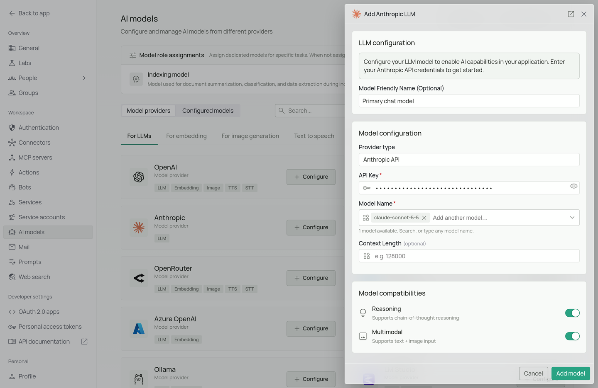
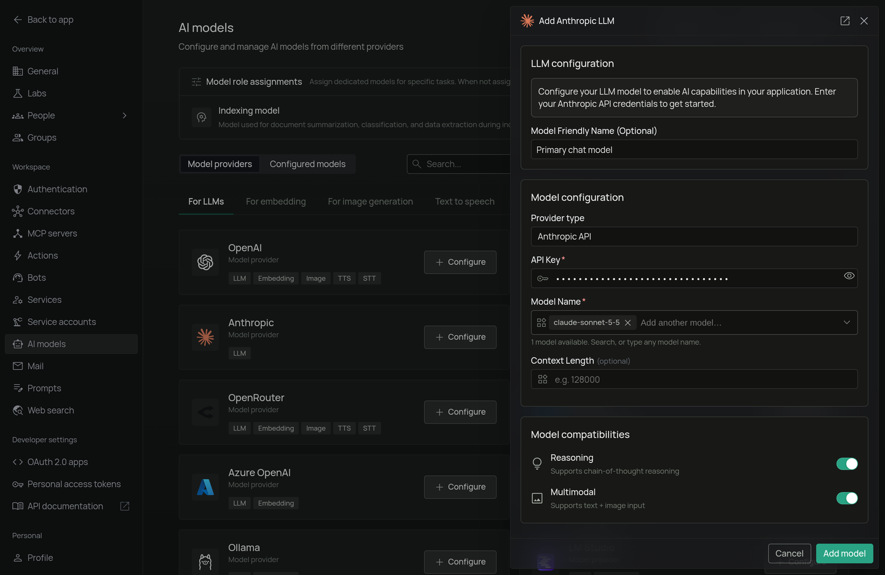

<Frame>
  
  
</Frame>

*The Anthropic configuration screen in PipesHub where you'll enter your API Key and Model Name*

PipesHub allows you to integrate with Anthropic's Claude models to enable powerful AI features in your workspace, providing sophisticated natural language understanding and generation capabilities.

## Required Fields

### API Key *

The Anthropic API Key is required to authenticate your requests to Anthropic's services.

**How to obtain an API Key:**
1. Log in to your [Anthropic Console](https://console.anthropic.com/)
2. Navigate to the "API Keys" section
3. Create a new API key
4. Copy the key immediately (it will only be shown once)

**Security Note:** Your API key should be kept secure and never shared publicly. PipesHub securely stores your API key and uses it only for authenticating requests to Anthropic.

### Model Name *

The Model Name field defines which Anthropic Claude model you want to use with PipesHub.

**Popular Anthropic models include:**
- `claude-opus-5-5` - For long-running agentic and knowledge work
- `claude-sonnet-5-5` - The best combination of speed and intelligence
- `claude-haiku-5-5` - The fastest model, for high-volume, latency-sensitive tasks

**How to choose a model:**
- For complex reasoning and advanced features, select `claude-opus-5-5`
- For balanced performance, select `claude-sonnet-5-5`
- For routine tasks and lower latency, select `claude-haiku-5-5`
- Check Anthropic's [model documentation](https://platform.claude.com/docs/en/about-claude/models/overview) for the most up-to-date options

## Optional Fields

### Context Length

The model's context window in tokens, from 1,024 to 20,000,000. Leave it empty and PipesHub assumes 128,000. Find your model's window in the provider's model documentation.

### Multimodal

Turn this on if the model accepts images as well as text. It is on by default. Turn it off for a text-only model, or chats that include an image will fail.

### Reasoning

Turn this on if the model supports chain-of-thought reasoning. It is on by default. Turn it off for a model without reasoning.

## Configuration Steps

As shown in the image above:

1. Click **Configure** on the Anthropic provider card
2. Enter your Anthropic API Key in the designated field (marked with *)
3. Specify your desired Model Name (marked with *)
4. Click **Add model** to save and validate your credentials

> Both the API Key and Model Name are required fields to successfully configure Anthropic integration. You must complete these fields to proceed with the setup.

## Usage Considerations

- API usage will count against your Anthropic account's quota and billing
- Different models have different pricing - check Anthropic's pricing page for details
- Model capabilities vary - more powerful models may provide better results but at higher cost
- Claude models excel at:
  - Nuanced content generation
  - Detailed reasoning
  - Following complex instructions
  - Maintaining consistency in long conversations

## Troubleshooting

- If you encounter authentication errors, verify your API key is correct and has not expired
- Ensure your Anthropic account has billing set up if you're using paid models
- Check that the model name is spelled correctly and matches Anthropic's naming conventions
- Verify that your account has access to the model you've selected

For additional support, refer to the [Anthropic documentation](https://docs.anthropic.com/) or email [support@pipeshub.com](mailto:support@pipeshub.com).
