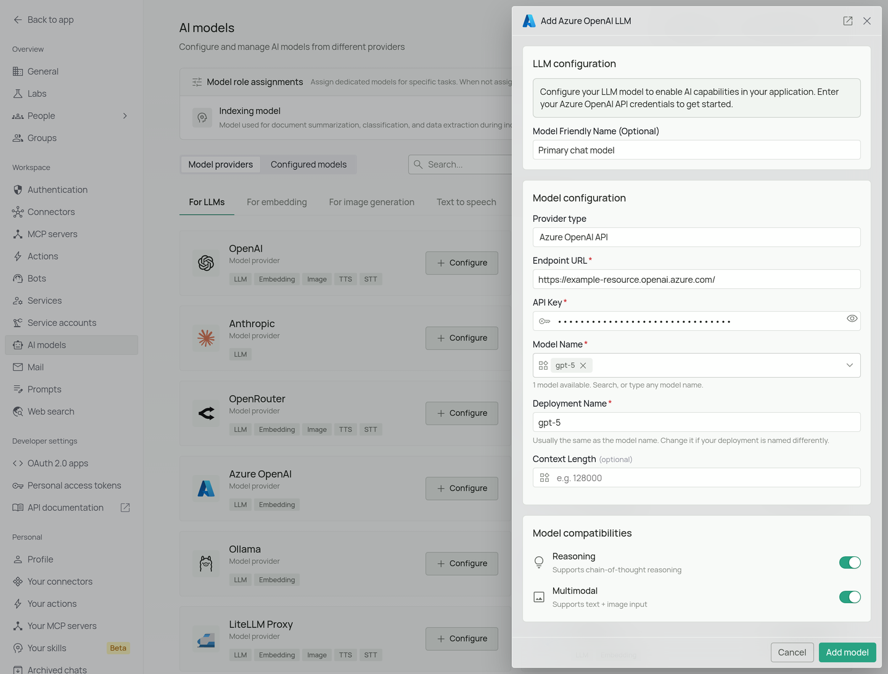
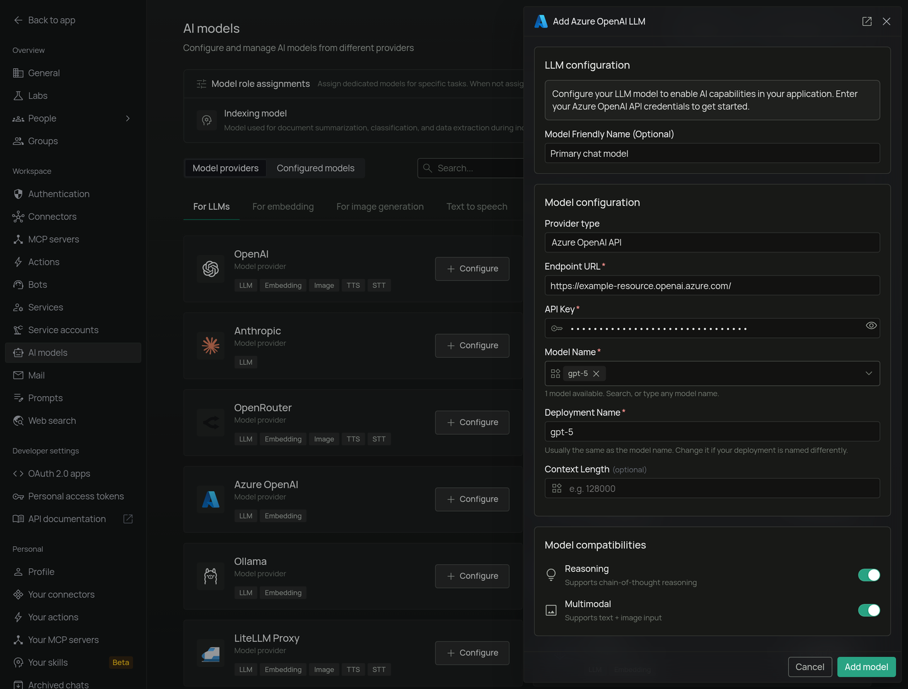

<Frame>
  
  
</Frame>

*The Azure OpenAI configuration screen in PipesHub where you'll enter your Endpoint URL, API Key, Model Name, and Deployment Name*

PipesHub allows you to integrate with Azure OpenAI's powerful language models to enable AI features in your workspace, providing enterprise-grade security and compliance with your Azure deployment.

## Required Fields

### Endpoint URL *

The Endpoint URL is required to connect to your Azure OpenAI service instance.

**How to obtain your Endpoint URL:**
1. Log in to the [Azure Portal](https://portal.azure.com)
2. Navigate to your Azure OpenAI resource
3. Go to the "Keys and Endpoint" section in the left navigation
4. Copy the Endpoint URL (it will look like: `https://<your-resource-name>.openai.azure.com/`)

**Note:** The endpoint must include the complete URL with your resource name.

### API Key *

The API Key authenticates your requests to your Azure OpenAI service.

**How to obtain your API Key:**
1. In the Azure Portal, navigate to your Azure OpenAI resource
2. Go to the "Keys and Endpoint" section in the left navigation
3. Copy either Key 1 or Key 2 (both will work)

**Security Note:** Your API key should be kept secure and never shared publicly. PipesHub securely stores your API key and uses it only for authenticating requests to your Azure OpenAI service.

### Model Name *

The Model Name field defines which Azure OpenAI model you want to use with PipesHub.

**Popular Azure OpenAI models include:**
- `gpt-5` - OpenAI's latest flagship model, best for complex tasks and reasoning.
- `gpt-5-mini` - Powerful model balancing cost and capability.
- `gpt-5-nano` - Fastest, most cost-effective option.

**How to choose a model:**
- For complex reasoning and advanced features, select `gpt-5`
- For balanced performance, select `gpt-5-mini`
- For routine tasks and lower latency, select `gpt-5-nano`
- Check the [Azure OpenAI model documentation](https://learn.microsoft.com/en-us/azure/ai-services/openai/concepts/models) for the most up-to-date options

### Deployment Name *

The Deployment Name refers to the specific model deployment you've created in your Azure OpenAI service.

**How to find your Deployment Name:**
1. In the Azure Portal, navigate to your Azure OpenAI resource
2. Select "Model deployments" from the left navigation
3. Find the deployment you want to use and copy the "Deployment name"
4. This is the name you assigned when you deployed the model (not the model name itself)

## Optional Fields

### Context Length

The model's context window in tokens, from 1,024 to 20,000,000. Leave it empty and PipesHub assumes 128,000. Find your model's window in the provider's model documentation.

### Multimodal

Turn this on if the model accepts images as well as text. It is on by default. Turn it off for a text-only model, or chats that include an image will fail.

### Reasoning

Turn this on if the model supports chain-of-thought reasoning. It is on by default. Turn it off for a model without reasoning.

## Configuration Steps

As shown in the image above:

1. Click **Configure** on the Azure OpenAI provider card
2. Enter your Endpoint URL (marked with *)
3. Enter your Azure OpenAI API Key (marked with *)
4. Specify your Model Name (marked with *)
5. Specify your Deployment Name from your Azure OpenAI service (marked with *)
6. Click **Add model** to save and validate your credentials

> All fields (Endpoint URL, API Key, Model Name, and Deployment Name) 
> are required to successfully configure Azure OpenAI integration. 
> You must complete these fields to proceed with the setup.

## Usage Considerations

- API usage will count against your Azure OpenAI resource's quota and billing
- Different models have different pricing - check Azure's pricing page for details
- Model capabilities vary - more powerful models may provide better results but at higher cost
- Azure OpenAI provides additional enterprise features like:
  - Virtual Network support
  - Role-based access control
  - Content filtering
  - Regional data residency

## Troubleshooting

- If you encounter authentication errors, verify your API key and endpoint are correct
- Ensure your Azure subscription is active and has sufficient quota for the selected model
- Verify that the deployment name exists in your Azure OpenAI resource
- Check that the model name matches one of the models available in your Azure OpenAI service
- Ensure your IP address is allowed if you've configured network access restrictions

For additional support, refer to the [Azure OpenAI documentation](https://learn.microsoft.com/en-us/azure/ai-services/openai/) or email [support@pipeshub.com](mailto:support@pipeshub.com).
