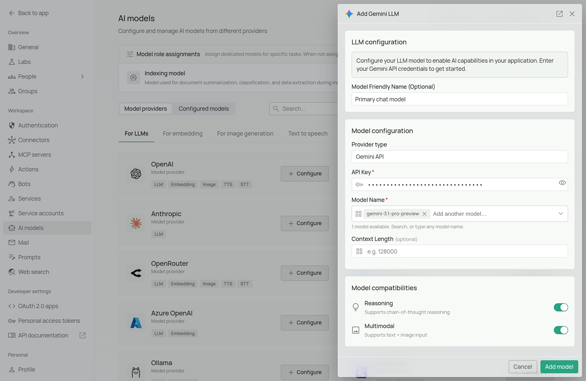
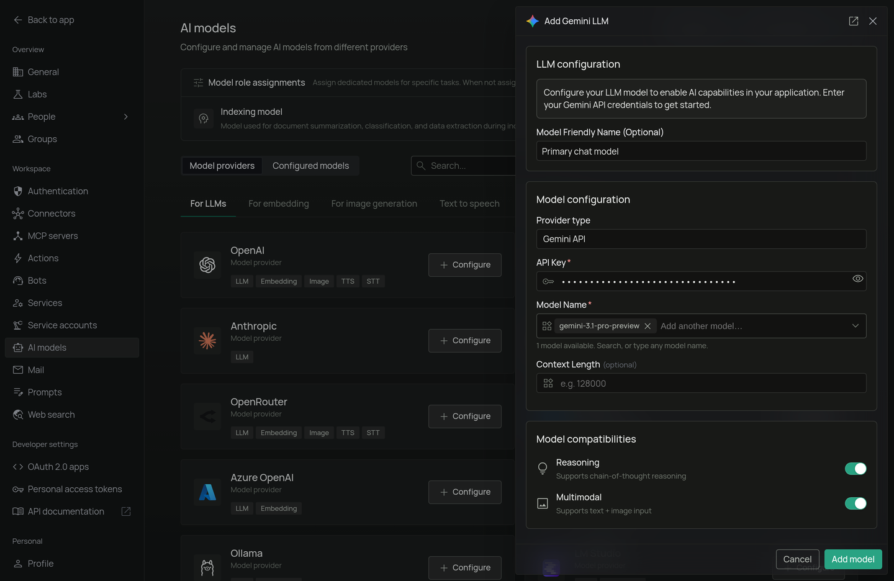

<Frame>
  
  
</Frame>

*The Google Gemini configuration screen in PipesHub where you'll enter your API Key and Model Name*

PipesHub allows you to integrate with Google's Gemini AI to enable sophisticated AI features in your workspace, accessing Google's powerful Gemini language models.

## Required Fields

### API Key *

The API Key is required to authenticate your requests to Google's Gemini AI services.

**How to obtain an API Key:**
1. Log in to the [Google AI Studio](https://aistudio.google.com/)
2. Click on your profile icon in the top right corner
3. Select "Get API key"
4. You can either create a new API key or use an existing one
5. Copy the generated API key

**Security Note:** Your API key should be kept secure and never shared publicly. PipesHub securely stores your API key and uses it only for authenticating requests to Google Gemini services.

### Model Name *

The Model Name field defines which Google Gemini model you want to use with PipesHub.

**Popular Google Gemini models include:**
- `gemini-3.1-pro-preview` - Most advanced model with strong reasoning abilities
- `gemini-3-flash-preview` - Cost-effective, low-latency, strong for multi-modal understanding and coding

**How to choose a model:**
- For complex reasoning and advanced features, select `gemini-3.1-pro-preview`
- For routine tasks and lower latency, select `gemini-3-flash-preview`
- Check Google's [Gemini model documentation](https://ai.google.dev/models/gemini) for the most up-to-date options

## Optional Fields

### Context Length

The model's context window in tokens, from 1,024 to 20,000,000. Leave it empty and PipesHub assumes 128,000. Find your model's window in the provider's model documentation.

### Multimodal

Turn this on if the model accepts images as well as text. It is on by default. Turn it off for a text-only model, or chats that include an image will fail.

### Reasoning

Turn this on if the model supports chain-of-thought reasoning. It is on by default. Turn it off for a model without reasoning.

## Configuration Steps

As shown in the image above:

1. Click **Configure** on the Gemini provider card
2. Enter your Google AI API Key in the designated field (marked with *)
3. Specify your desired Model Name (marked with *)
4. Click **Add model** to save and validate your credentials

> Both the API Key and Model Name are required fields to successfully configure Google 
Gemini integration. You must complete these fields to proceed with the setup.

## Usage Considerations

- API usage will count against your Google AI API quota and billing
- Different models have different pricing - check Google AI's pricing page for details
- Model capabilities vary - more powerful models may provide better results but at higher cost
- Google Gemini provides:
  - Advanced reasoning capabilities
  - Multimodal understanding (text, images, code)
  - Support for long contexts
  - Optimized performance across various tasks

## Troubleshooting

- If you encounter authentication errors, verify your API key is correct and has not expired
- Ensure your Google account has billing set up if you're using paid service tiers
- Check that the model name is spelled correctly and available in your region
- Verify that your API key has access to the specific model you've selected
- If you're experiencing rate limits, check your API usage in the Google AI Studio dashboard

For additional support, refer to the [Google Gemini documentation](https://ai.google.dev/docs) or email [support@pipeshub.com](mailto:support@pipeshub.com).
