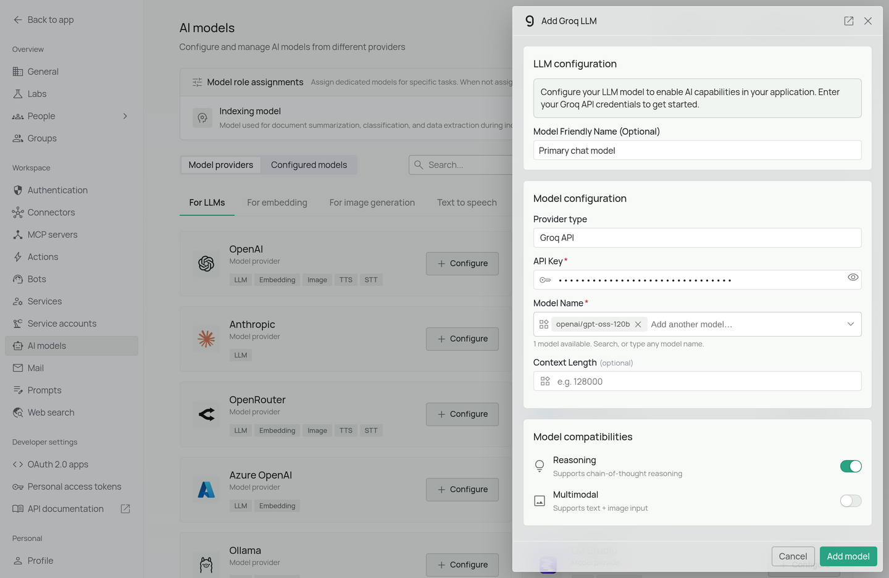
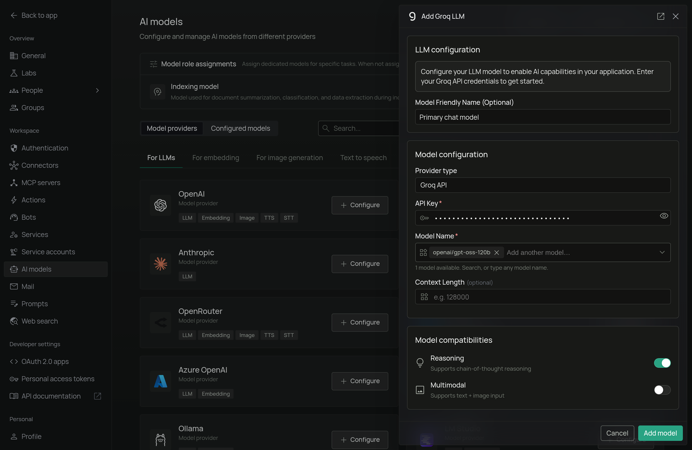

<Frame>
  
  
</Frame>

*The Groq configuration screen in PipesHub where you'll enter your API Key and Model Name*

PipesHub allows you to integrate with Groq to enable AI features in your workspace. Groq's Language Processing Unit (LPU) hardware delivers exceptionally fast inference speeds, making it ideal for latency-sensitive applications and real-time interactions.

## Required Fields

### API Key *

The API Key is required to authenticate your requests to Groq's services.

**How to obtain an API Key:**
1. Log in to the [Groq Console](https://console.groq.com/)
2. Navigate to the "API Keys" section
3. Click "Create API Key"
4. Copy the generated API key

**Security Note:** Your API key should be kept secure and never shared publicly. PipesHub securely stores your API key and uses it only for authenticating requests to Groq.

### Model Name *

The Model Name field defines which model you want to run on Groq's infrastructure.

**Popular models available on Groq:**
- `openai/gpt-oss-120b` - OpenAI's open-weight GPT-OSS 120B model

**How to choose a model:**
- For fast, general-purpose instruction-following, select `openai/gpt-oss-120b`
- Check Groq's [model documentation](https://console.groq.com/docs/models) for the full list of supported models

## Optional Fields

### Context Length

The model's context window in tokens, from 1,024 to 20,000,000. Leave it empty and PipesHub assumes 128,000. Find your model's window in the provider's model documentation.

### Multimodal

Turn this on if the model accepts images as well as text. It is on by default. Turn it off for a text-only model, or chats that include an image will fail.

### Reasoning

Turn this on if the model supports chain-of-thought reasoning. It is on by default. Turn it off for a model without reasoning.

## Configuration Steps

As shown in the image above:

1. Click **Configure** on the Groq provider card
2. Enter your Groq API Key in the designated field (marked with *)
3. Specify your desired Model Name (marked with *)
4. Click **Add model** to save and validate your credentials

> Both the API Key and Model Name are required fields to successfully configure Groq integration.

## Usage Considerations

- API usage will count against your Groq account's quota and billing
- Different models have different pricing — check Groq's pricing page for details
- Groq provides:
  - Ultra-low latency inference via dedicated LPU hardware
  - High throughput for concurrent requests
  - Support for popular open-source models including the Llama and GPT-OSS families

## Troubleshooting

- If you encounter authentication errors, verify your API key is correct and has not expired
- Ensure your Groq account has billing set up if you are on a paid tier
- Check that the model name is spelled correctly — Groq uses a `provider/model-name` format for most models
- Verify that your account has access to the specific model you have selected
- If you are experiencing rate limits, check your usage in the Groq Console dashboard

For additional support, refer to the [Groq documentation](https://console.groq.com/docs/) or email [support@pipeshub.com](mailto:support@pipeshub.com).
