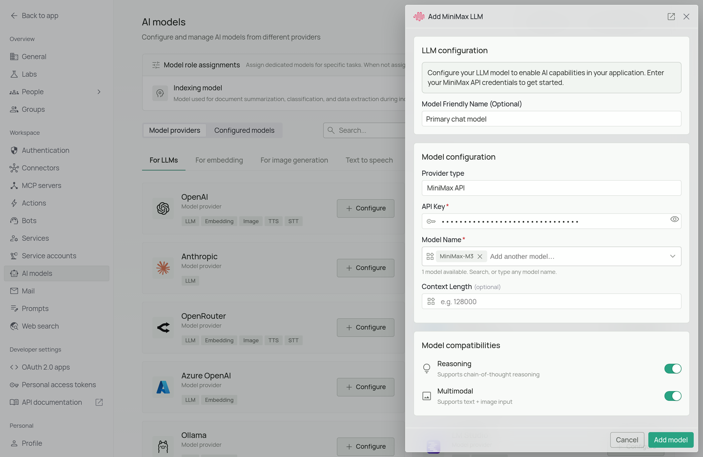
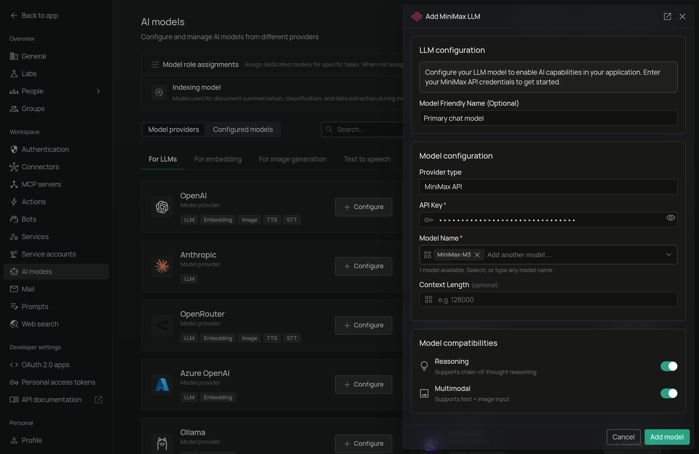

<Frame>
  
  
</Frame>

*The MiniMax configuration screen in PipesHub where you'll enter your API Key and Model Name*

PipesHub allows you to integrate with MiniMax's language models to enable AI features in your workspace. MiniMax offers high-performance models with strong multilingual capabilities and efficient inference.

## Required Fields

### API Key *

The API Key is required to authenticate your requests to MiniMax's services.

**How to obtain an API Key:**
1. Log in to the [MiniMax Platform](https://platform.minimax.io/)
2. Navigate to the "API Keys" section in your account settings
3. Create a new API key
4. Copy the generated API key

**Security Note:** Your API key should be kept secure and never shared publicly. PipesHub securely stores your API key and uses it only for authenticating requests to MiniMax.

### Model Name *

The Model Name field defines which MiniMax model you want to use with PipesHub.

**Popular MiniMax models include:**
- `MiniMax-M3` - MiniMax's flagship model with strong reasoning and instruction-following capabilities
- `MiniMax-M3.1-Flash` - A faster model for lower latency use cases

**How to choose a model:**
- For best quality and complex tasks, select `MiniMax-M3`
- For faster responses where speed matters more than maximum quality, select `MiniMax-M3.1-Flash`
- Check MiniMax's [model documentation](https://platform.minimax.io/docs) for the most up-to-date options

## Optional Fields

### Context Length

The model's context window in tokens, from 1,024 to 20,000,000. Leave it empty and PipesHub assumes 128,000. Find your model's window in the provider's model documentation.

### Multimodal

Turn this on if the model accepts images as well as text. It is on by default. Turn it off for a text-only model, or chats that include an image will fail.

### Reasoning

Turn this on if the model supports chain-of-thought reasoning. It is on by default. Turn it off for a model without reasoning.

## Configuration Steps

As shown in the image above:

1. Click **Configure** on the MiniMax provider card
2. Enter your MiniMax API Key in the designated field (marked with *)
3. Specify your desired Model Name (marked with *)
4. Click **Add model** to save and validate your credentials

> Both the API Key and Model Name are required fields to successfully configure MiniMax integration.

## Usage Considerations

- API usage will count against your MiniMax account's quota and billing
- Different models have different pricing — check MiniMax's pricing page for details
- MiniMax models provide:
  - Strong multilingual understanding and generation
  - Efficient inference with competitive latency
  - High-quality instruction-following across a range of tasks

## Troubleshooting

- If you encounter authentication errors, verify your API key is correct and has not expired
- Ensure your MiniMax account has billing set up if you are on a paid tier
- Check that the model name is spelled correctly and matches MiniMax's naming conventions (names are case-sensitive)
- Verify that your API key has access to the specific model you have selected

For additional support, refer to the [MiniMax documentation](https://platform.minimax.io/docs) or email [support@pipeshub.com](mailto:support@pipeshub.com).
