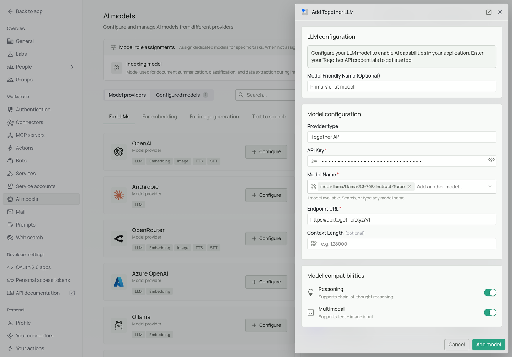
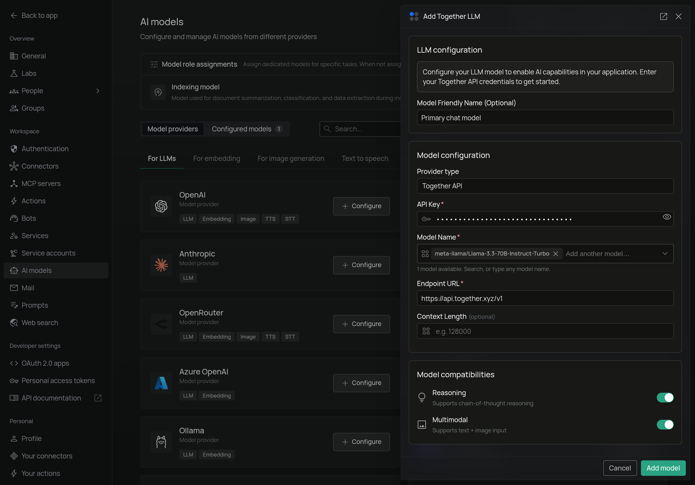

<Frame>
  
  
</Frame>

*The Together AI configuration screen in PipesHub where you'll enter your API Key, Model Name, and Endpoint URL*

PipesHub allows you to integrate with Together AI to enable AI features in your workspace. Together AI provides access to a broad catalog of open-source models with fast, scalable cloud inference and competitive pricing.

## Required Fields

### API Key *

The API Key is required to authenticate your requests to Together AI's services.

**How to obtain an API Key:**
1. Log in to the [Together AI Platform](https://api.together.xyz/)
2. Navigate to the "API Keys" section in your account settings
3. Click "Create API Key"
4. Copy the generated API key

**Security Note:** Your API key should be kept secure and never shared publicly. PipesHub securely stores your API key and uses it only for authenticating requests to Together AI.

### Model Name *

The Model Name field defines which model you want to use through Together AI.

**Popular Together AI models include:**
- `deepseek-ai/DeepSeek-V4.1-Flash` - DeepSeek's general-purpose model for complex tasks

**How to choose a model:**
- For powerful general-purpose tasks, select `deepseek-ai/DeepSeek-V4.1-Flash`
- Browse Together AI's [model catalog](https://api.together.xyz/models) for the full list of available models
- Use the exact model identifier shown in the catalog (format: `provider/model-name`)

### Endpoint URL *

The base address of the Together AI API. PipesHub has no default for it, so enter it even if you use the standard Together AI API.

**Standard value:** `https://api.together.xyz/v1`

Change it only if you route traffic through a proxy or gateway in front of Together AI.

## Optional Fields

### Context Length

The model's context window in tokens, from 1,024 to 20,000,000. Leave it empty and PipesHub assumes 128,000. Find your model's window in the provider's model documentation.

### Multimodal

Turn this on if the model accepts images as well as text. It is on by default. Turn it off for a text-only model, or chats that include an image will fail.

### Reasoning

Turn this on if the model supports chain-of-thought reasoning. It is on by default. Turn it off for a model without reasoning.

## Configuration Steps

As shown in the image above:

1. Click **Configure** on the Together provider card
2. Enter your Together AI API Key in the designated field (marked with *)
3. Specify your desired Model Name (marked with *)
4. Enter the Endpoint URL (marked with *), for example `https://api.together.xyz/v1`
5. Click **Add model** to save and validate your credentials

> API Key, Model Name and Endpoint URL are required fields.

## Usage Considerations

- API usage will count against your Together AI account's quota and billing
- Different models have different pricing — check [Together AI pricing](https://www.together.ai/pricing) for details
- Together AI provides:
  - Access to a large catalog of popular open-source models
  - Fast, scalable cloud inference
  - Competitive pricing, especially for open-source model families

## Troubleshooting

- If you encounter authentication errors, verify your API key is correct and has not expired
- Ensure your Together AI account has billing or credits set up
- Check that the model name uses the exact format shown in Together AI's model catalog (`provider/model-name`)
- Verify the model is available in your region and account tier
- If you are experiencing rate limits, check your usage in the Together AI dashboard

For additional support, refer to the [Together AI documentation](https://docs.together.ai/) or email [support@pipeshub.com](mailto:support@pipeshub.com).
