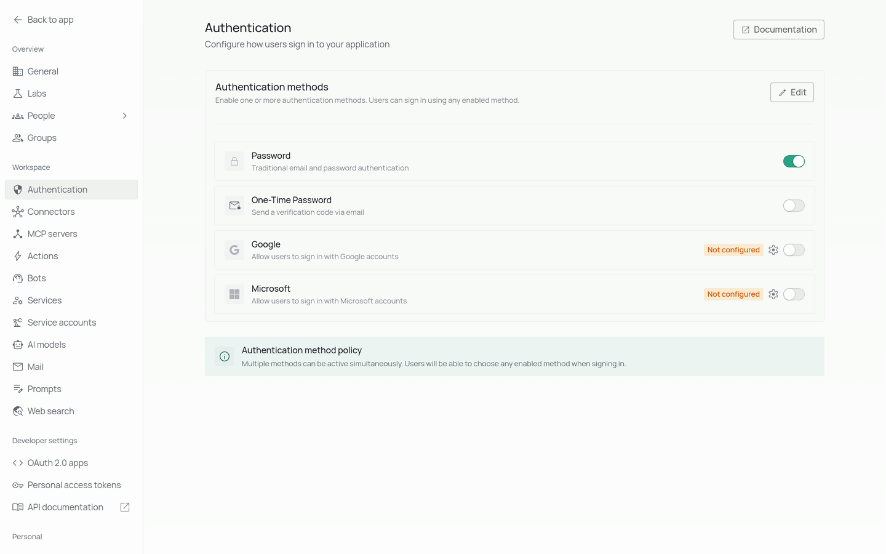

Our application supports multiple authentication methods to provide secure and flexible access for your users. This guide explains each authentication option, how to configure them, and best practices for implementation.

## Overview

Authentication is the process of verifying a user's identity before granting access to your application. Selecting the right authentication method(s) depends on your organization's security requirements, user experience preferences, and existing infrastructure.

<CardGroup>
  <Card title="Security" icon="shield">
    Choose authentication methods that align with your security policies and
    compliance requirements.
  </Card>
  <Card title="User Experience" icon="user">
    Balance security with a smooth login experience to enhance user adoption.
  </Card>
</CardGroup>

You can edit the authentication method and configure the respective credentials under the authentication page of settings in Company profie as shown in below image.

## Available Authentication Methods

<Tabs>
  <Tab title="Password">
    ## Password Authentication 
    Traditional username and password authentication for your application.

    ### For more info, refer to [Password Configuration Guide](/auth/password).

    <Info>
      Password authentication is the simplest to set up your app.
    </Info>

  </Tab>

<Tab title="One-Time Password">

## One-Time Password (OTP)

Single-use codes sent via email for secure, passwordless authentication.

### For more info, refer to [OTP Configuration Guide](/auth/otp).

</Tab>

<Tab title="Google">

## Google Authentication Allow users to sign in with their Google accounts using OAuth 2.0.

Get credentials from Google Cloud console.

### For more info, refer to [Google Configuration Guide](/auth/google).

</Tab>

<Tab title="Microsoft/AzureAd">
  ## Microsoft Authentication Allow users to sign in with their Microsoft
  accounts using OAuth 2.0.

</Tab>

</Tabs>

## Enterprise methods

<Info>
  These features are part of PipesHub Enterprise and aren't in the open-source edition. Version 1.0 of the open-source edition removed SAML SSO and OAuth / OIDC sign-in. To use any of these features, [upgrade to PipesHub Enterprise](/contact-us).
</Info>

<CardGroup cols={2}>
  <Card title="SAML SSO" icon="user-lock" href="/auth/saml">
    Let people sign in through your company's identity provider using SAML.
  </Card>
  <Card title="OAuth / OIDC" icon="key" href="/auth/oauth">
    Let people sign in through any OAuth 2.0 or OpenID Connect provider.
  </Card>
  <Card title="GitHub" icon="github" href="/auth/github">
    Let people sign in with their GitHub account.
  </Card>
  <Card title="Active Directory / LDAP" icon="server" href="/auth/ldap">
    Let people sign in with their company Active Directory username and password.
  </Card>
  <Card title="SCIM User Provisioning" icon="users-gear" href="/auth/scim">
    Add, update and remove users automatically from Okta or Microsoft Entra ID.
  </Card>
</CardGroup>

## How sign-in protects accounts

These rules describe the open-source edition. In PipesHub Enterprise, an account locks after ten wrong passwords or codes, and sign-in says the account is blocked. Active Directory has [its own limit](/auth/ldap#sign-in-protection).

- **Only the methods you allow.** Sign-in accepts only a method your organization has turned on. In a sign-in with more than one step (for example, a password and then a code sent by email), each step accepts only the methods listed for that step, so the second step can't be skipped by entering the password again.
- **The same person at every step.** Every step must be completed by the same account. A step completed with a different account (for example, a colleague's Google sign-in) is refused with *"This step was completed with a different account than the step before it. Start again from the sign-in page and use the same account for every step."*
- **No hint about who has an account.** Sign-in answers the same way whether or not an email belongs to an account, so nobody can use the sign-in page to find out which addresses are real. A wrong password and an unknown email both get *"The email or password is incorrect. Check both and try again, or use Forgot password to set a new password."*
- **Locking after repeated failures.** After five wrong passwords or codes in a row, the account is locked for 24 hours and then unlocks by itself. The account owner is emailed when the lock is applied. While the lock lasts, sign-in shows the ordinary "incorrect" message, even for the right password or code, because a different message would tell a stranger that the account exists. The lock email is the only place the owner learns about it.

<Note>
  Sign-in steps are set up through the API (`POST /api/v1/orgAuthConfig/updateAuthMethod`); the settings page saves a single step. In PipesHub Enterprise, sign-in has one step: a policy with more than one step is refused.
</Note>

## Troubleshooting

If users encounter authentication issues:

1. Verify the authentication method configuration
2. Check server logs for specific error messages
3. Confirm network connectivity to identity providers
4. Validate certificate expiration dates
5. Test authentication flow with a test account
6. If someone is sure their password is right but is told it is incorrect, their account may be locked after five failed attempts (ten in PipesHub Enterprise). Ask them to look for the lock email; the account unlocks 24 hours after the lock was applied

## Next Steps
