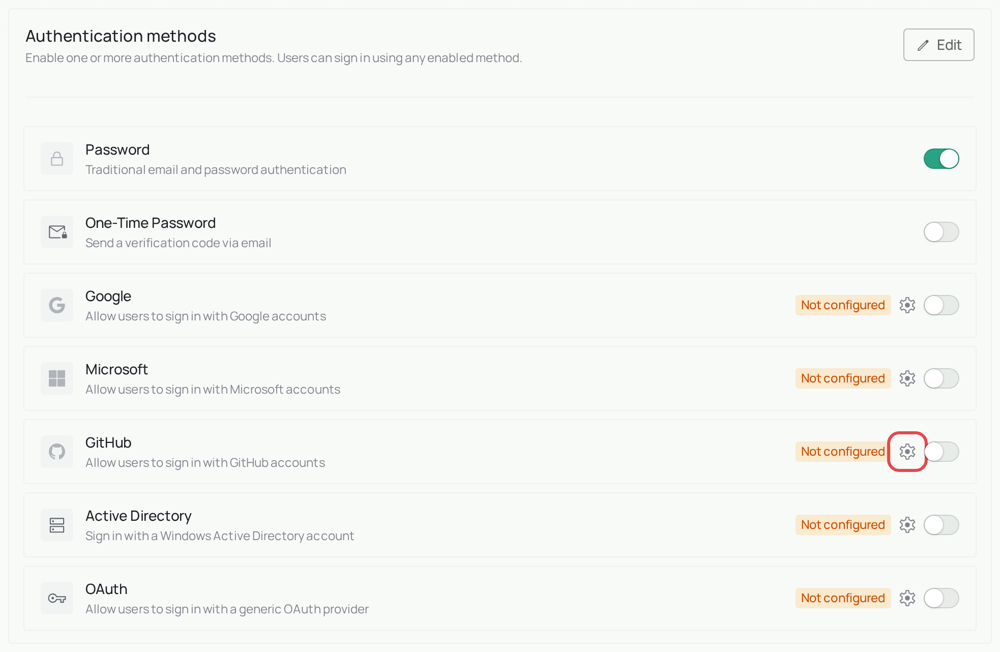
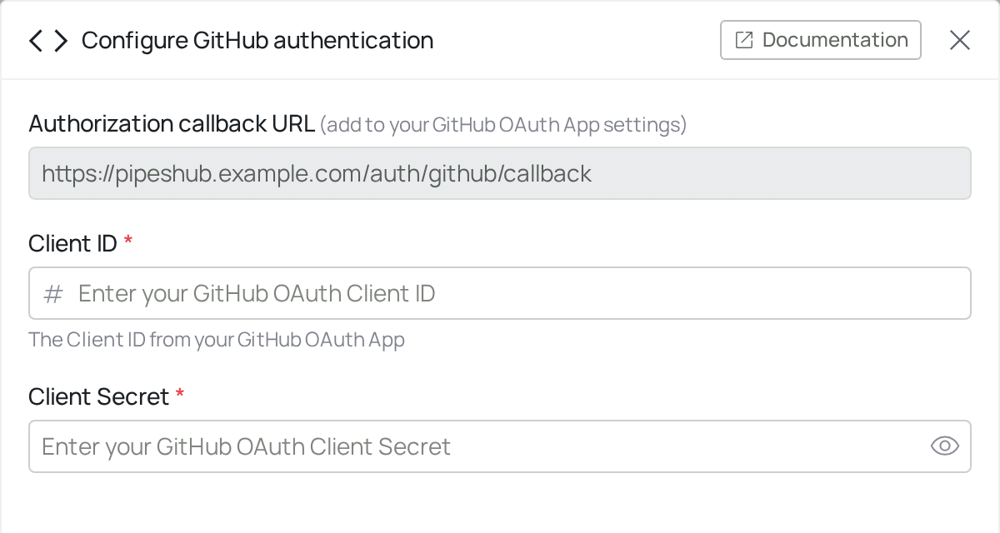
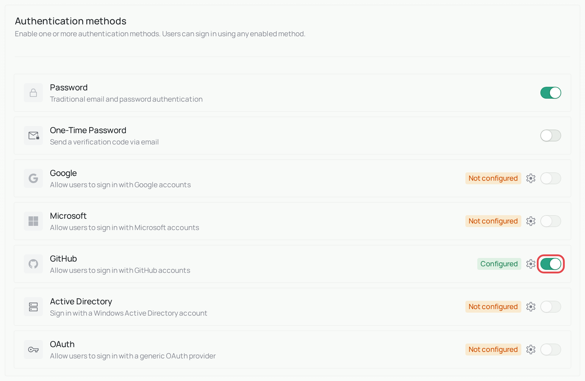
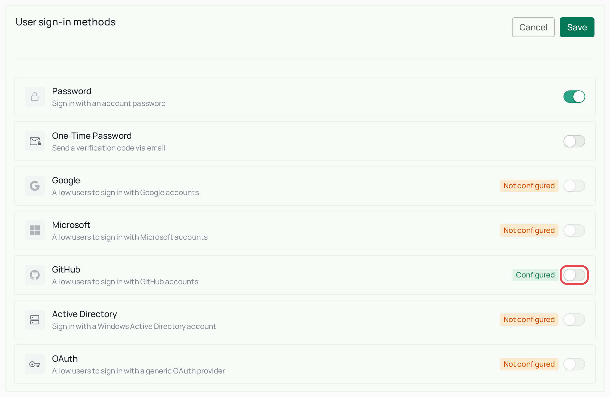
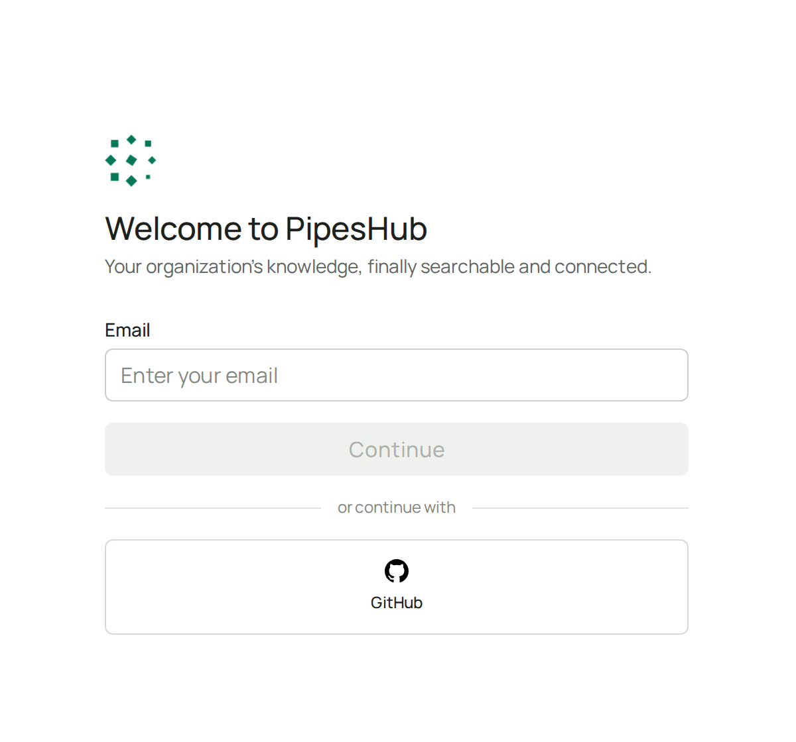

<Info>
  **Enterprise feature.** GitHub sign-in is part of PipesHub Enterprise. It isn't in the open-source edition. To use it, [upgrade to PipesHub Enterprise](/contact-us).
</Info>

## What is GitHub sign-in?

GitHub sign-in adds a GitHub option to your PipesHub sign-in page. People use their GitHub account instead of a separate PipesHub password.

PipesHub finds the right person by comparing email addresses. It reads the **primary, verified email** on their GitHub account.

<Warning>
  GitHub sign-in doesn't create accounts by itself. Add each person to PipesHub first, with the same email as the primary email on their GitHub account.

  Someone without an account can still join on their own if their email domain matches your workspace and **Allow Auto-Join** is on under **Workspace Access**. Turn it off to make an admin approve each request to join.
</Warning>

## What you need before you start

- An admin account in PipesHub
- A GitHub account that can create an OAuth app. To create the app under your company's GitHub organization, you need to be an owner of that organization.

<Warning>
  Keep one admin account on password or one-time password sign-in until you've confirmed that GitHub sign-in works, so you can't lock yourself out.
</Warning>

## Set up GitHub sign-in

The screenshots use sample details such as `example.com`. You'll see your own details instead.

<Steps>
  <Step title="Copy the callback address from PipesHub">
    Go to **Workspace → Authentication**, find the **GitHub** row, and select the gear icon.

    

    Copy the **Authorization callback URL** from the panel that opens. You'll need it in the next step.

    
  </Step>
  <Step title="Create an OAuth app in GitHub">
    In GitHub, go to **Settings → Developer settings → OAuth Apps → New OAuth App**. For an organization app, start from your organization's settings instead. Fill in these fields:

    | GitHub field | What to enter |
    |---|---|
    | **Application name** | A name people will recognize, such as `PipesHub` |
    | **Homepage URL** | Your PipesHub address |
    | **Authorization callback URL** | The address you copied from PipesHub |

    Then select **Register application**.
  </Step>
  <Step title="Get the ID and secret">
    On the app's page, copy the **Client ID**. Then select **Generate a new client secret** and copy the secret.

    <Warning>
      GitHub shows the secret only once. Keep it private, like a password.
    </Warning>
  </Step>
  <Step title="Add them to PipesHub">
    Back in the PipesHub panel, paste the **Client ID** and **Client Secret**, then select **Save**.
  </Step>
  <Step title="Turn it on">
    You can only turn a method on after its details are saved, so check that the row now says **Configured**.

    Under **Authentication methods**, select **Edit**, turn on **GitHub**, and leave **Password** on for now. Select **Save** at the bottom of the page.

    

    Then do the same under **User sign-in methods**. Its **Save** button is at the top of that section. The sign-in page only offers methods that are turned on in this second section.

    
  </Step>
  <Step title="Try signing in">
    In a private browser window, open PipesHub and select **GitHub**.

    

    Approve the request in the window that opens. It worked if you land in PipesHub, signed in as yourself. If not, see [Troubleshooting](#troubleshooting).
  </Step>
</Steps>

## What PipesHub can see

When someone signs in, GitHub asks them to approve two permissions: `read:user` and `user:email`. They let PipesHub read the person's profile and email addresses. They don't give PipesHub access to code.

## Troubleshooting

| What you see | What it means | What to do |
|---|---|---|
| After signing in, the person sees a **Join** button, **Create workspace**, or *Workspace creation is not allowed* | No PipesHub account uses this GitHub email. | Add the person in PipesHub with the same email as their primary GitHub email. |
| *No verified primary email found on the GitHub account* | The person's primary GitHub email isn't verified. | Ask them to verify it in their GitHub email settings. |
| *GitHub sign-in is not configured for this workspace* | The Client ID hasn't been saved. | Add the **Client ID** and **Client Secret** in PipesHub. |
| *Failed to exchange GitHub authorization code* or *GitHub token exchange did not return an access token* | GitHub didn't accept the sign-in. | Check the **Client Secret**, and that the callback address in GitHub exactly matches the one in PipesHub. If needed, generate a new secret. |
| GitHub says the redirect URI isn't associated with the application | The callback addresses don't match. | Copy the address from PipesHub into the OAuth app again. |
| The GitHub option doesn't appear on the sign-in page | The method is turned off or isn't set up. | Check that it's saved under **Workspace → Authentication**, and turned on under both **Authentication methods** and **User sign-in methods**. |

## Common words

| Word | What it means |
|---|---|
| **OAuth app** | A registration in GitHub that allows PipesHub to ask people to sign in with GitHub. |
| **Client ID** | The public name of your OAuth app. |
| **Client secret** | The private password of your OAuth app. |
| **Callback URL** | The PipesHub address that GitHub sends people back to after they sign in. |

## Related

- [Authentication overview](/auth)
- [Google sign-in](/auth/google)
- [Microsoft sign-in](/auth/microsoft-azureAd)
