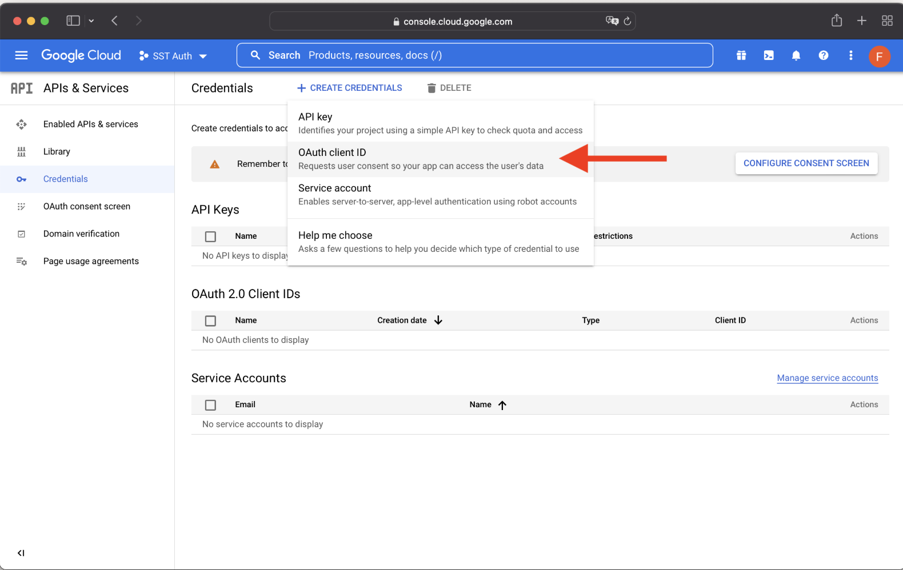
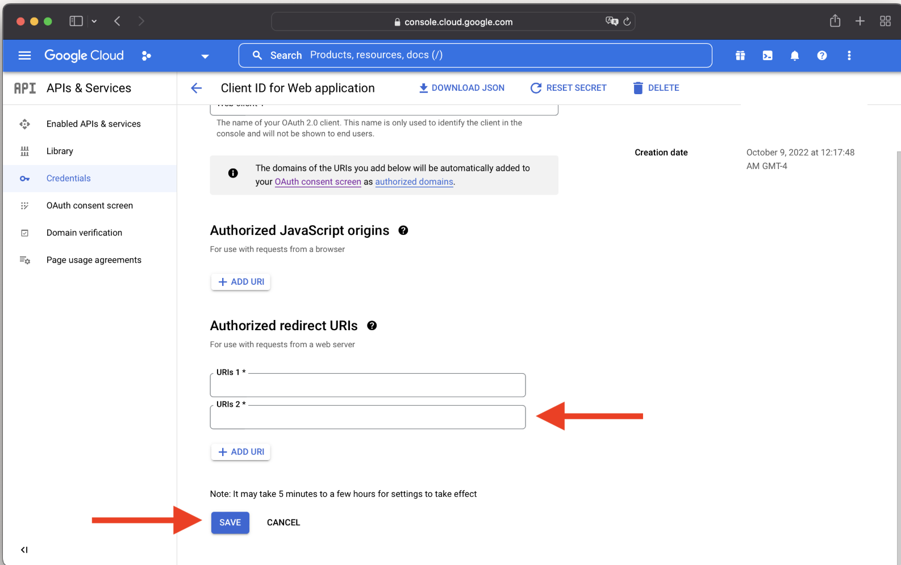
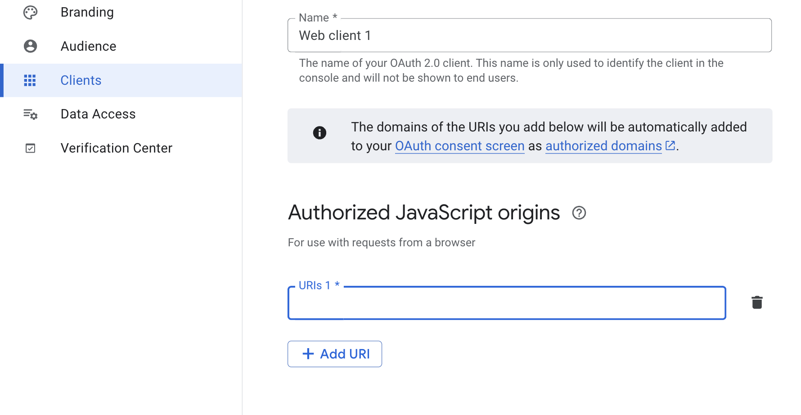
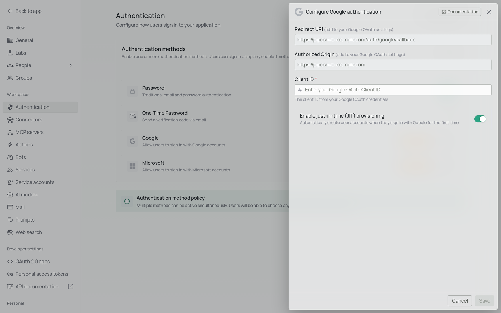
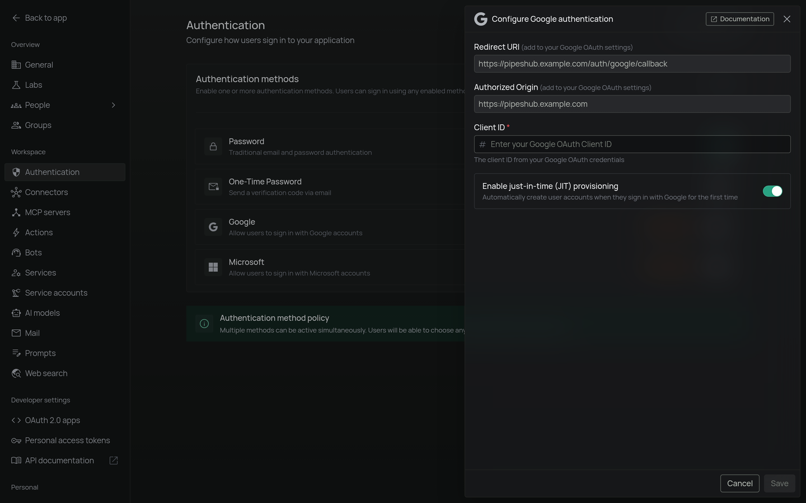

## Google authentication

Allow users to sign in with their Google accounts using OAuth 2.0.

### How it works

1. A user clicks **Sign in with Google**.
2. The user is redirected to Google's sign-in page.
3. After signing in, the user is returned to the application.
4. Once PipesHub validates the sign-in, access is granted.

### Configuration

To enable Google authentication:

1. Create OAuth credentials in the [Google Cloud Console](https://console.cloud.google.com/):
   - Create a project (if you don't have one).
   - Configure the OAuth consent screen.
   - Create an OAuth client ID (Web application).
   - Note your Client ID. PipesHub doesn't need the client secret.

   

     
   

   <Warning>
     The redirect URI in your Google Cloud Console must match exactly
     `your-app-url/auth/google/callback`.
     <Info>
       For example, if your app runs at `https://pipeshub.example.com`, the redirect URI is
       `https://pipeshub.example.com/auth/google/callback`.
     </Info>
   </Warning>

   

     
   

   <Warning>
     The authorized JavaScript origin in your Google Cloud Console must match exactly
     `your-app-url`.
     <Info>
       For example, if your app runs at `https://pipeshub.example.com`, the authorized
       JavaScript origin is `https://pipeshub.example.com`.
     </Info>
   </Warning>

   

     
   

2. In PipesHub, open **Workspace settings** > **Authentication**, click the settings (gear) icon on **Google**, enter the **Client ID** and click **Save**. Then click **Edit**, turn on **Google** and click **Save**. (The toggle stays off until the method is configured.)
   <Frame>
     
     
   </Frame>
