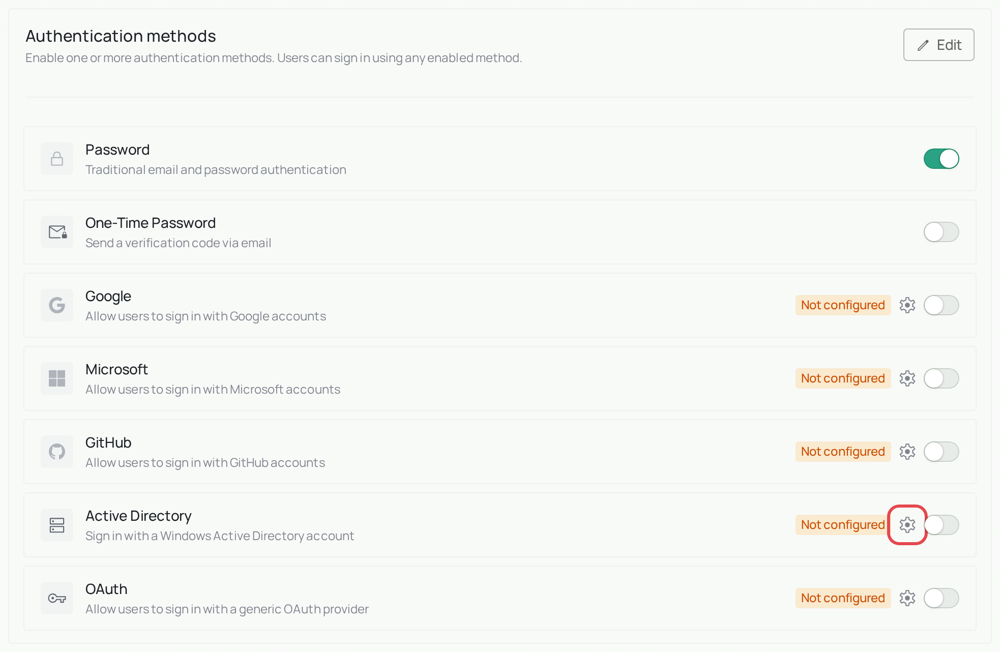
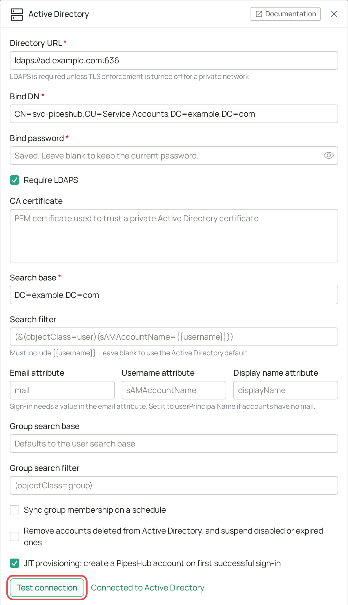
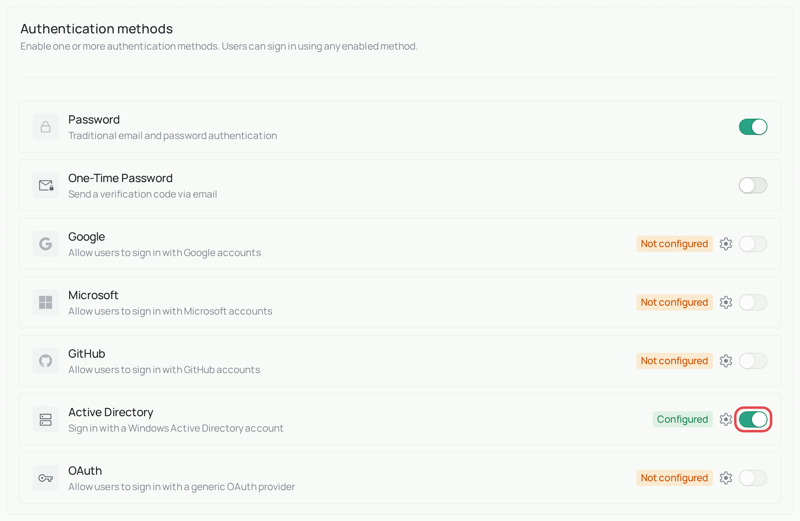
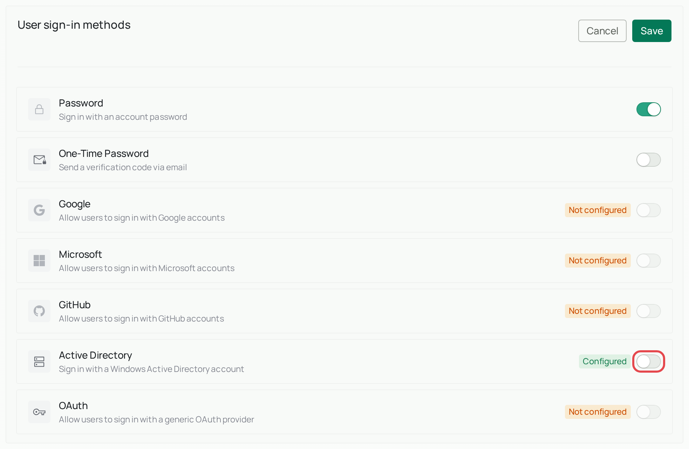
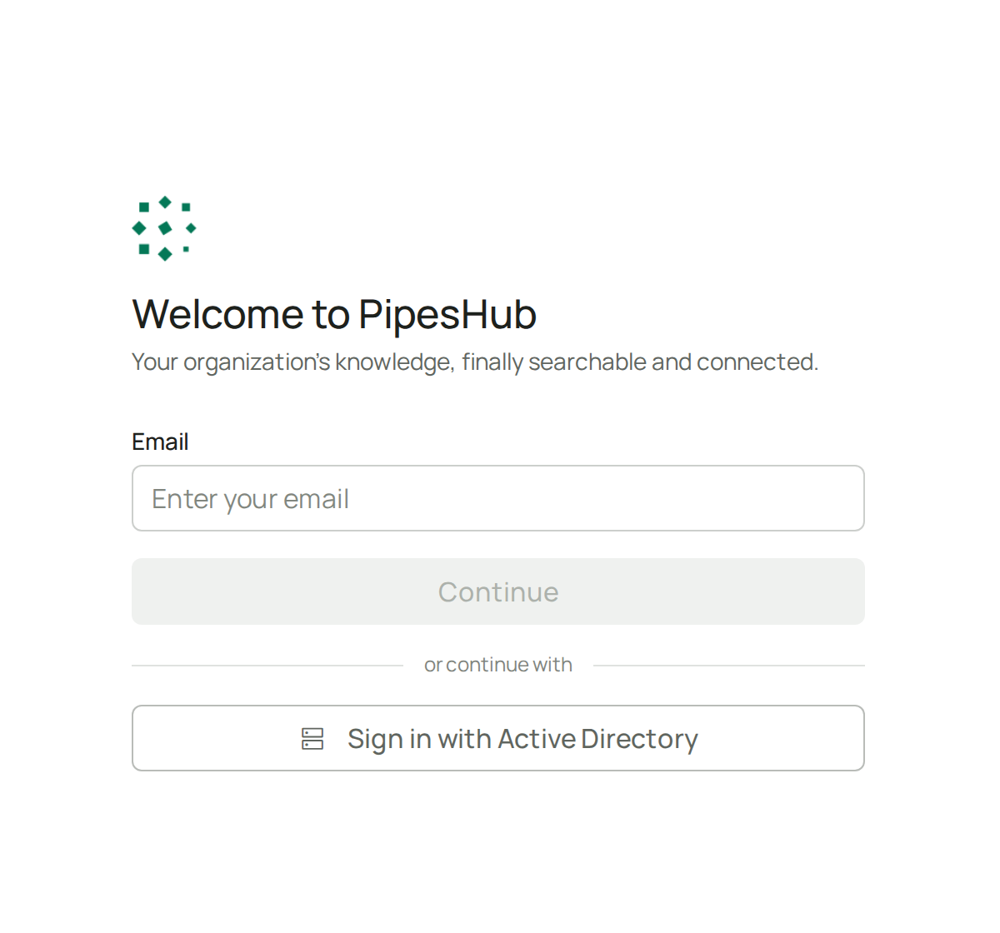
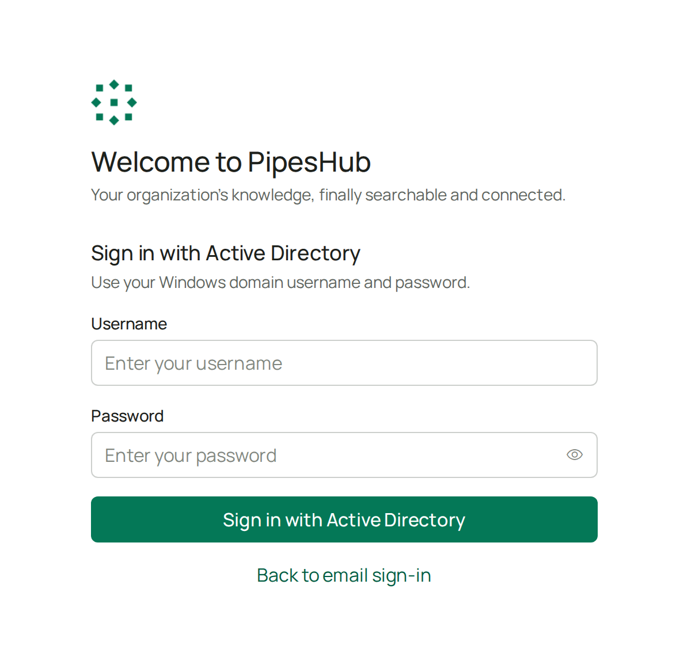

<Info>
  **Enterprise feature.** Active Directory sign-in is part of PipesHub Enterprise. It isn't in the open-source edition. To use it, [upgrade to PipesHub Enterprise](/contact-us).
</Info>

## What is Active Directory sign-in?

Many companies keep their employee accounts in **Active Directory**, a Microsoft system that usually runs on the company's own servers. It's where people's work usernames and passwords live.

With this feature, people sign in to PipesHub with those same details, so they have no extra password to remember. PipesHub checks the username and password with Active Directory using a standard called **LDAP**.

<Note>
  This page is for Active Directory on your own servers. If your company uses Microsoft's cloud service (Microsoft Entra ID, formerly Azure AD), use [Microsoft sign-in](/auth/microsoft-azureAd) instead.
</Note>

PipesHub can also connect to other LDAP directories. For those, you'll usually need to enter your own **Search filter** and attribute names, because the defaults are written for Active Directory.

## What you need before you start

Ask the person who manages Active Directory at your company for:

| What you need | What it is | Example |
|---|---|---|
| **Directory URL** | Where PipesHub can reach Active Directory. | `ldaps://ad.example.com:636` |
| **Service account** | A dedicated account PipesHub uses to look people up. It only needs permission to read users and groups. | `CN=svc-pipeshub,OU=Service Accounts,DC=example,DC=com` |
| **Service account password** | The password for that account. | |
| **Search base** | The part of the directory where your users are. | `DC=example,DC=com` |

Your PipesHub server must also be able to reach Active Directory over the network.

<Warning>
  Keep one admin account on password or one-time password sign-in until you've confirmed that Active Directory sign-in works, so you can't lock yourself out.
</Warning>

## Set up Active Directory sign-in

The screenshots use sample details such as `example.com`. You'll see your own details instead.

<Steps>
  <Step title="Open the settings">
    In PipesHub, go to **Workspace → Authentication**. Find the **Active Directory** row and select the gear icon. Only admins can see this page.

    
  </Step>
  <Step title="Enter the connection details">
    Fill in the required fields:

    | Field | What to enter |
    |---|---|
    | **Directory URL** | The **Directory URL** from your list |
    | **Bind DN** | The **Service account** from your list |
    | **Bind password** | The **Service account password** from your list |
    | **Search base** | The **Search base** from your list |

    You can leave the other fields as they are for now.
  </Step>
  <Step title="Test the connection">
    Select **Test connection**. You should see *Connected to Active Directory*. If you see an error, check [Troubleshooting](#troubleshooting).

    
  </Step>
  <Step title="Save">
    Select **Save**.
  </Step>
  <Step title="Turn it on">
    You can only turn a method on after its details are saved, so check that the row now says **Configured**.

    Under **Authentication methods**, select **Edit**, turn on **Active Directory**, and leave **Password** on for now. Select **Save** at the bottom of the page.

    

    Then do the same under **User sign-in methods**. Its **Save** button is at the top of that section. The sign-in page only offers methods that are turned on in this second section.

    
  </Step>
  <Step title="Try signing in">
    In a private browser window, open PipesHub and select **Sign in with Active Directory**.

    

    Enter your work username and password. It worked if you land in PipesHub, signed in as yourself. If not, see [Troubleshooting](#troubleshooting).

    
  </Step>
</Steps>

## Advanced settings

You don't need these to get started. Open one only if you need it.

<AccordionGroup>
<Accordion title="Change the default settings" icon="sliders">

| Setting | What it does | Default |
|---|---|---|
| **Require LDAPS** | Only allows encrypted connections, which use an address starting with `ldaps://`. Turn this off only on a private network you trust. | On |
| **CA certificate** | Lets PipesHub trust your directory's security certificate. You need this if your company issued the certificate itself. | Empty |
| **Search filter** | How PipesHub finds a person from their username. It must include `{{username}}`. | `(&(objectClass=user)(sAMAccountName={{username}}))` |
| **Email attribute** | The directory field that holds a person's email. If your accounts have no `mail` value, use `userPrincipalName`. | `mail` |
| **Username attribute** | The directory field that holds a person's username. | `sAMAccountName` |
| **Display name attribute** | The directory field that holds a person's name. | `displayName` |
| **JIT provisioning** | Creates a PipesHub account automatically the first time someone signs in. Turn this off if you'd rather add people yourself. To make an admin approve people who join on their own, also turn off **Allow Auto-Join** under **Workspace Access**. | On |

<Warning>
  With **JIT provisioning** on, anyone your search filter can find gets a PipesHub account when they first sign in. If that's too many people, narrow the **Search base** or **Search filter**, or turn it off. If you narrow them while account removal is on, existing accounts outside the new limits are suspended.
</Warning>

</Accordion>
<Accordion title="Keep groups in sync" icon="users">

You can link an Active Directory group to a PipesHub group. People in the Active Directory group who already have a PipesHub account are then added to the PipesHub group automatically. A sync never creates accounts.

<Steps>
  <Step title="Save your connection first">
    Saving closes the panel. Open it again and you'll see the **Group mapping** section.
  </Step>
  <Step title="Link the groups">
    In **Group mapping**, add a row. Choose an Active Directory group and the PipesHub group to link it to, then select **Save mappings**. Create the PipesHub group first if it doesn't exist yet. Each PipesHub group links to one Active Directory group, and each Active Directory group to one PipesHub group. You can't link the group that includes everyone.
  </Step>
  <Step title="Run the first sync">
    Select **Sync now**.
  </Step>
</Steps>

After that, a person's groups update each time they sign in. To also update them on a schedule, turn on **Sync group membership on a schedule** and set a **Sync interval** between 5 and 1440 minutes. The schedule runs while Active Directory is on in either section. Turn it off in both to stop it. **Sync now** works either way.

<Warning>
  Active Directory decides who belongs in a linked group. A sync removes anyone who isn't in the Active Directory group, including people you added to the PipesHub group by hand. Members outside your **Search base** or **Search filter** count as not in the group.
</Warning>

</Accordion>
<Accordion title="Remove people who leave" icon="user-minus">

PipesHub can check its accounts against Active Directory on a schedule. To use this, open the Active Directory panel, turn on **Remove accounts deleted from Active Directory, and suspend disabled or expired ones**, set the **Sync interval**, and save. The check only covers accounts that sign in with Active Directory, and it runs while Active Directory is on in either section.

| What happened in Active Directory | What happens in PipesHub |
|---|---|
| **The account was disabled or expired, or is now outside your Search base or Search filter** | The person is suspended and can't use PipesHub, and is removed from their groups. When the account works again, they're let back in automatically if a seat is free. They rejoin the group that includes everyone, and linked groups return at their next sign-in or sync. Add them again to any other groups by hand. |
| **The account was deleted** | The account is removed after two checks at least one **Sync interval** apart, to be sure the deletion is real. Selecting **Sync Users** twice in a row won't remove it. To bring someone back, invite them again. |
| **PipesHub can't tell what happened to the account** | Nothing changes. These accounts appear under **Could not be verified**, and you can remove them yourself. |
| **The person is a PipesHub admin** | Nothing changes. Admins are never changed automatically. They're listed so you can decide what to do. |
| **Active Directory can't be reached** | Nothing changes. The check stops and tries again at the next scheduled time. |

**To see what a check would do first**, open the panel again and select **Preview** in the **Account removal** section. Nothing changes. Select **Sync Users** to run the check right away. If you've just changed the **Directory URL**, **Search base**, **Search filter**, **Email attribute** or **Username attribute**, the first run only previews.

</Accordion>
</AccordionGroup>

## Sign-in protection

After five wrong passwords in a row, PipesHub blocks that username from Active Directory sign-in for 30 minutes. It then unblocks by itself.

## Troubleshooting

| What you see | What it means | What to do |
|---|---|---|
| *Invalid username or password* | The username or password is wrong, or the search filter can't find this person. | Check the details. Then check that the person is inside the **Search base**. |
| *Your account has been disabled as you have entered incorrect username/Password too many times* | PipesHub has blocked this username after five wrong passwords. | Wait 30 minutes and try again. |
| *Active Directory account is locked* | Active Directory itself has locked the account. | Ask your Active Directory admin to unlock it. |
| *Your Active Directory account has no email address* | The person's account has no value in the email field. | Add an email to the account, or set **Email attribute** to `userPrincipalName`. |
| After signing in, the person sees a **Join** button, **Create workspace**, or *Workspace creation is not allowed* | The person has no active PipesHub account: **JIT provisioning** is off, or account removal removed them. | Add or invite them in PipesHub, or turn on **JIT provisioning** for new people. |
| *Active Directory account does not match this sign-in* | The Active Directory account has a different email from the account used earlier in this sign-in. | Sign in again with the same account at every step. |
| *Active Directory service account rejected the bind* | The **Bind DN** or **Bind password** is wrong. | Check both with your Active Directory admin. |
| *LDAP TLS handshake failed* | PipesHub doesn't trust the directory's security certificate. | Paste your company's certificate into **CA certificate**. |
| *Active Directory is unavailable* | PipesHub can't reach the directory. | Check the **Directory URL**, the port, and that your network allows the connection. |
| *LDAP search filter matched more than one account* | The filter found several people for one username. | Make the **Search filter** more specific. |
| *Re-enter the password to change the directory connection* | You changed the connection details. | Enter the **Bind password** again before saving. |

## Common words

| Word | What it means |
|---|---|
| **Active Directory** | Microsoft's system for storing a company's user accounts and groups. |
| **LDAP** | The standard way for tools to talk to a directory such as Active Directory. |
| **LDAPS** | LDAP over an encrypted connection. |
| **Service account** | An account used by a tool rather than a person. |
| **Bind** | When PipesHub signs in to the directory. **Bind DN** is the account it signs in with. |
| **DN (distinguished name)** | The full path to something in the directory, such as `CN=Jane Doe,OU=Staff,DC=example,DC=com`. |
| **JIT provisioning** | Creating an account "just in time", when someone first signs in. |

## Related

- [Microsoft sign-in](/auth/microsoft-azureAd)
- [SCIM User Provisioning](/auth/scim)
- [User groups](/user-management/user-group)
