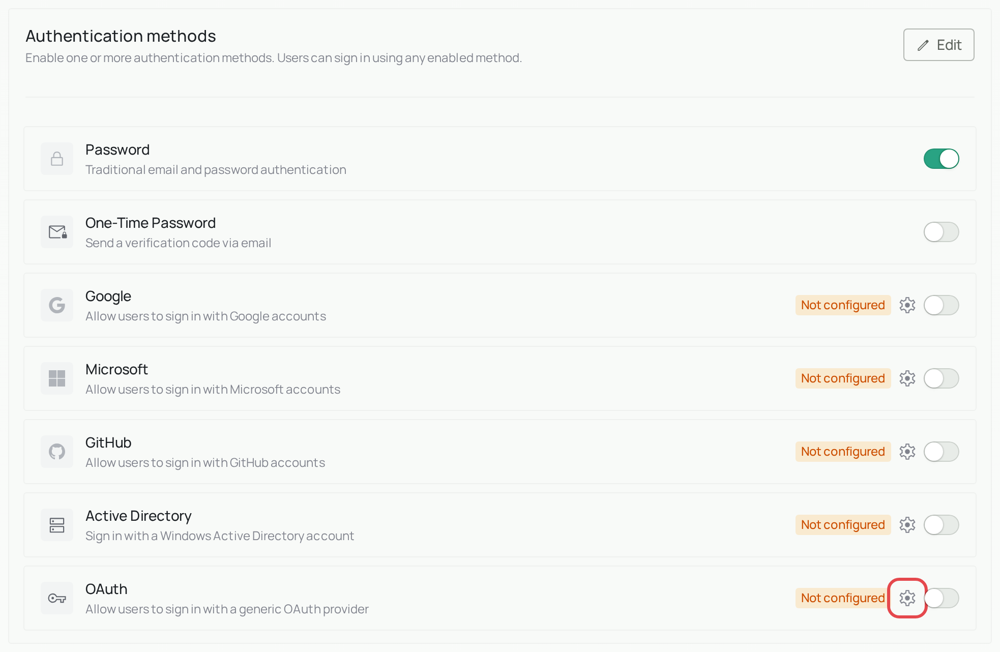
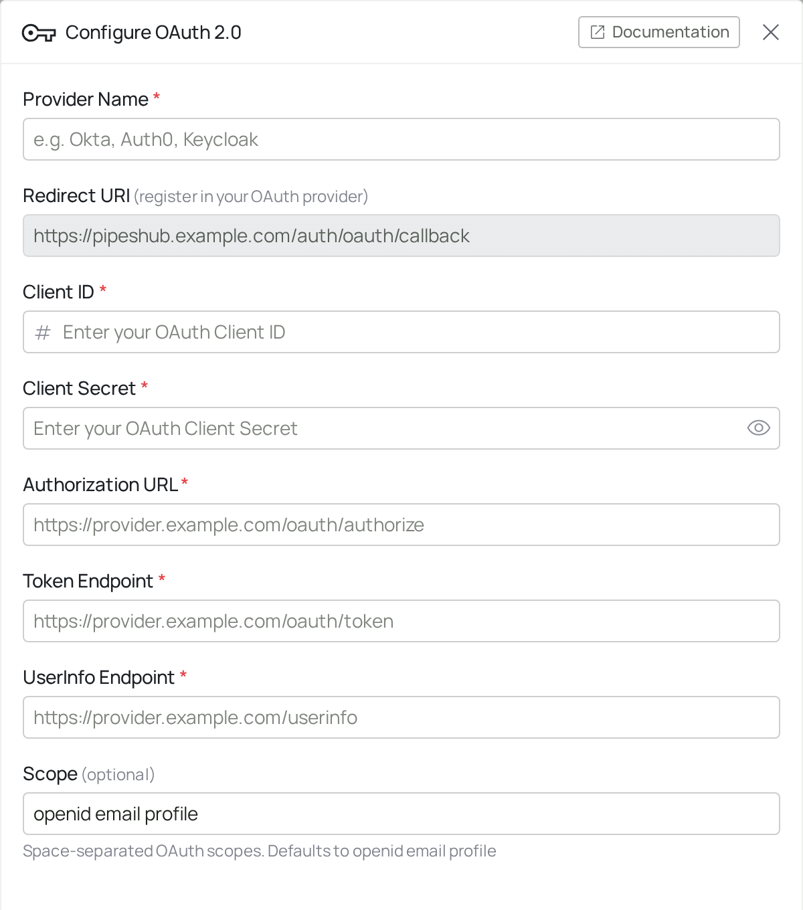
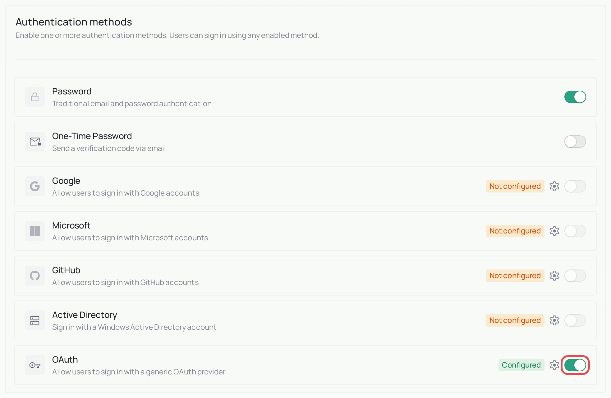
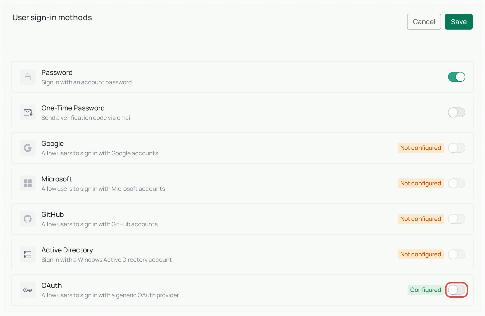

<Info>
  **Enterprise feature.** OAuth / OIDC sign-in is part of PipesHub Enterprise. The open-source edition removed it in [version 1.0](/changelog/platform/1.0.0), so you won't see this option there. To use it, [upgrade to PipesHub Enterprise](/contact-us).
</Info>

# OAuth / OIDC Sign-in

PipesHub can accept sign-ins from any identity provider that speaks OAuth 2.0 or OpenID Connect. Use this when your provider is not one of the ones with a dedicated page — Okta, Auth0, Keycloak, Authentik, Ping, and self-hosted providers all work through this method.

If you use Google or Microsoft, configure those directly instead: [Google](/auth/google), [Microsoft / Azure AD](/auth/microsoft-azureAd). They need less setup.

## How it works

1. Someone selects your provider's button on the PipesHub sign-in page.
2. PipesHub sends them to your provider's authorisation URL.
3. They sign in there and approve the request.
4. Your provider redirects back to PipesHub with a code, which PipesHub exchanges for a token.
5. PipesHub reads their identity from the user info endpoint and signs them in.

## Before you start

You need administrator access to both PipesHub and your identity provider.

Anyone who can sign in at your provider gets a PipesHub account. Read [Who gets an account](#who-gets-an-account) before you start.

## Step 1: Register PipesHub with your provider

Create an application (your provider may call it a client, an app integration, or a relying party) and set its redirect URI to:

```
https://your-pipeshub-domain/auth/oauth/callback
```

Replace `your-pipeshub-domain` with the address people use to reach PipesHub — the same value as `FRONTEND_PUBLIC_URL` in your `.env`.

Then note these values from your provider, which you will need in the next step:

- Client ID and client secret
- Authorization URL
- Token endpoint
- User info endpoint

Most OpenID Connect providers publish the three URLs at `https://your-provider/.well-known/openid-configuration`. Fetching that document is usually quicker than hunting through the console:

```bash
curl -s https://your-provider/.well-known/openid-configuration | grep -E 'authorization_endpoint|token_endpoint|userinfo_endpoint'
```

## Step 2: Configure PipesHub

The screenshots use sample details such as `example.com`. You'll see your own details instead.

Go to **Workspace → Authentication**, find the **OAuth** row, and select the gear icon.



Fill in the panel, then select **Save**.



| Field | Required | Description |
|---|---|---|
| **Provider Name** | Yes | The label shown on the sign-in button, for example `Okta` or `Company SSO`. |
| **Client ID** | Yes | The client identifier from your provider. |
| **Client Secret** | Yes | The client secret from your provider. Stored encrypted. |
| **Authorization URL** | Yes | Where PipesHub sends people to sign in. |
| **Token Endpoint** | Yes | Where PipesHub exchanges the authorisation code for a token. |
| **UserInfo Endpoint** | Yes | Where PipesHub reads the signed-in person's identity. |
| **Scope** | No | Space-separated scopes to request. Defaults to `openid email profile`, which covers most providers. |
| **Redirect URI** | Shown, not editable | PipesHub fills this in and displays it read-only. Copy it into your provider. |

<Note>
Provider Name, Client ID, Client Secret, Authorization URL, Token Endpoint and
UserInfo Endpoint are all required. Scope is optional.

PipesHub uses a confidential client: the authorisation code is exchanged for a
token server-side using the client secret, so a public client with PKCE and no
secret will not work here.
</Note>

<Warning>
**Do not treat the values on this page as hidden from end users.** Configure this
method as though the client secret could be read by anyone who can reach the
sign-in page, and rely on the redirect URI allow-list at your identity provider —
not on the secret staying private — as the control that stops it being reused.

Register the exact redirect URI and nothing broader, so an authorisation code
cannot be redirected anywhere else.
</Warning>

## Step 3: Turn it on

You can only turn a method on after its details are saved, so check that the row now says **Configured**.

Under **Authentication methods**, select **Edit**, turn on **OAuth**, and leave **Password** on for now. Select **Save** at the bottom of the page.



Then do the same under **User sign-in methods**. Its **Save** button is at the top of that section. The sign-in page only offers methods that are turned on in this second section.



## Who gets an account

Anyone who can sign in at your identity provider gets a PipesHub account the first time they sign in, without an invitation. This is called just-in-time (JIT) provisioning. The settings panel has no switch to turn it off.

<Warning>
Only use this method if your identity provider contains exactly the people who should have access. Don't use it with a shared directory, a provider that lets people register themselves, or a social login.
</Warning>

## Step 4: Test before you rely on it

1. Save the configuration.
2. Open PipesHub in a private browsing window so you are not signed in.
3. Select your provider's button and complete sign-in.
4. Confirm you land in PipesHub, and check that the account was created or matched as you intended.

Keep one administrator account on password or OTP sign-in until you have confirmed OAuth works. If the provider configuration is wrong, that account is how you get back in to fix it.

## Troubleshooting

**`redirect_uri_mismatch`.** The redirect URI registered with your provider does not exactly match the one PipesHub uses. It must match on scheme, host, port and path. `http` versus `https` and a trailing slash both count as a mismatch.

**"Account not found. Please contact your administrator."** Sign-in worked, but PipesHub couldn't create or find an account for this person. Add them in PipesHub with the same email, then try again.

**Sign-in succeeds and then returns to the login page.** PipesHub could not read an identity from the user info endpoint. Check that the endpoint is correct and that your scope includes `openid email profile`, or whatever your provider requires to return an email address.

**The button does not appear.** The method is configured but not enabled for the organisation. Check **Workspace settings → Authentication** and confirm OAuth is turned on under both **Authentication methods** and **User sign-in methods**.

## Related

- [Google](/auth/google)
- [Microsoft / Azure AD](/auth/microsoft-azureAd)
- [SAML](/auth/saml)
