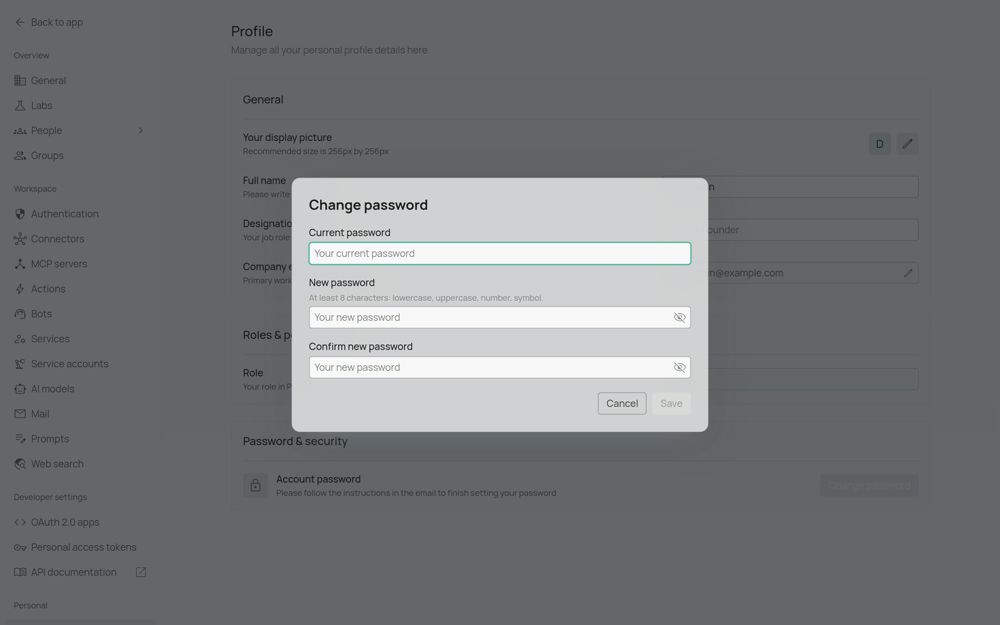
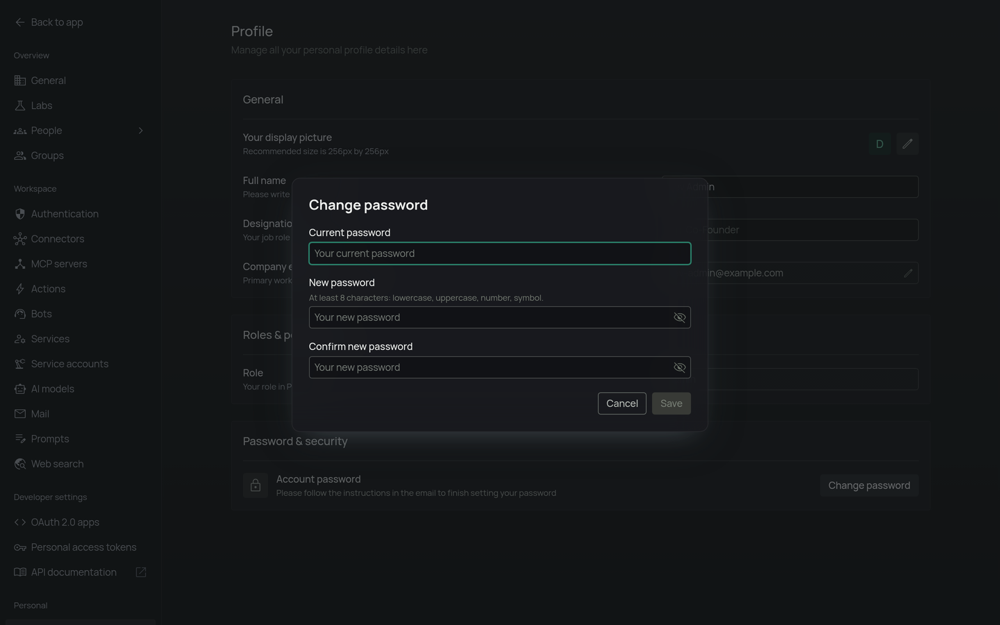
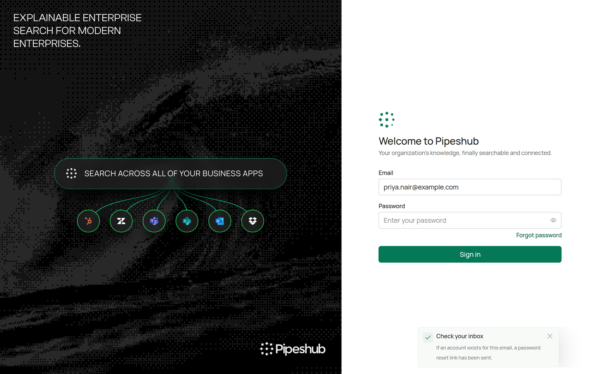
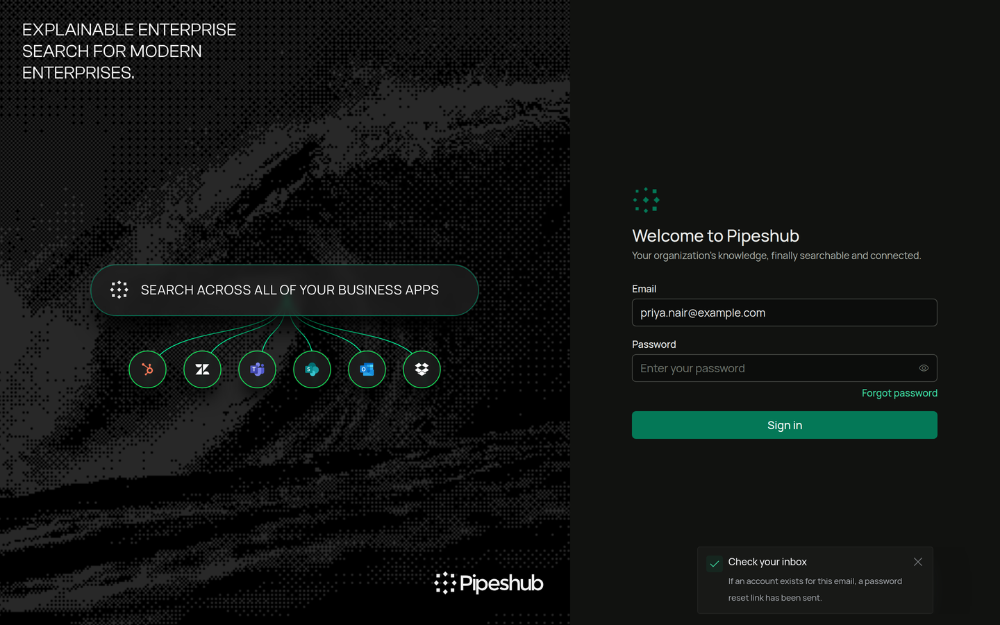
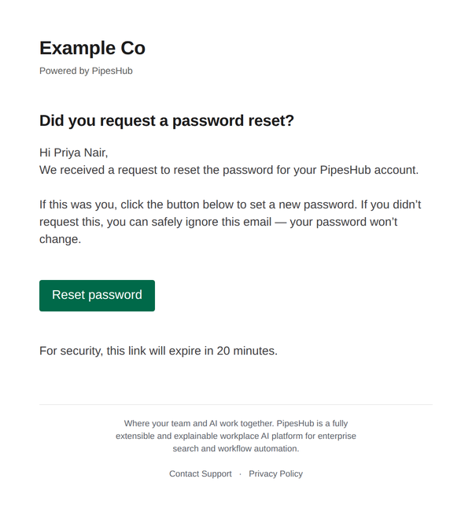
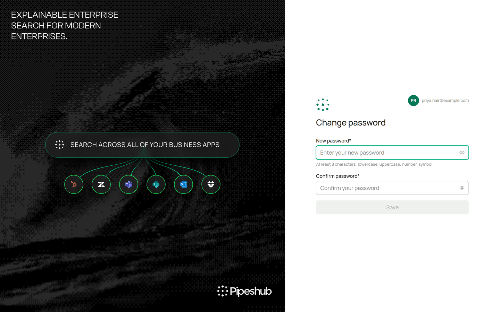
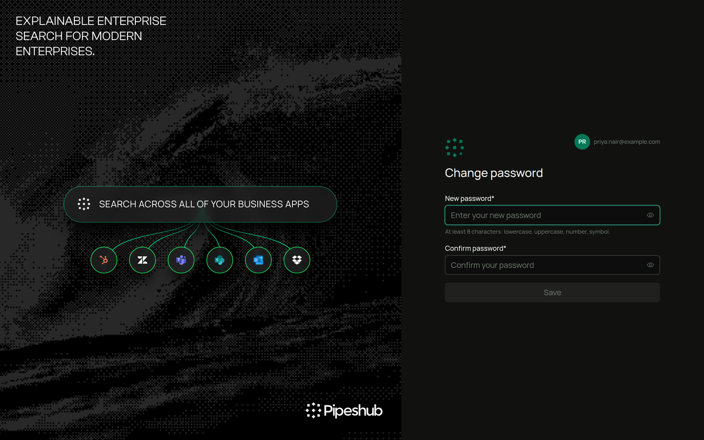

## Password Authentication

    Traditional username and password authentication for your application.
    ### How It Works
    1. Users enter their email address and password
    2. The system validates credentials against stored (hashed)
    passwords
    3. Upon successful validation, access is granted
    ### Configuration
    Password authentication is enabled by default. From the Authentication
    Settings page:
    1. Ensure "Password" is toggled on.

    <Info>
      Password that was used to login for the first time will be considered as default.
    </Info>

    ### Wrong passwords and locked accounts
    A wrong password and an email with no account get the same message: *"The email or password is incorrect. Check both and try again, or use Forgot password to set a new password."*

    After ten wrong passwords or sign-in codes in a row, the account is locked for 24 hours and the owner is emailed. While it is locked, even the right password gets the same "incorrect" message. The account unlocks by itself 24 hours after the lock was applied, or an admin can choose **Unblock** on the [Users](/user-management/user#unblocking-users) page. See [How sign-in protects accounts](/auth#how-sign-in-protects-accounts).

    ### Reset Password
    For resetting the password, open **Workspace settings** > **Profile** and click **Change password** under **Password & security**.

    <Frame>
      
      
    </Frame>

    Enter the current password, the new password and the confirmation, then click **Save**.

    A password must be at least 8 characters and include an uppercase letter, a lowercase letter, a number and a special character (one of `# ? ! @ $ % ^ & * -`). It can be at most 72 bytes long; longer passwords are refused.

    ### Forgot Password
    If a user forgets their password, SMTP configuration is necessary to enable the password reset functionality.

    How It Works

    1. Users click on the "Forgot Password" option.
    2. The system sends a password reset email via the configured SMTP server.
    3. The email contains a secure link redirecting the user to the password reset page.
    4. Users enter and confirm their new password. The link works once and expires after 20 minutes by default. Set `PASSWORD_RESET_LINK_EXPIRY` (for example `30m`) to change that; the server refuses to start if the value is not a valid duration.
    5. The system updates the password and grants access.

    On the sign-in page, enter the email address, then click **Forgot password** under the password field. A **Check your inbox** message confirms the request.

    <Frame>
      
      
    </Frame>

    The email has a **Reset password** button that opens the reset page.

    <Frame>
      
    </Frame>

    On that page, enter the new password twice and click **Save**.

    <Frame>
      
      
    </Frame>

    ### For Smtp Configuration, refer to [SMTP Configuration Guide](/smtp).

    <Info>
      Password authentication is the simplest to set up your app.
    </Info>
