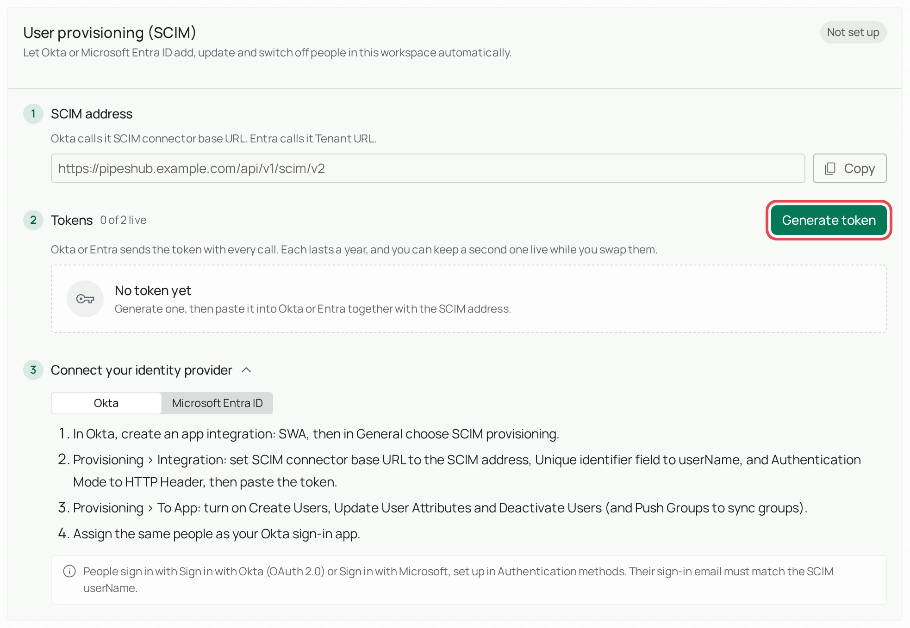
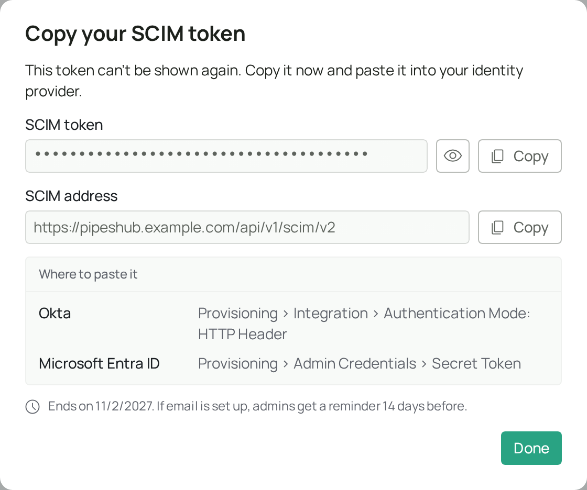
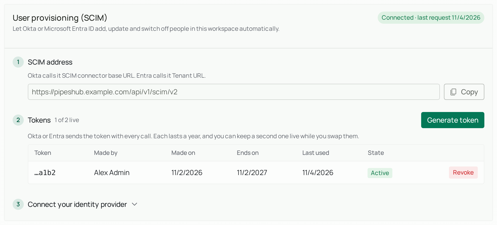

<Info>
  **Enterprise feature.** SCIM is part of PipesHub Enterprise when you install it on your own servers (on-premise). It isn't in the open-source edition. To use it, [upgrade to PipesHub Enterprise](/contact-us).
</Info>

## What is SCIM?

Most companies keep a master list of their employees in a tool such as Okta or Microsoft Entra ID. This tool is called an **identity provider**.

Without SCIM, an admin has to add every new employee to PipesHub by hand, and remove them by hand when they leave. It's easy to forget someone.

**SCIM connects your identity provider to PipesHub so this happens automatically:**

| When this happens in your identity provider | This happens in PipesHub |
|---|---|
| You give a new employee access | Their PipesHub account is created |
| You change someone's name or email | Their PipesHub account is updated |
| An employee leaves and you switch them off | They can no longer sign in |

<Note>
  SCIM only manages the list of people. It doesn't sign anyone in. To let people sign in with the same account, also set up [OAuth / OIDC](/auth/oauth) (for Okta) or [Microsoft](/auth/microsoft-azureAd) sign-in. The email they sign in with must match the email your identity provider sends through SCIM.
</Note>

## What you need before you start

- PipesHub Enterprise installed on your own servers
- An admin account in PipesHub
- An admin account in Okta or Microsoft Entra ID

## Set up SCIM

The screenshots use sample details such as `example.com`. You'll see your own details instead.

<Steps>
  <Step title="Open the SCIM settings in PipesHub">
    Go to **Workspace → Authentication** and find the section called **User provisioning (SCIM)**.

    
  </Step>
  <Step title="Copy the SCIM address">
    Copy the **SCIM address**. Your identity provider sends its updates to this address, so it must be able to reach your PipesHub server over the network.
  </Step>
  <Step title="Generate a token">
    Select **Generate token**, then copy the token. A token works like a password: it proves to PipesHub that the updates really come from your identity provider.

    

    <Warning>
      The token is shown only once. Copy it before you close the window, and keep it private. If you lose it, generate a new one.
    </Warning>
  </Step>
  <Step title="Connect your identity provider">
    Follow the steps for your provider in the next section. You'll paste in the address and the token.
  </Step>
  <Step title="Check that it works">
    Give one test person access in your identity provider. Then check two things in PipesHub:

    - The test person appears in your list of users.
    - The **User provisioning (SCIM)** section shows **Connected**, with the date of the last request.

    

    Once this works, give access to everyone else.
  </Step>
</Steps>

## Connect your identity provider

<Tabs>
  <Tab title="Okta">
    <Steps>
      <Step title="Create the app">
        In Okta, create an app integration and choose **SWA** (a basic app type). Then, under **General**, choose **SCIM provisioning**.
      </Step>
      <Step title="Add the address and token">
        Go to **Provisioning → Integration** and fill in these fields:

        | Okta field | What to enter |
        |---|---|
        | **SCIM connector base URL** | The SCIM address from PipesHub |
        | **Unique identifier field** | `userName` |
        | **Authentication Mode** | HTTP Header |

        Then paste the token.
      </Step>
      <Step title="Choose what Okta can do">
        Go to **Provisioning → To App** and turn on **Create Users**, **Update User Attributes** and **Deactivate Users**. To send groups as well, turn on **Push Groups**.
      </Step>
      <Step title="Assign people">
        On the app's **Assignments** tab, assign the same people who are assigned to your Okta sign-in app.
      </Step>
    </Steps>
  </Tab>
  <Tab title="Microsoft Entra ID">
    <Steps>
      <Step title="Create the app">
        Go to **Enterprise applications → New application → Create your own application**. Choose **Integrate any other application you don't find in the gallery**.
      </Step>
      <Step title="Add the address and token">
        Open **Provisioning** and fill in these fields:

        | Entra field | What to enter |
        |---|---|
        | **Mode** | Automatic |
        | **Tenant URL** | The SCIM address from PipesHub |
        | **Secret Token** | The token from PipesHub |

        Select **Test Connection**, then **Save**.
      </Step>
      <Step title="Turn on the safety settings">
        Under **Provisioning → Settings**, add a notification email and turn on accidental-deletion prevention.
      </Step>
      <Step title="Assign people and start">
        Assign users and groups, then select **Start provisioning**.
      </Step>
    </Steps>

    <Note>
      Entra doesn't send updates the moment you save, so the test person can take a while to appear.
    </Note>
  </Tab>
</Tabs>

<Warning>
  The `userName` that your identity provider sends must be the person's email address. PipesHub refuses anything else.
</Warning>

## What happens after setup

You don't need these details to get started. Open one when you want to know more.

<AccordionGroup>
<Accordion title="What happens to people" icon="user">

| What you do in your identity provider | What happens in PipesHub |
|---|---|
| **Give someone access** | PipesHub creates their account and adds them to the group that includes everyone. |
| **Give access to someone who already has a PipesHub account** | PipesHub doesn't create a second account. Your identity provider normally finds the existing account by its email and starts managing it. |
| **Change someone's name** | Their name is updated. |
| **Change someone's email** | Their email is updated, as long as the new address uses one of your workspace's email domains. Otherwise, make the change in PipesHub. An admin's email can't be changed through SCIM. |
| **Switch someone off** | They can no longer sign in. Their account and work are kept. They are removed from groups that were created in PipesHub, but stay in groups that came from your identity provider. |
| **Switch someone back on** | They can use their account again, and they're back in their identity provider groups. Add them again to any groups that were created in PipesHub. |
| **Delete someone** | They can no longer sign in, and they're removed from all groups. Their work is kept. If you give them access again later, their old account and work come back. |

</Accordion>
<Accordion title="What happens to admins" icon="user-shield">

SCIM never makes anyone an admin. To give someone admin rights, do it in PipesHub.

If an admin is switched off or deleted through SCIM, they first become a regular member. They stay a member if they're switched back on, so you'd need to make them an admin again in PipesHub.

SCIM can't switch off or delete your last admin. Make someone else an admin first.

</Accordion>
<Accordion title="What happens to groups" icon="users">

If you send groups from your identity provider, PipesHub creates a matching group and keeps its members up to date. Give people access before you send their group, because a group's members must already exist in PipesHub. Groups named Admin, Everyone or Standard, or sharing a name with an existing PipesHub group, are refused.

- **SCIM only changes the groups it created.** Built-in groups and groups you made in PipesHub are safe.
- **Permissions are still set in PipesHub.** A new group can't do anything special until you decide what it can access.
- **Deleting a group doesn't remove its people.** They stay in PipesHub.

</Accordion>
</AccordionGroup>

## Replace a token before it expires

Each token lasts one year. If email is set up in PipesHub, admins get a reminder 14 days before it ends. When a token expires, updates stop until you add a new one.

You can have two working tokens at once, so you can swap them without any interruption:

<Steps>
  <Step title="Generate a new token">
    In PipesHub, select **Generate replacement**, or **Generate token** if that's what you see. Copy the new token.
  </Step>
  <Step title="Update your identity provider">
    Paste the new token in place of the old one.
  </Step>
  <Step title="Revoke the old token">
    Back in PipesHub, select **Revoke** next to the old token.
  </Step>
</Steps>

If a token is ever exposed, revoke it right away. It stops working at once, and updates stop until you add a new token, unless your identity provider is already using another working token.

## Troubleshooting

| What you see | What it means | What to do |
|---|---|---|
| Status stays on **Waiting for first request** | Your identity provider hasn't reached PipesHub yet. | Check the SCIM address and that your identity provider can reach your server. In Entra, also check that provisioning has started. |
| *The SCIM token is not valid* | The token is wrong or incomplete. | Generate a new token and paste it into your identity provider. |
| *This SCIM token was revoked* or *SCIM token expired* | The token no longer works. | Generate a new token and paste it into your identity provider. |
| *userName must be the person's email address* | Your identity provider is sending something other than an email. | Change its settings so that `userName` is mapped from the email field. |
| *A person with userName … already exists* | That email already has a PipesHub account. | Make sure your identity provider is set to match existing users by `userName`. |
| *This is the workspace's last admin* | SCIM can't remove your only admin. | Make someone else an admin in PipesHub, then try again. |
| *Too many people are being added at once* | You're adding a lot of people at the same time. | Nothing. Okta and Entra try again automatically. |
| The person was created but can't sign in | Sign-in isn't set up, or the emails don't match. | Set up a sign-in method, and check that the email they sign in with matches their `userName`. |

## Common words

| Word | What it means |
|---|---|
| **Identity provider** | The tool that holds your company's list of employees, such as Okta or Microsoft Entra ID. |
| **Provisioning** | Creating, updating and removing user accounts. |
| **SCIM** | A standard way for tools to share user lists. It stands for System for Cross-domain Identity Management. |
| **Token** | A secret code that proves who is sending an update. |
| **Revoke** | Cancel a token so that it stops working. |

## Related

- [OAuth / OIDC](/auth/oauth)
- [Microsoft sign-in](/auth/microsoft-azureAd)
- [SAML SSO](/auth/saml)
- [Active Directory / LDAP](/auth/ldap)
- [User groups](/user-management/user-group)
