<div className="not-prose mt-10">
  <div className="p-6 border border-gray-200 dark:border-gray-700 rounded-xl bg-blue-50 dark:bg-gray-800">
    <div className="flex items-center gap-3 mb-4">
      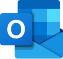
      <div className="text-xl font-semibold text-gray-900 dark:text-white">Outlook Personal</div>
    </div>
    <p className="text-base text-gray-700 dark:text-gray-300 mt-0 mb-5">Your own mailbox, with your own Microsoft sign-in</p>
    <div className="flex flex-wrap items-center gap-2">
      <span className="px-3 py-1.5 bg-green-100 dark:bg-green-900 text-green-800 dark:text-green-200 rounded-full text-sm font-medium">
        ✅ Ready
      </span>
      <span className="px-3 py-1.5 bg-blue-100 dark:bg-blue-900 text-blue-800 dark:text-blue-200 rounded-full text-sm font-medium">
        📖 Documentation Available
      </span>
    </div>
  </div>
</div>

## Overview

Outlook Personal syncs **one mailbox: the one you sign in with**. It uses delegated Microsoft Graph permissions, so it needs no admin-consented application permissions and reads nothing beyond your own mail. Only you can search what it syncs.

To sync every mailbox in your organization, an administrator sets up the [Outlook](/connectors/microsoft-365/outlook) connector instead.

### What gets synced

| Entity | Description |
|--------|-------------|
| **Mail folders** | Your folders and subfolders (Deleted Items only when selected) |
| **Emails** | Messages in those folders, within the Received Date filter |
| **Attachments** | Files attached to the messages. Attached emails and cloud links are skipped |

### Authentication

An administrator registers an app in Microsoft Entra and saves it in PipesHub as an OAuth app (steps 1–4). Each user then adds the connector with that app and signs in with their Microsoft work or school account. PipesHub asks for these delegated permissions:

| Permission | Why |
|------------|-----|
| `Mail.Read` | Read your mail and folders |
| `User.Read` | Read your profile (your email address) |
| `offline_access` | Keep syncing after the first sign-in (refresh token) |

## Configuration Guide

### Step 1: Register an application

1. Go to the [Azure Portal](https://portal.azure.com) → **Microsoft Entra ID** → **App registrations** → **New registration**.

<div className="text-center">
  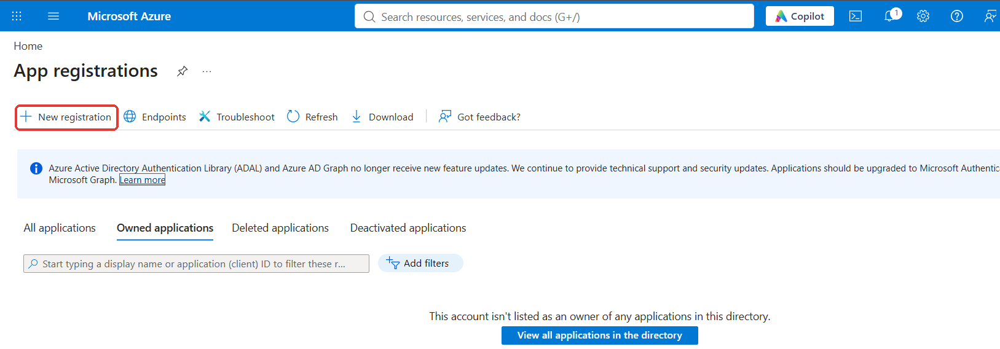
</div>

2. Give it a name (for example, `PipesHub Outlook Personal`).
3. Under **Supported account types**, choose **Single tenant only** (older portals call it **Accounts in this organizational directory only**).
4. Under **Redirect URI**, choose **Web** and enter:

```text
https://{your_pipeshub_base_url}/connectors/oauth/callback/OutlookPersonal
```

5. Click **Register**.

<div className="text-center">
  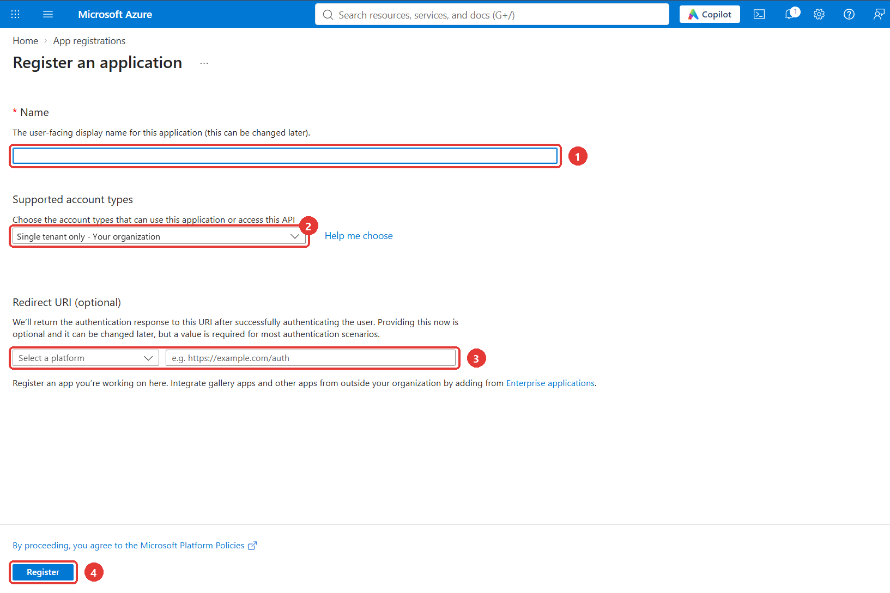
</div>

<Note>
  The redirect URI must match your PipesHub address exactly, including the port if you use one. Microsoft accepts `https` addresses, and `http` only for `localhost` (local development).
</Note>

### Step 2: Copy the IDs and create a client secret

1. On the app's **Overview** page, copy the **Application (client) ID** and the **Directory (tenant) ID**.

<div className="text-center">
  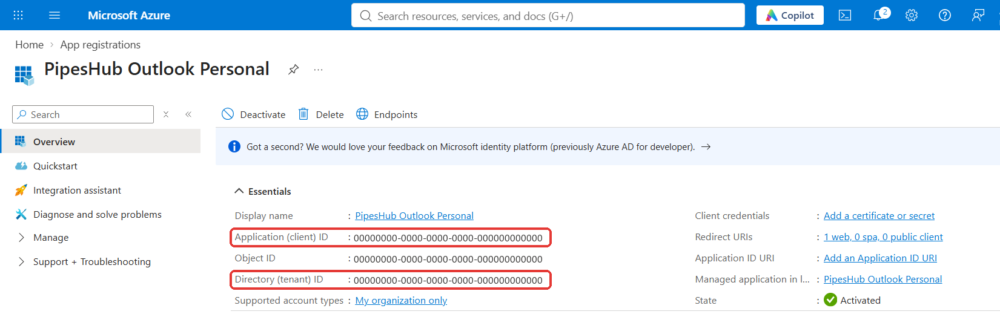
</div>

2. Go to **Certificates & secrets** → **New client secret**, add it, and copy its **Value** right away (it is shown only once).

<div className="text-center">
  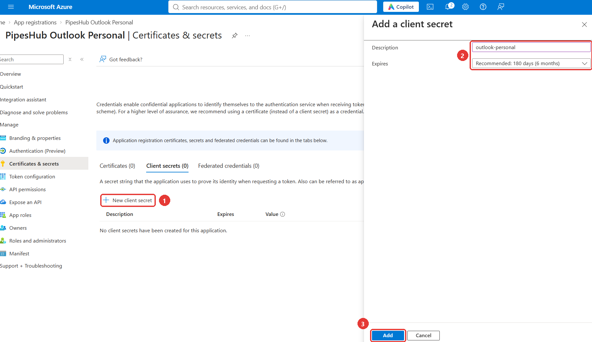
</div>

<div className="text-center">
  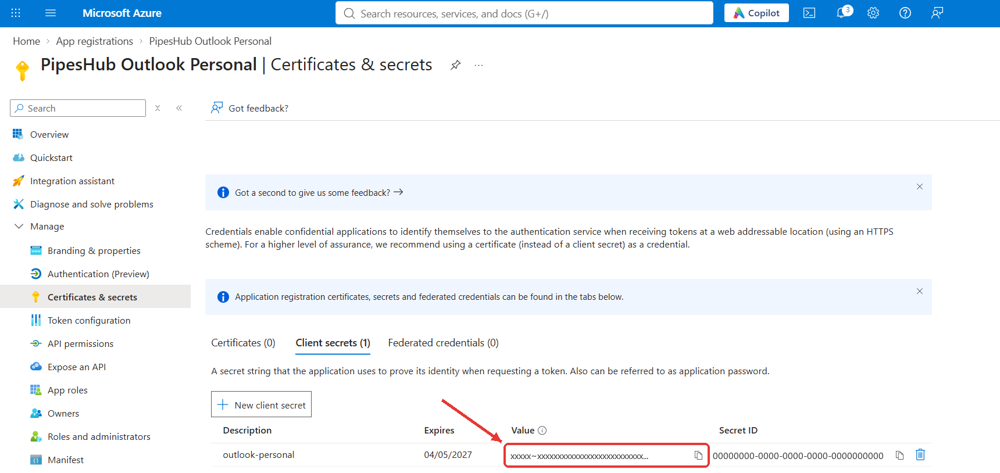
</div>

### Step 3: Add the delegated permissions

1. Go to **API permissions** → **Add a permission** → **Microsoft Graph** → **Delegated permissions**.

<div className="text-center">
  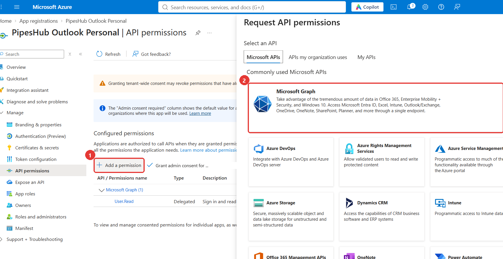
</div>

<div className="text-center">
  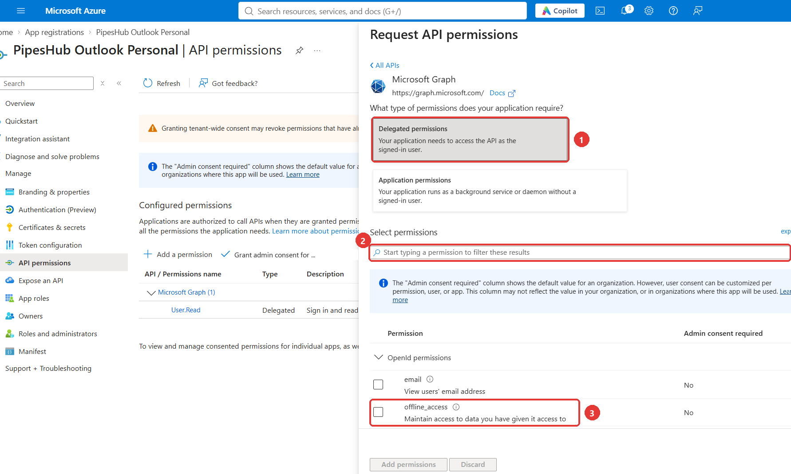
</div>

2. Add `Mail.Read`, `User.Read` and `offline_access`. Type each name in the search box and tick it, then click **Add permissions**.

<div className="text-center">
  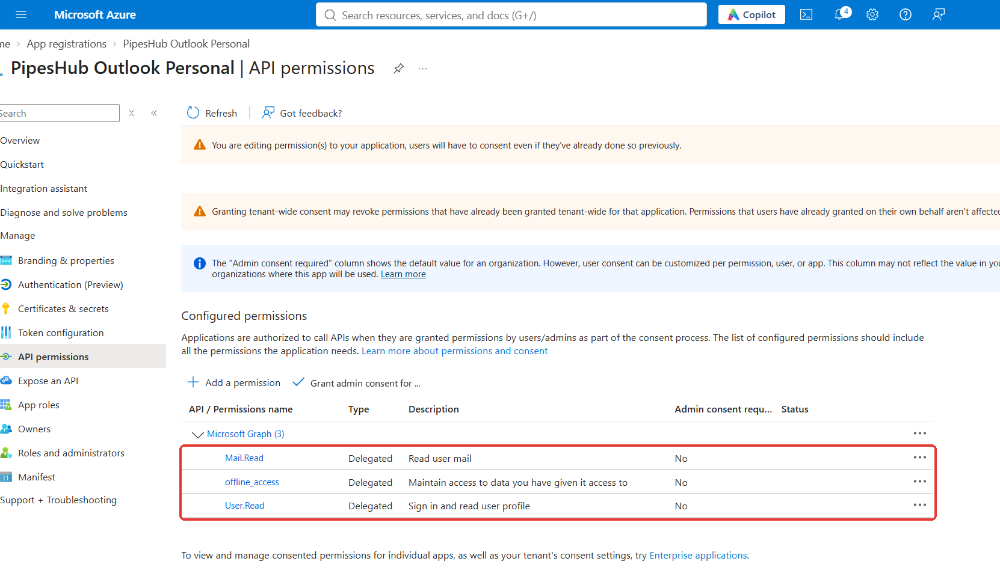
</div>

3. If your organization does not let users consent to apps, an administrator must grant consent once. Click **Grant admin consent for** *your organization*, then **Yes**. Each permission then shows **Granted for** *your organization* in the **Status** column.

<div className="text-center">
  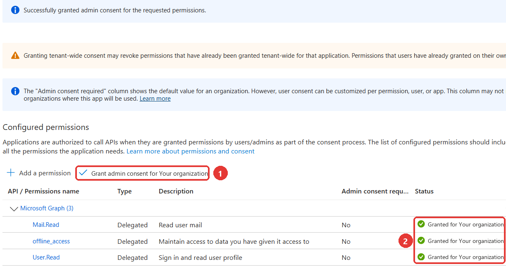
</div>

<Note>
  These are delegated permissions: PipesHub reads only the mailbox of the person who signs in. If you skip step 3 and your organization blocks user consent, Microsoft shows **Need admin approval** when users sign in (see [Troubleshooting](#troubleshooting)).
</Note>

### Step 4: Add the connector in PipesHub

The app registration from steps 1–3 is saved in PipesHub as an OAuth app, which an administrator sets up once for everyone.

1. In PipesHub, open **Workspace Settings** → **Your connectors** (under **Personal**), find **Outlook Personal** and click **Set up**.

<div className="text-center">
  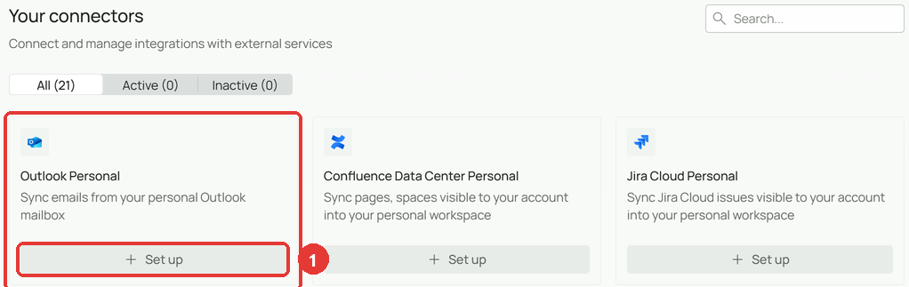
</div>

2. On the **Authenticate** tab:
   - **Instance name**: keep `Outlook Personal` or enter your own.
   - **Redirect/Callback URL**: this is the URL to register in step 1. Copy it from here if you have not added it yet.
   - **Administrator:** enter an **OAuth app name**, then the **Tenant ID**, **Client ID** and **Client Secret** from step 2. PipesHub saves them as an OAuth app that other users can pick.
   - **Member:** pick the saved OAuth app your administrator set up. Members cannot enter app credentials.
   - **If an OAuth app is already saved**, pick it under **OAuth app**. Its Tenant ID, Client ID and Client Secret fill in, so you do not enter them again.

3. Click **Next**.

<div className="text-center">
  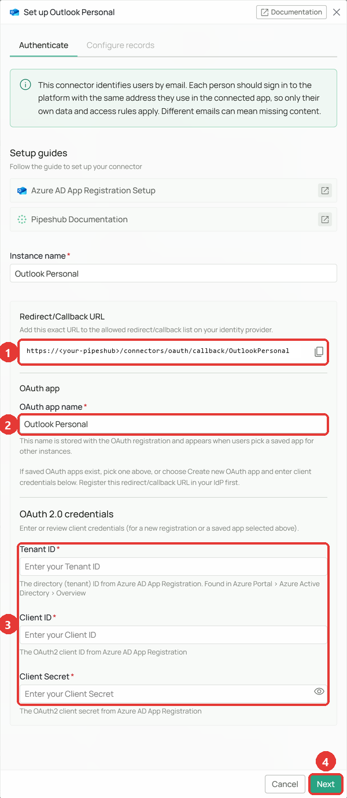
</div>

When you open the connector again, or pick an OAuth app that is already saved, the tab shows the saved app and its credentials instead:

<div className="text-center">
  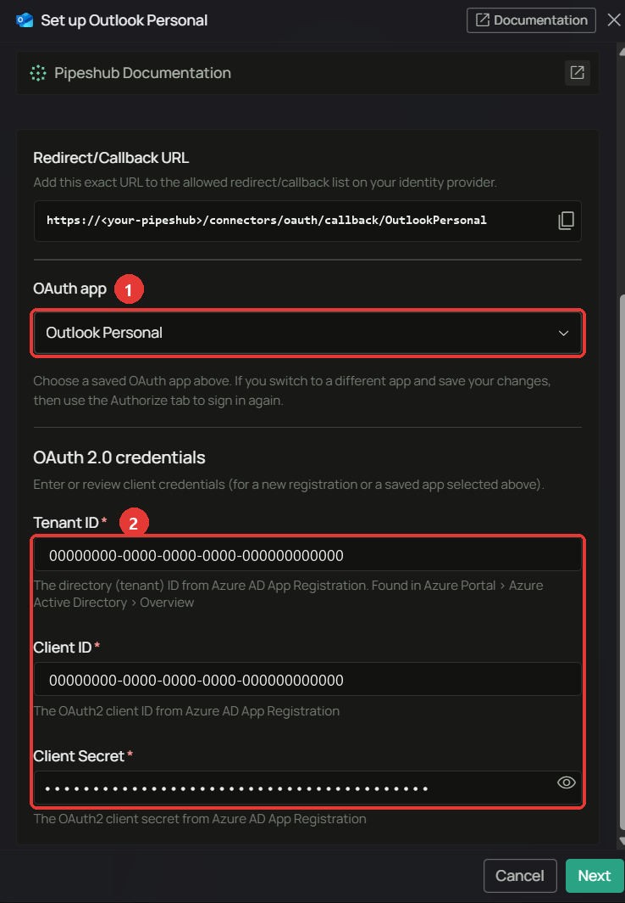
</div>

4. On the **Authorize** tab, click the button to sign in with Microsoft. A Microsoft window opens: sign in with the mailbox you want to sync and accept the permissions, if asked.
5. When the tab shows **Connected**, click **Continue to configuration**.

<div className="text-center">
  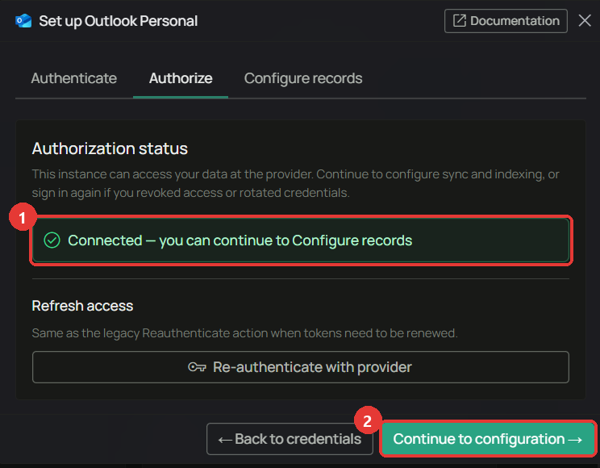
</div>

<Warning>
  Sign in with the same email address as your PipesHub account.
</Warning>

### Step 5: Choose what to sync and enable

1. On the **Configure records** tab, choose the **Sync strategy** and **Sync interval** (**Scheduled**, every **1 hour** by default). Leave **Enable Manual Indexing** off to index every synced email; turn it on to pick what gets indexed yourself.

<div className="text-center">
  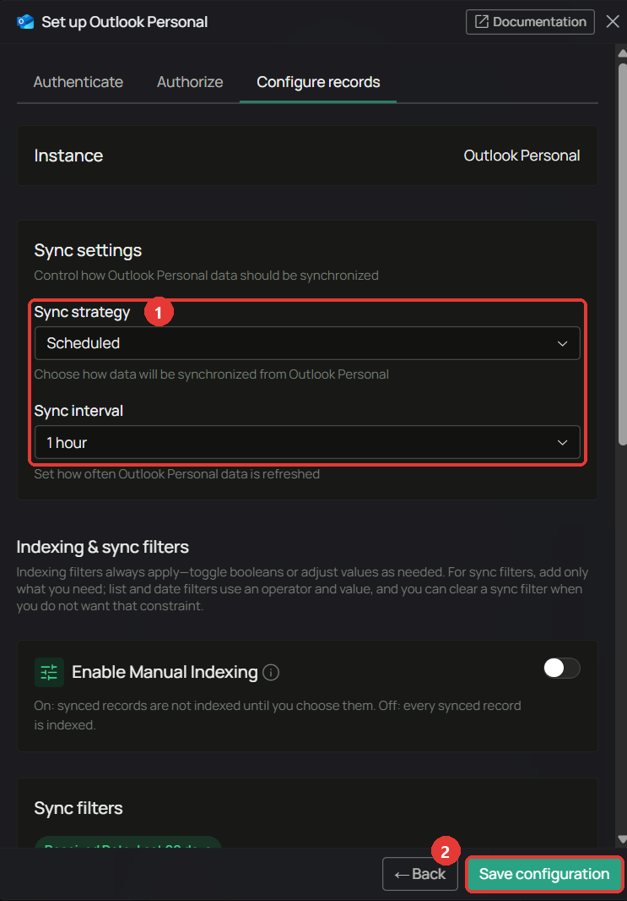
</div>

2. Scroll down to the filters:

| Filter | Behaviour |
|--------|-----------|
| **Received Date** | Only mail received in this window is synced (last 90 days by default). Click **Clear** to sync all mail. |
| **Mail Folders** | The folders to sync. Leave empty to sync every folder except Deleted Items. Only top-level folders can be picked; their subfolders come with them. |
| **Index Emails** / **Index Attachments** | Turn indexing of messages or attachments on or off. |

<div className="text-center">
  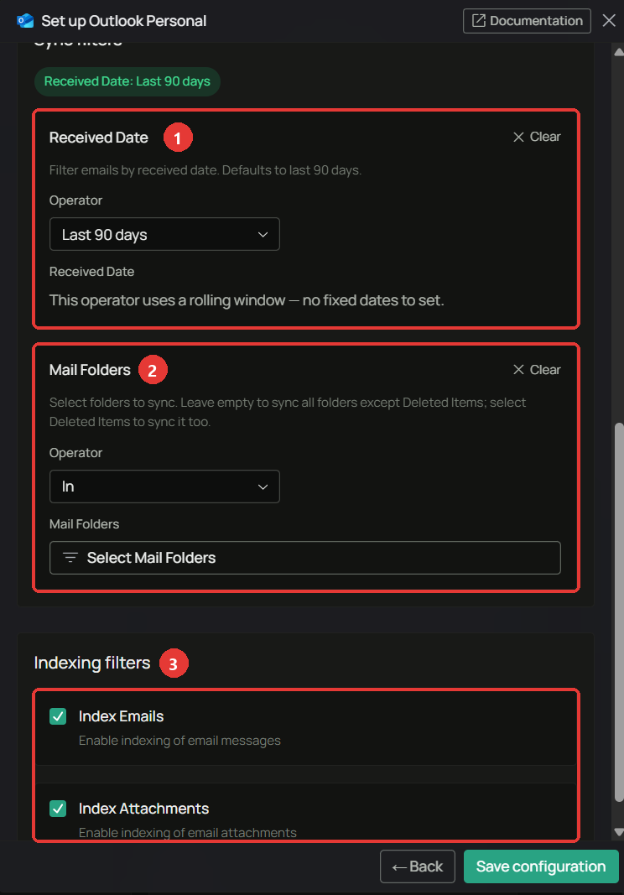
</div>

3. Click **Save configuration**, then **Start syncing now**. To start later, click **I'll do it later** and turn on **Sync enabled** on the connector page when you are ready.

<div className="text-center">
  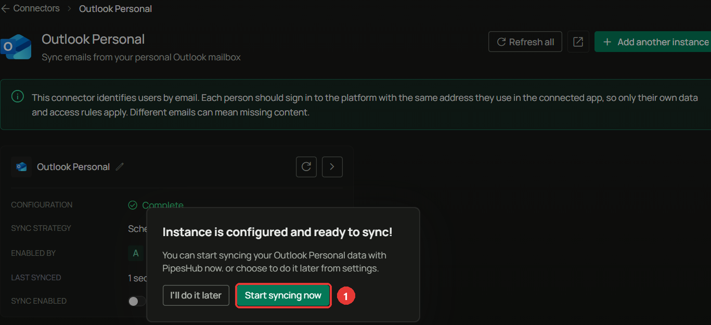
</div>

The connector page now shows **Sync enabled** turned on and **Full sync in progress**. The first sync reads every selected folder; later syncs read only the changes, on the interval you chose or when you click **Sync**.

<div className="text-center">
  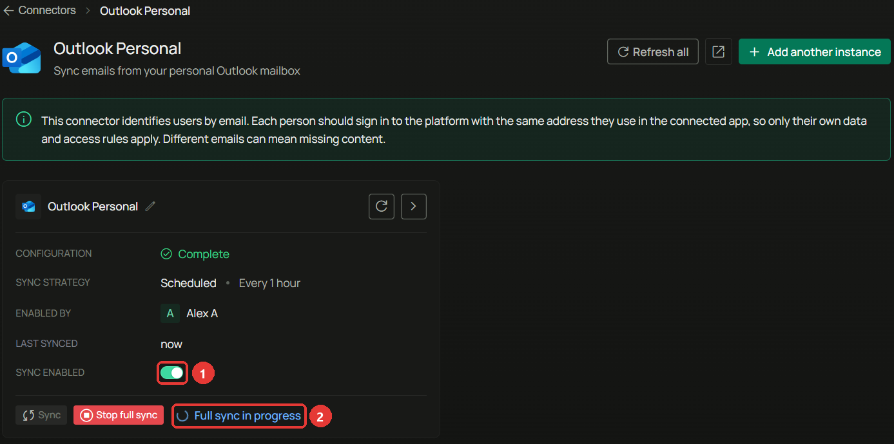
</div>

## Data sync behavior

- **New, changed and moved mail** is picked up on the next sync. A moved message keeps its place in search; reading or flagging mail does not re-index it.
- **Deleted mail and folders** are removed from search on the next sync. Moving mail to Deleted Items counts as deleting it, unless you sync Deleted Items.
- **Large attachments**: attachments over 25 MB are listed but not indexed.
- **Changing a filter** starts a full sync, which removes what is no longer in scope.

## Troubleshooting

<AccordionGroup>

<Accordion title="Common issues" icon="circle-exclamation">

**"Sign in again" or the connector stops syncing.** Your refresh token was revoked or expired (for example after a password change). Open the connector and click **Authorize** again.

**Redirect URI mismatch during sign-in (AADSTS50011).** The redirect URI in the app registration must match the one in step 1 exactly.

**Need admin approval.** Your organization requires an administrator to consent. Close the Microsoft window and ask an administrator to click **Grant admin consent** on the app's **API permissions** page (step 3), then click **Authorize** again.

<div className="text-center">
  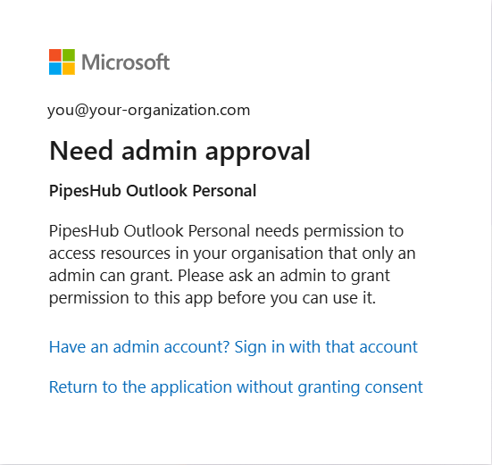
</div>

**A personal outlook.com account does not work.** The app registration in step 1 accepts accounts of your organization only.

</Accordion>

</AccordionGroup>

## Useful Links

- [Register an application (Microsoft Entra)](https://learn.microsoft.com/en-us/entra/identity-platform/quickstart-register-app)
- [Microsoft Graph permissions reference](https://learn.microsoft.com/en-us/graph/permissions-reference)
- [Outlook connector for the whole organization](/connectors/microsoft-365/outlook)
