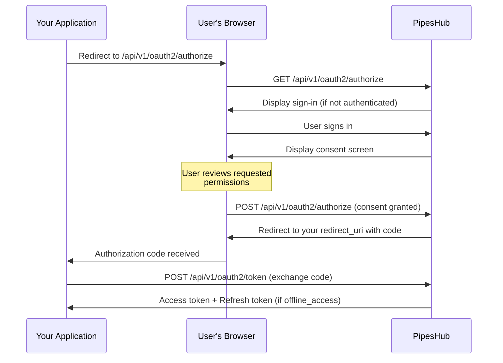

PipesHub provides a built-in OAuth 2.0 authorization server that allows administrators to register third-party applications and control how they access organizational data. This guide walks through the complete process of creating, configuring, and managing OAuth applications.

---

## Who Can Manage OAuth Applications

OAuth application management is available exclusively to **administrators**. Only users with admin privileges can create, edit, suspend, or delete OAuth applications within the organization.

---

## Navigating to OAuth Settings

To access the OAuth application management page:

1. Sign in to your PipesHub account with administrator credentials
2. Open **Workspace settings**
3. Select **OAuth 2.0 apps** under **Developer settings**

<div style={{ textAlign: "center", padding: "10px" }}>
  
</div>

This page displays all registered OAuth applications along with their current status (active or suspended).

---

## Creating a New OAuth Application

Follow these steps to register a new OAuth application.

### Step 1: Open the Application Registration Form

From the **OAuth 2.0 apps** page, click the **New OAuth application** button.


### Step 2: Provide Application Details

Fill in the following fields:

| Field | Required | Description |
|-------|----------|-------------|
| **App name** | Yes | A descriptive name for the application (1-100 characters). This name is displayed to users during the consent process. |
| **Description** | No | A brief explanation of what the application does (up to 500 characters). Helps users understand why they are granting access. |
| **Home page URL** | No | The URL of the application's homepage or landing page. |
| **Privacy policy URL** | No | Link to the application's privacy policy. |
| **Terms of service URL** | No | Link to the application's terms of service. |

<div style={{ textAlign: "center", padding: "10px" }}>
  
</div>

<Tip>
  Providing a clear description and relevant URLs builds trust with users who are asked to grant access to their data during the consent flow.
</Tip>

### Step 3: Configure Grant Types

Select the authorization grant types that your application requires:

<AccordionGroup>

<Accordion title="Authorization Code (Recommended)">

The **Authorization Code** grant is the most common and secure flow. It is suitable for applications that have a backend server capable of securely storing credentials.

**How it works:**
1. The application redirects the user to PipesHub's authorization page
2. The user reviews the requested permissions and grants consent
3. PipesHub redirects the user back to your application with a temporary authorization code
4. Your application exchanges this code for an access token on the server side

This grant type supports **PKCE (Proof Key for Code Exchange)**, which is required for public clients such as mobile applications or single-page applications that cannot securely store a client secret.

</Accordion>

<Accordion title="Client Credentials">

The **Client Credentials** grant is designed for server-to-server communication where no user interaction is involved. The application authenticates directly using its client ID and client secret.

An application that allows this grant must be bound to a **service account** when it is created. Its tokens act as that service account, so they see only what the service account can access. Only an organization admin can create such an application, and the service account must be enabled in the same organization.

**When to use:**
- Background services or automation scripts
- Machine-to-machine integrations
- Scheduled tasks that access organizational data

</Accordion>

<Accordion title="Refresh Token">

The **Refresh Token** grant allows your application to obtain a new access token without requiring the user to re-authenticate. This is enabled automatically when the `offline_access` scope is requested during the authorization code flow.

**Key details:**
- Refresh tokens are rotated on each use — the old token is revoked and a new one is issued
- Your application should always store the latest refresh token
- Refresh tokens have a default lifetime of 30 days (configurable per application)

</Accordion>

</AccordionGroup>

### Step 4: Add Redirect URIs

Redirect URIs define where PipesHub sends users after they authorize (or deny) access. You may register up to **10 redirect URIs** per application.

<div style={{ textAlign: "center", padding: "10px" }}>
  
</div>

**Requirements:**
- All redirect URIs must use **HTTPS**, except for `localhost` and `127.0.0.1` (permitted for local development)
- The URI provided during the authorization request must exactly match one of the registered URIs
- Redirect URIs are required when the Authorization Code grant type is enabled

### Step 5: Select Scopes

Scopes define the specific permissions your application is requesting. Select only the scopes your application genuinely needs — following the principle of least privilege.

<div style={{ textAlign: "center", padding: "10px" }}>
  
</div>

Scopes are organized by category for ease of selection. The following table provides a complete reference:

<AccordionGroup>

<Accordion title="Identity & Access Scopes">

| Scope | Description |
|-------|-------------|
| `openid` | OpenID Connect authentication. Does not need user consent. |
| `profile` | User profile information (name, picture). |
| `email` | User email address. |
| `offline_access` | Access when the user is offline (refresh tokens). |

</Accordion>

<Accordion title="Organization Scopes">

| Scope | Description |
|-------|-------------|
| `org:read` | Read organization information. |
| `org:write` | Update organization settings. |
| `org:admin` | Full organization administration. |

</Accordion>

<Accordion title="User Management Scopes">

| Scope | Description |
|-------|-------------|
| `user:read` | Read user profiles. |
| `user:write` | Update user profiles. |
| `user:invite` | Invite new users to the organization. |
| `user:delete` | Delete users from the organization. |

</Accordion>

<Accordion title="User Groups & Teams Scopes">

| Scope | Description |
|-------|-------------|
| `usergroup:read` | Read user groups. |
| `usergroup:write` | Create and manage user groups. |
| `team:read` | Read team information. |
| `team:write` | Create and manage teams. |

</Accordion>

<Accordion title="Knowledge Base Scopes">

| Scope | Description |
|-------|-------------|
| `kb:read` | Read knowledge bases and records. |
| `kb:write` | Create and update knowledge bases. |
| `kb:delete` | Delete knowledge bases and records. |
| `kb:upload` | Upload files to knowledge bases. |

</Accordion>

<Accordion title="Search & Conversations Scopes">

| Scope | Description |
|-------|-------------|
| `semantic:read` | Read semantic search results and history. |
| `semantic:write` | Execute semantic search queries. |
| `semantic:delete` | Delete semantic search history. |
| `conversation:read` | Read conversations. |
| `conversation:write` | Create and manage conversations. |
| `conversation:chat` | Send messages in conversations. |

</Accordion>

<Accordion title="Agents & Skills Scopes">

| Scope | Description |
|-------|-------------|
| `agent:read` | Read AI agents. |
| `agent:write` | Create and manage AI agents. |
| `agent:execute` | Execute AI agents. |
| `skill:read` | Read custom agent skills. |
| `skill:write` | Create and manage custom agent skills. |

</Accordion>

<Accordion title="MCP Servers Scopes">

| Scope | Description |
|-------|-------------|
| `mcp:read` | Read MCP servers and their tools. |
| `mcp:write` | Add, configure and authenticate MCP servers. |
| `mcp:delete` | Remove MCP servers and their credentials. |

</Accordion>

<Accordion title="Actions Scopes">

The API still calls actions toolsets, so these scopes are named `toolset:*`.

| Scope | Description |
|-------|-------------|
| `toolset:read` | Read actions and their authentication status. |
| `toolset:write` | Add, configure and authenticate actions. |
| `toolset:delete` | Remove actions and their credentials. |

</Accordion>

<Accordion title="Projects Scopes">

| Scope | Description |
|-------|-------------|
| `project:read` | Read projects and their conversations. |
| `project:write` | Create, update and share projects. Adding files to a project also needs `kb:write`. |
| `project:delete` | Delete projects. |

</Accordion>

<Accordion title="Connectors Scopes">

| Scope | Description |
|-------|-------------|
| `connector:read` | Read connector configurations. |
| `connector:write` | Create and update connectors. |
| `connector:sync` | Trigger connector synchronization. |
| `connector:delete` | Delete connectors. |

</Accordion>

<Accordion title="Code Scopes">

| Scope | Description |
|-------|-------------|
| `code:read` | Read indexed code repositories and their code graph. |

</Accordion>

<Accordion title="Configuration Scopes">

| Scope | Description |
|-------|-------------|
| `config:read` | Read system configuration. |
| `config:write` | Update system configuration. |

</Accordion>

<Accordion title="Crawling Scopes">

| Scope | Description |
|-------|-------------|
| `crawl:read` | Read crawling jobs. |
| `crawl:write` | Create and manage crawling jobs. |
| `crawl:delete` | Delete crawling jobs. |

</Accordion>

</AccordionGroup>

Only organization admins can register these scopes on an application: `org:write`, `org:admin`, `user:invite`, `user:delete`, `usergroup:write`, `team:write`, `config:write`, `crawl:write` and `crawl:delete`.

### Step 6: Save and Store Credentials

After submitting the form, PipesHub generates a unique **Client ID** and **Client Secret** for your application.

<div style={{ textAlign: "center", padding: "10px" }}>
  
</div>

<Warning>
  The **Client Secret** is displayed only once at the time of creation. Copy and store it in a secure location immediately. If lost, you will need to regenerate the secret, which invalidates the previous one.
</Warning>

---

## Authorization Flow

The following diagram illustrates how the OAuth 2.0 Authorization Code flow operates within PipesHub.



### Step-by-Step Breakdown

<Steps>

<Step title="Initiate Authorization">
Your application redirects the user's browser to PipesHub's authorization endpoint with the required parameters:

```http
GET /api/v1/oauth2/authorize?
  response_type=code&
  client_id=YOUR_CLIENT_ID&
  redirect_uri=YOUR_REDIRECT_URI&
  scope=openid profile email&
  state=RANDOM_STATE_VALUE
```

**For public clients (PKCE)**, include additional parameters:

```text
  &code_challenge=GENERATED_CHALLENGE
  &code_challenge_method=S256
```

</Step>

<Step title="User Authentication">
If the user is not already signed in to PipesHub, they are redirected to the sign-in page. After successful authentication, they are directed to the consent screen.
</Step>

<Step title="User Consent">
The consent screen displays your application's name, description, and the specific permissions being requested. The user can choose to **Allow** or **Deny** access.

<div style={{ textAlign: "center", padding: "10px" }}>
  
</div>

</Step>

<Step title="Authorization Code">
Upon approval, PipesHub redirects the user's browser back to your registered redirect URI with a temporary authorization code:

```text
https://your-app.com/callback?code=AUTHORIZATION_CODE&state=RANDOM_STATE_VALUE
```

</Step>

<Step title="Exchange Code for Tokens">
Your application exchanges the authorization code for tokens by making a server-side request:

```bash
curl -X POST https://your-pipeshub-instance.com/api/v1/oauth2/token \
  -H "Content-Type: application/x-www-form-urlencoded" \
  -d "grant_type=authorization_code" \
  -d "code=AUTHORIZATION_CODE" \
  -d "redirect_uri=YOUR_REDIRECT_URI" \
  -d "client_id=YOUR_CLIENT_ID" \
  -d "client_secret=YOUR_CLIENT_SECRET"
```

**For PKCE**, include the `code_verifier` instead of `client_secret`:

```bash
  -d "code_verifier=YOUR_CODE_VERIFIER"
```

**Successful response:**

```json
{
  "access_token": "eyJhbGciOiJIUzI1NiIs...",
  "token_type": "Bearer",
  "expires_in": 3600,
  "refresh_token": "dGhpcyBpcyBhIHJlZnJl...",
  "scope": "openid profile email"
}
```

</Step>

<Step title="Access Protected Resources">
Use the access token to make API requests on behalf of the user:

```bash
curl -X GET https://your-pipeshub-instance.com/api/v1/resource \
  -H "Authorization: Bearer ACCESS_TOKEN"
```

</Step>

</Steps>

---

## Client Credentials Flow

For server-to-server integrations with no interactive user. The application must have been created with a service account, and the token acts as that service account:

```bash
curl -X POST https://your-pipeshub-instance.com/api/v1/oauth2/token \
  -H "Content-Type: application/x-www-form-urlencoded" \
  -d "grant_type=client_credentials" \
  -d "client_id=YOUR_CLIENT_ID" \
  -d "client_secret=YOUR_CLIENT_SECRET" \
  -d "scope=kb:read semantic:read"
```

---

## Refreshing Tokens

When an access token expires, use the refresh token to obtain a new one without requiring user interaction:

```bash
curl -X POST https://your-pipeshub-instance.com/api/v1/oauth2/token \
  -H "Content-Type: application/x-www-form-urlencoded" \
  -d "grant_type=refresh_token" \
  -d "refresh_token=YOUR_REFRESH_TOKEN" \
  -d "client_id=YOUR_CLIENT_ID" \
  -d "client_secret=YOUR_CLIENT_SECRET"
```

<Warning>
  PipesHub uses **refresh token rotation**. Each time you refresh, the previous refresh token is revoked and a new one is issued. Always store and use the most recent refresh token from the response.
</Warning>

---

## Revoking Tokens

To revoke an access token or refresh token when it is no longer needed:

```bash
curl -X POST https://your-pipeshub-instance.com/api/v1/oauth2/revoke \
  -H "Content-Type: application/x-www-form-urlencoded" \
  -d "token=TOKEN_TO_REVOKE" \
  -d "token_type_hint=access_token" \
  -d "client_id=YOUR_CLIENT_ID" \
  -d "client_secret=YOUR_CLIENT_SECRET"
```

Set `token_type_hint` to either `access_token` or `refresh_token` to help the server identify the token type more efficiently.

---

## Device Authorization Flow

Use the device flow (RFC 8628) for a CLI, a coding agent or any tool that cannot open a browser redirect. The tool shows a short code, the user approves it in a browser, and the tool polls for the token.

The device grant is on by default. An administrator turns it off by setting `PIPESHUB_ENABLE_DEVICE_GRANT=false` on the backend.

**Which `client_id` to use.** Every instance has a built-in public client for this flow. Its `client_id` is `pipeshub-agent`, and discovery returns it as `pipeshub_device_client_id`. It allows only the device and refresh token grants and needs no client secret. It does not appear in **Developer Settings**. Applications you create in **Developer Settings** cannot select the device grant.

<Steps>
<Step title="Request a device code">

```bash
curl -X POST https://your-pipeshub-instance.com/api/v1/oauth2/device_authorization \
  -H "Content-Type: application/x-www-form-urlencoded" \
  -d "client_id=pipeshub-agent" \
  -d "scope=kb:read semantic:write offline_access"
```

```json
{
  "device_code": "…",
  "user_code": "ABCD-EFGH",
  "verification_uri": "https://your-pipeshub-instance.com/oauth/device",
  "verification_uri_complete": "https://your-pipeshub-instance.com/oauth/device?user_code=ABCD-EFGH",
  "expires_in": 600,
  "interval": 5
}
```

If you leave out `scope`, the request gets every scope the client allows.

</Step>
<Step title="Ask the user to approve">

Show the user `user_code` and `verification_uri`, or open `verification_uri_complete`. The user signs in to PipesHub, checks the code and the requested permissions, and approves or denies. The code expires after `expires_in` seconds (10 minutes).

</Step>
<Step title="Poll for the token">

Poll the token endpoint every `interval` seconds:

```bash
curl -X POST https://your-pipeshub-instance.com/api/v1/oauth2/token \
  -H "Content-Type: application/x-www-form-urlencoded" \
  -d "grant_type=urn:ietf:params:oauth:grant-type:device_code" \
  -d "client_id=pipeshub-agent" \
  -d "device_code=DEVICE_CODE"
```

Until the user decides, the endpoint returns HTTP 400 with one of these `error` values:

| `error` | Meaning |
|---------|---------|
| `authorization_pending` | The user has not approved yet. Keep polling. |
| `slow_down` | You polled faster than `interval`. Wait longer. |
| `access_denied` | The user denied the request. Stop. |
| `expired_token` | The code expired. Start again. |

After approval, the response is a normal token response. The token acts as the user who approved it. Each device code can be exchanged once.

</Step>
</Steps>

<Tip>
  The [`pipeshub` CLI](/mcp/cli) runs this flow for you with `pipeshub login`.
</Tip>

---

## Dynamic Client Registration

PipesHub supports dynamic client registration (RFC 7591) at `POST /api/v1/oauth2/register`. It lets a client such as an MCP client create its own OAuth application without an administrator.

Registration is **off by default**, because anyone who can reach the instance could register an application. While it is off, the endpoint returns `403` with `"error": "access_denied"`. An administrator turns it on by setting `PIPESHUB_ENABLE_DCR=true` on the backend.

```bash
curl -X POST https://your-pipeshub-instance.com/api/v1/oauth2/register \
  -H "Content-Type: application/json" \
  -d '{
    "client_name": "My MCP client",
    "redirect_uris": ["http://localhost:8765/callback"],
    "grant_types": ["authorization_code", "refresh_token"],
    "token_endpoint_auth_method": "none",
    "scope": "kb:read semantic:write conversation:chat"
  }'
```

The response returns HTTP `201` with the new `client_id` and the registered metadata. It includes a `client_secret` only when `token_endpoint_auth_method` is `client_secret_basic` or `client_secret_post`.

Rules for registered clients:

- `grant_types` defaults to `authorization_code` and `refresh_token`. `client_credentials` is refused. Add `urn:ietf:params:oauth:grant-type:device_code` if the client will use the device flow.
- `redirect_uris` is required with `authorization_code`, up to 10 URIs.
- `token_endpoint_auth_method` defaults to `none` (a public client).
- Each requested scope must be one a regular member may hold and, when `MCP_SCOPES` is set, one listed there. Otherwise the request fails with `invalid_client_metadata`.
- The application belongs to the instance's organization. The consent screen tells users that the application registered itself.

---

## Discovery Endpoints

These endpoints are public and need no authentication. They are served at the root of the instance, not under `/api/v1`.

| Endpoint | Returns |
|----------|---------|
| `/.well-known/openid-configuration` | OpenID Connect discovery document |
| `/.well-known/oauth-authorization-server` | The same document at the RFC 8414 path. Some MCP clients read this one. |
| `/.well-known/oauth-protected-resource/mcp` | Protected resource metadata (RFC 9728) for the `/mcp` endpoint |
| `/.well-known/jwks.json` | Public keys for verifying tokens |

The discovery document lists the authorization, token, userinfo, revocation and introspection endpoints, `scopes_supported`, and `grant_types_supported`. Some fields appear only when the feature is on:

| Field | Present when |
|-------|--------------|
| `device_authorization_endpoint` and the `device_code` grant type | The device grant is on (the default) |
| `pipeshub_device_client_id` | The device grant is on and the instance has an organization |
| `registration_endpoint` | `PIPESHUB_ENABLE_DCR=true` |

The protected resource document for `/mcp` lists only the scopes the MCP tools use. See [MCP Server Overview](/mcp/overview).

---

## Managing OAuth Applications

### Viewing Application Details

Click on any application from the list to view its configuration, including the client ID, allowed scopes, grant types, redirect URIs, and token settings.

<div style={{ textAlign: "center", padding: "10px" }}>
  
</div>

### Regenerating the Client Secret

If your client secret has been compromised or needs to be rotated:

1. Open the application detail page
2. Click **Generate new client secret**
3. Copy and securely store the new secret immediately

<Warning>
  Regenerating the client secret immediately invalidates the previous secret. Any active integrations using the old secret will stop functioning until updated.
</Warning>

### Suspending an Application

If you need to temporarily disable an application without deleting it:

1. Select **Manage** on the application to open its panel
2. Open the **Advanced** tab
3. Click **Suspend application**

A suspended application cannot authorize new users or issue tokens. Existing tokens remain valid until they expire. To restore access, click **Activate application** on the same page.

### Deleting an Application

Deleting an OAuth application:

1. Revokes all active access tokens and refresh tokens associated with the application
2. Permanently marks the application as revoked

Steps to delete an application:
1. Select **Manage** on the application to open its panel
2. Open the **Advanced** tab
3. Click **Delete application**
4. Confirm by putting the application name in dialog box

<Warning>
  Application deletion is irreversible. All active integrations will lose access immediately.
</Warning>

### Revoking Active Tokens

From the application detail page, administrators can:

- **Revoke all tokens** at once, which is useful in the event of a security incident

Steps to revoke all tokens:
1. Select **Manage** on the application to open its panel
2. Open the **Advanced** tab
3. Click **Revoke all tokens**
4. Confirm by putting the application name in dialog box

---

## Security Best Practices

<CardGroup cols={2}>

<Card title="Store Secrets Securely" icon="vault">
  Never expose client secrets in frontend code, public repositories, or client-side applications. Use environment variables or a dedicated secrets manager.
</Card>

<Card title="Use PKCE for Public Clients" icon="shield-check">
  Public clients (mobile apps, SPAs) must use PKCE with the S256 challenge method to protect against authorization code interception attacks.
</Card>

<Card title="Request Minimal Scopes" icon="minimize">
  Only request the scopes your application genuinely needs. Users are more likely to trust and approve applications with narrowly defined permissions.
</Card>

<Card title="Validate the State Parameter" icon="fingerprint">
  Always generate a unique, unpredictable `state` value for each authorization request and verify it in the callback to prevent cross-site request forgery (CSRF) attacks.
</Card>

<Card title="Handle Token Rotation" icon="rotate">
  Always store the latest refresh token after each refresh operation. Using an outdated refresh token will fail and may trigger a security alert.
</Card>

<Card title="Revoke Tokens on Sign-Out" icon="right-from-bracket">
  When users sign out of your application or disconnect the integration, revoke both access and refresh tokens to maintain a clean security posture.
</Card>

</CardGroup>

---

## API Endpoints Reference

The following table provides a quick reference for all OAuth 2.0 endpoints:

| Endpoint | Method | Description |
|----------|--------|-------------|
| `/api/v1/oauth2/authorize` | `GET` | Initiate the authorization flow |
| `/api/v1/oauth2/authorize` | `POST` | Submit user consent |
| `/api/v1/oauth2/token` | `POST` | Exchange a code, refresh token, client credentials or device code for tokens |
| `/api/v1/oauth2/revoke` | `POST` | Revoke an access or refresh token |
| `/api/v1/oauth2/introspect` | `POST` | Inspect a token's validity and metadata |
| `/api/v1/oauth2/userinfo` | `GET` | Retrieve user profile information (requires `openid` scope) |
| `/api/v1/oauth2/device_authorization` | `POST` | Start the device flow |
| `/api/v1/oauth2/register` | `POST` | Dynamic client registration (off by default) |
| `/.well-known/openid-configuration` | `GET` | OpenID Connect Discovery document |
| `/.well-known/oauth-authorization-server` | `GET` | Authorization server metadata (RFC 8414) |
| `/.well-known/oauth-protected-resource/mcp` | `GET` | Protected resource metadata for `/mcp` |
| `/.well-known/jwks.json` | `GET` | Public keys for token verification |

---

## Troubleshooting

<AccordionGroup>

<Accordion title="Authorization request returns an error">

**Common causes:**
- The `redirect_uri` does not exactly match one of the registered URIs for the application
- The `client_id` is incorrect or belongs to a suspended/deleted application
- The requested scopes include scopes that are not in the application's allowed scopes

**Resolution:** Verify the client ID, redirect URI, and scopes in your application settings.

</Accordion>

<Accordion title="Token exchange fails with 'invalid_grant'">

**Common causes:**
- The authorization code has expired (codes are valid for 10 minutes)
- The authorization code has already been used
- The `redirect_uri` in the token request does not match the one used during authorization
- For PKCE: the `code_verifier` does not match the original `code_challenge`

**Resolution:** Initiate a new authorization request and ensure the code is exchanged promptly.

</Accordion>

<Accordion title="Refresh token is rejected">

**Common causes:**
- The refresh token has been rotated and the old token was used instead of the most recent one
- The refresh token has expired
- The application or its tokens have been revoked by an administrator

**Resolution:** Redirect the user through the authorization flow again to obtain new tokens.

</Accordion>

<Accordion title="API request returns 403 Forbidden">

**Common causes:**
- The access token does not include the required scope for the requested endpoint
- The user does not have sufficient permissions within the organization

**Resolution:** Check the scope requirements for the endpoint and ensure your application requests the appropriate scopes.

</Accordion>

</AccordionGroup>

---

## FAQ

<AccordionGroup>

<Accordion title="Can non-admin users create OAuth applications?">
No. OAuth application management is restricted to organization administrators. Regular users can only interact with OAuth applications during the consent flow when an application requests access to their data.
</Accordion>

<Accordion title="What happens when I regenerate a client secret?">
The previous secret is immediately invalidated. Any integration using the old secret will receive authentication errors. You must update all services that use the old secret with the new one.
</Accordion>

<Accordion title="Is there a limit on the number of OAuth applications?">
There is no fixed limit on the number of OAuth applications per organization. However, each application can have a maximum of 10 registered redirect URIs.
</Accordion>

<Accordion title="Does PipesHub support PKCE?">
Yes. PKCE (Proof Key for Code Exchange) is fully supported and is required for public (non-confidential) clients. PipesHub supports both `S256` and `plain` challenge methods, though `S256` is strongly recommended.
</Accordion>

</AccordionGroup>
