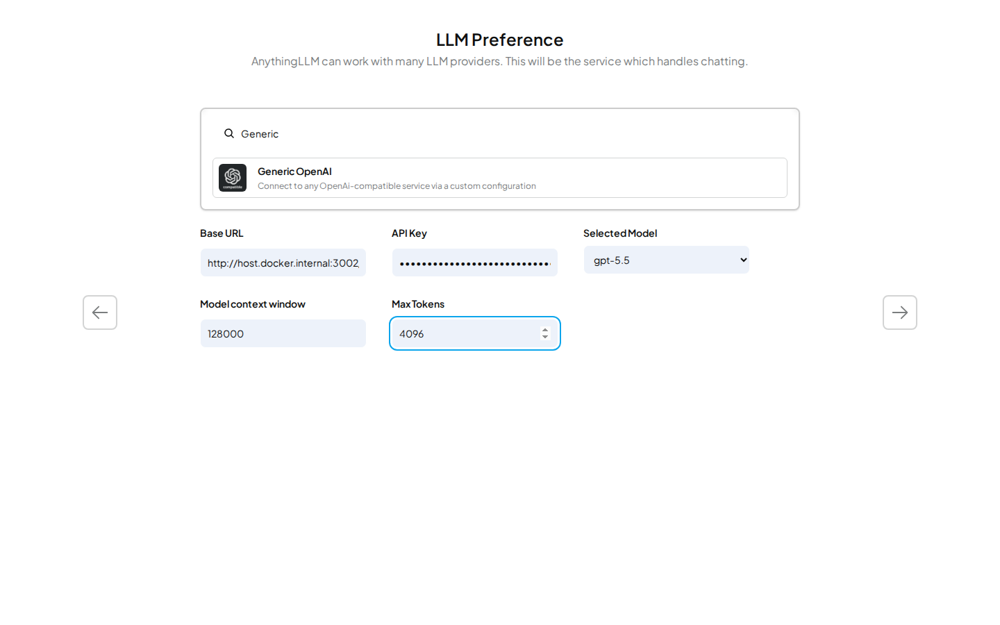
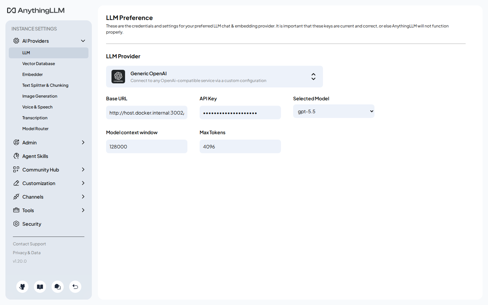
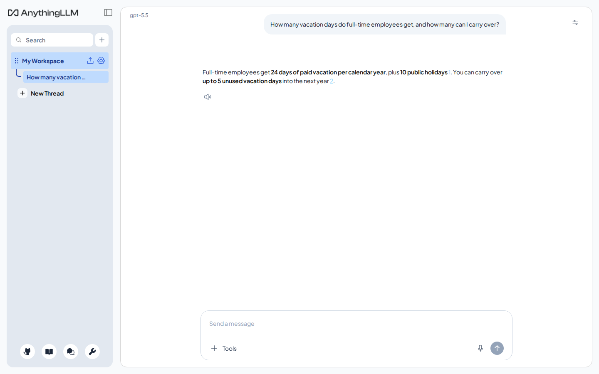

AnythingLLM's **Generic OpenAI** provider connects to PipesHub. AnythingLLM workspaces then answer with PipesHub's assistant, grounded in the knowledge the token's user can see, with citations.

Tested with AnythingLLM 1.20 (Docker).

## Before you start

- A [personal access token](/developer/personal-access-tokens) with the `conversation:chat` scope. Everyone who chats in this AnythingLLM instance chats as the token's user.
- Your PipesHub URL. If AnythingLLM runs in Docker on the same machine as PipesHub, use `http://host.docker.internal:<port>` instead of `localhost`.

## Set up

<Steps>
  <Step title="Choose Generic OpenAI">
    During onboarding, on **LLM Preference**, search for and select **Generic OpenAI**. On an instance that is already set up, open **Settings → AI Providers → LLM** and pick **Generic OpenAI** as the **LLM Provider**.
  </Step>
  <Step title="Enter the PipesHub settings">
    - **Base URL**: `https://your-pipeshub-instance.com/api/v1/openai`
    - **API Key**: your token
    - **Selected Model**: AnythingLLM loads the model list from PipesHub once the URL and key are in. Pick one.
    - **Model context window**: the context window of that model, such as `128000`
    - **Max Tokens**: any value, such as `4096`. PipesHub ignores it.

    <Frame>
      
    </Frame>

    On the settings page, save your changes.

    <Frame>
      
    </Frame>
  </Step>
  <Step title="Chat">
    Open a workspace and ask a question. The numbered markers in the answer are PipesHub's citations.

    <Frame>
      
    </Frame>
  </Step>
</Steps>

## Good to know

- **Documents you upload to an AnythingLLM workspace** are embedded by AnythingLLM and sent to PipesHub as text in the prompt. PipesHub also searches its own knowledge for every answer, so you don't need to copy PipesHub content into AnythingLLM.
- **Agent skills (`@agent`)** are not supported: PipesHub runs its own tools and does not call tools for AnythingLLM. Use normal chat.
- **Each message starts a new PipesHub conversation**, saved to the token user's chat history. AnythingLLM sends the recent chat history along, so the assistant still sees the thread.
