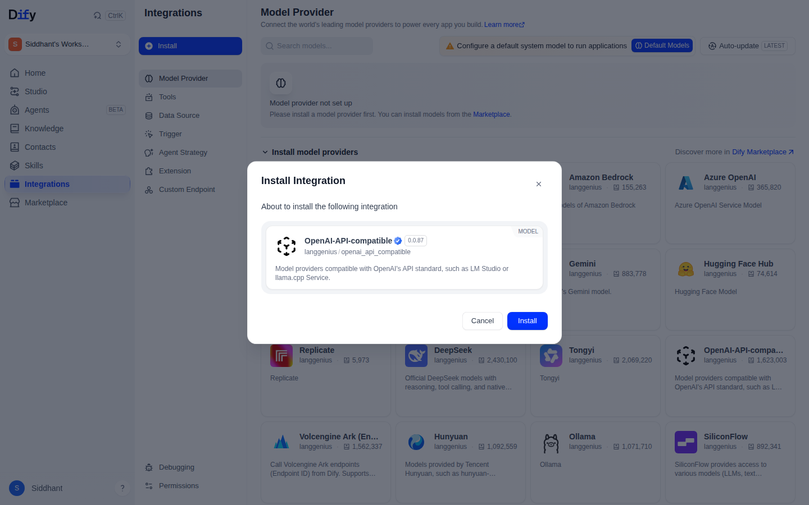
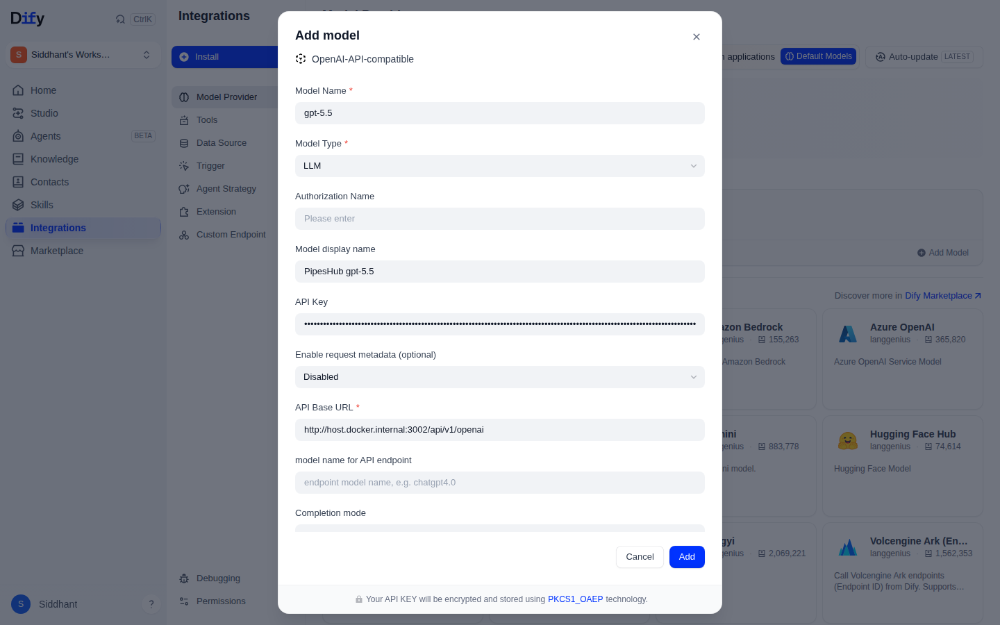
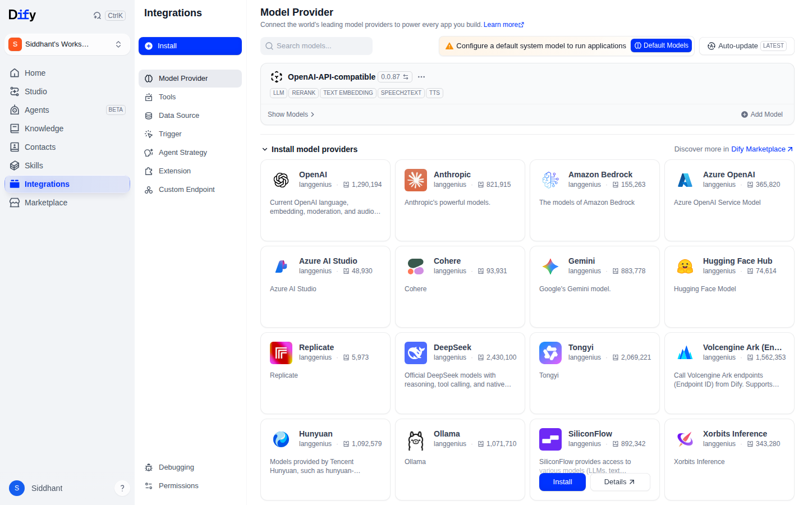
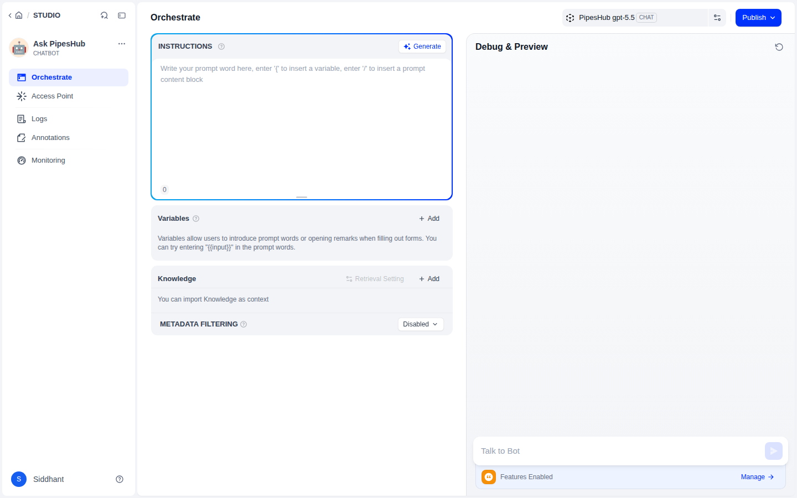
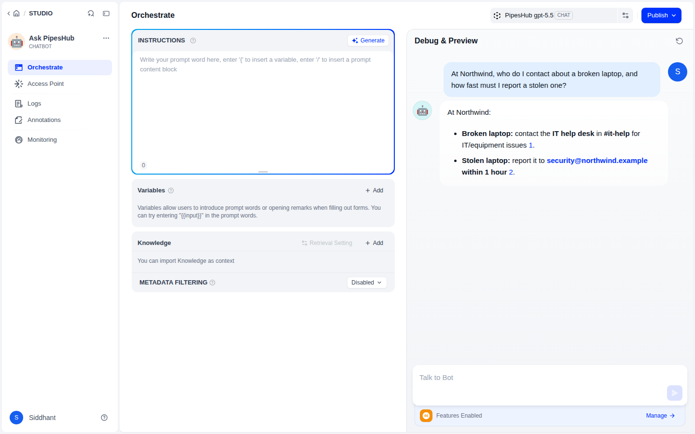

Dify's **OpenAI-API-compatible** model provider connects to PipesHub. Dify chatbots, workflows and text generators can then use a PipesHub model, and each answer comes from PipesHub's assistant, grounded in the knowledge the token's user can see.

Tested with Dify 1.20 (Docker) and the OpenAI-API-compatible plugin 0.0.87.

## Before you start

- A [personal access token](/developer/personal-access-tokens) with the `conversation:chat` scope. Every app that uses the model runs as the token's user.
- Your PipesHub URL, reachable from Dify's containers. Dify's Docker setup does not define `host.docker.internal`; if PipesHub runs on the same machine, use the machine's IP address, or add `host.docker.internal:host-gateway` under `extra_hosts` for the `plugin_daemon` service in a `docker-compose.override.yaml`.

## Set up

<Steps>
  <Step title="Install the provider">
    Open **Integrations → Model Provider**, find **OpenAI-API-compatible** under **Install model providers**, and select **Install**.

    <Frame>
      
    </Frame>
  </Step>
  <Step title="Add a PipesHub model">
    On the **OpenAI-API-compatible** card, select **Add Model** and fill in:

    - **Model Name**: a model id from PipesHub's `GET /api/v1/openai/models`, such as `gpt-5`
    - **Model Type**: **LLM**
    - **Model display name**: for example `PipesHub gpt-5`
    - **API Key**: your token
    - **API Base URL**: `https://your-pipeshub-instance.com/api/v1/openai`
    - **Model context size**: the context window of that model, such as `128000`
    - **Function Call Type**, **Structured Output**, **Vision Support**: leave at **Not Support**

    Select **Add**. Dify checks the settings by sending a short chat request, which runs PipesHub's assistant once.

    <Frame>
      
    </Frame>

    The model is listed under the provider. Repeat for each PipesHub model you want in Dify.

    <Frame>
      
    </Frame>
  </Step>
  <Step title="Use it in an app">
    In **Studio**, create a **Chatbot** (under **More basic app types**) and pick the PipesHub model in the model selector at the top.

    <Frame>
      
    </Frame>
  </Step>
  <Step title="Chat">
    Ask a question in **Debug & Preview**. The answer comes from PipesHub, with its citation links in the text.

    <Frame>
      
    </Frame>
  </Step>
</Steps>

## Good to know

- **Dify's Agent apps and tool nodes** rely on tool calling, which PipesHub does not do for clients. Use the PipesHub model in Chatbot apps and in LLM nodes.
- **You don't need Dify Knowledge.** PipesHub searches its own knowledge for every answer.
- **Each request starts a new PipesHub conversation**, saved to the token user's chat history.
