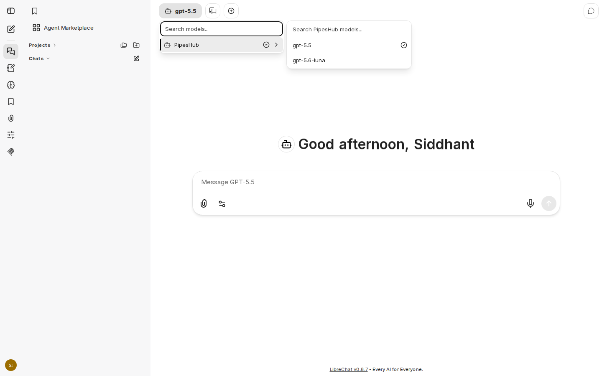
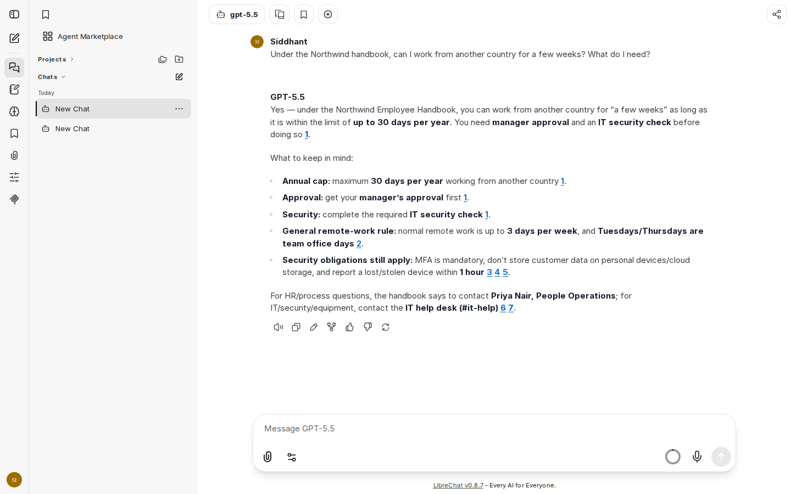

Add PipesHub to LibreChat as a custom endpoint in `librechat.yaml`. LibreChat then lists your organization's PipesHub models, and every answer comes from PipesHub's assistant, grounded in the knowledge the token's user can see.

Tested with LibreChat 0.8.7.

<Note>
  This page uses PipesHub as a **model** in LibreChat. To give LibreChat's own models PipesHub's search and record tools instead, connect the [PipesHub MCP server](/mcp/librechat).
</Note>

## Before you start

- A [personal access token](/developer/personal-access-tokens) with the `conversation:chat` scope. Everyone who uses this endpoint chats as the token's user. To have each LibreChat user enter their own token, set `apiKey: "user_provided"` instead.
- Your PipesHub URL. If LibreChat runs in Docker on the same machine as PipesHub, use `http://host.docker.internal:<port>` instead of `localhost`.

## Set up

<Steps>
  <Step title="Add the endpoint">
    Add PipesHub under `endpoints.custom` in `librechat.yaml`:

    ```yaml librechat.yaml
    endpoints:
      custom:
        - name: "PipesHub"
          apiKey: "${PIPESHUB_TOKEN}"
          baseURL: "https://your-pipeshub-instance.com/api/v1/openai"
          models:
            default: ["gpt-5"]  # shown if the model list can't be fetched
            fetch: true         # load the model list from PipesHub
          titleConvo: false
          summarize: false
          modelDisplayLabel: "PipesHub"
    ```

    `titleConvo: false` and `summarize: false` stop LibreChat from sending extra requests to name and summarize conversations. Each of those would run PipesHub's assistant again and save another conversation.
  </Step>
  <Step title="Add the token and restart">
    Put the token in LibreChat's `.env`, then restart LibreChat:

    ```bash .env
    PIPESHUB_TOKEN=phpat_...
    ```
  </Step>
  <Step title="Pick a model">
    Open the model picker. **PipesHub** is listed with the models from your organization.

    <Frame>
      
    </Frame>
  </Step>
  <Step title="Chat">
    Ask a question. The answer cites the PipesHub records it used.

    <Frame>
      
    </Frame>
  </Step>
</Steps>

## Good to know

- **LibreChat agents and tools** (code interpreter, web search, MCP tools on this endpoint) rely on tool calling, which PipesHub does not do for clients. Use plain chat with PipesHub models.
- **Files you attach** in LibreChat are handled by LibreChat. PipesHub reads the text of the messages and searches its own knowledge.
- **Each message starts a new PipesHub conversation**, saved to the token user's chat history. LibreChat sends the earlier messages along, so the assistant still sees the thread.
