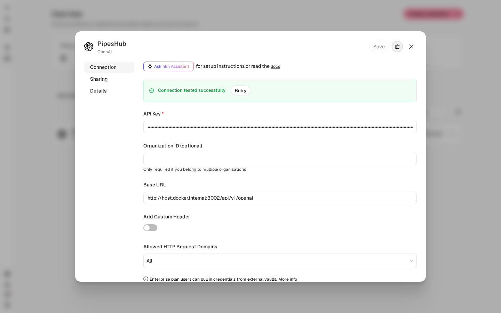
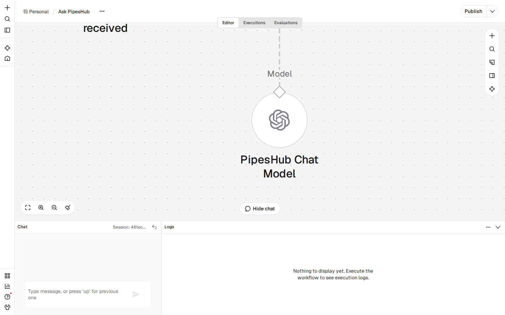
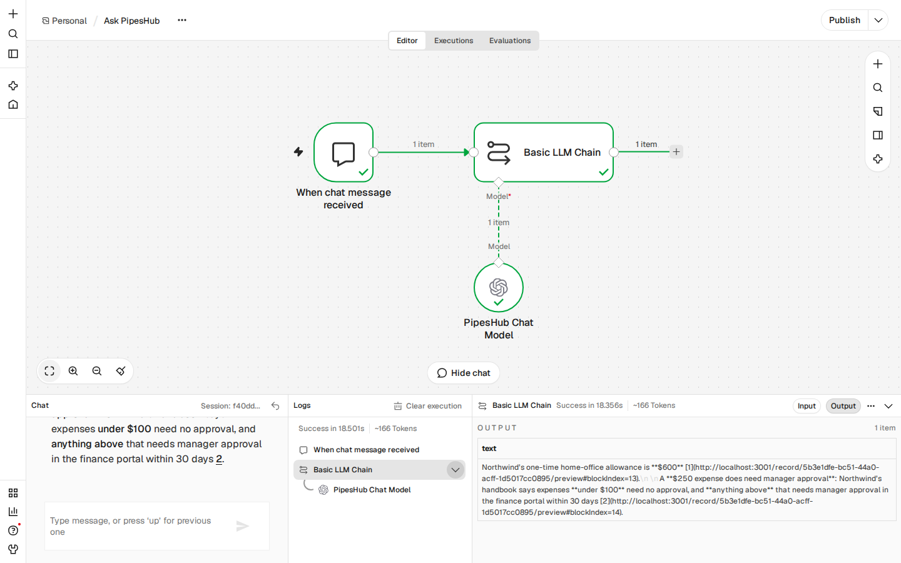

n8n's OpenAI credential takes a base URL, so the **OpenAI Chat Model** node can run on PipesHub. Any workflow that uses that model, such as a chat or a step that answers a question from a form, a ticket or an email, then gets answers from PipesHub's assistant, grounded in the knowledge the token's user can see.

Tested with n8n 2.48.

## Before you start

- A [personal access token](/developer/personal-access-tokens) with the `conversation:chat` scope. The workflow runs as the token's user.
- Your PipesHub URL. If n8n runs in Docker on the same machine as PipesHub, use `http://host.docker.internal:<port>` instead of `localhost`.

## Set up

<Steps>
  <Step title="Create the credential">
    Open **Overview → Create credential**, pick **OpenAI**, and fill in:

    - **API Key**: your token
    - **Base URL**: `https://your-pipeshub-instance.com/api/v1/openai`

    Name it (for example **PipesHub**) and select **Save**. n8n checks the connection by listing PipesHub's models and shows **Connection tested successfully**.

    <Frame>
      
    </Frame>
  </Step>
  <Step title="Build the workflow">
    Add a **Chat Trigger** (**When chat message received**) and a **Basic LLM Chain**. On the chain's **Model** input, add an **OpenAI Chat Model** node, and in it:

    - **Credential**: the PipesHub credential
    - **Model**: pick a PipesHub model from the list
    - **Use Responses API**: on or off; both work

    <Frame>
      
    </Frame>
  </Step>
  <Step title="Chat">
    Select **Open chat** at the bottom of the canvas and ask a question. The answer comes from PipesHub, with its citation links in the text.

    <Frame>
      
    </Frame>
  </Step>
</Steps>

## Good to know

- **Use the Basic LLM Chain rather than the AI Agent node.** PipesHub never calls the tools you attach to an AI Agent; its assistant already searches your knowledge and uses its own tools for every answer.
- **Built-in Tools** on the OpenAI Chat Model node (web search, file search) are OpenAI features; leave them empty.
- **Each run starts a new PipesHub conversation**, saved to the token user's chat history. Add a memory node to the chain to send earlier messages along.
