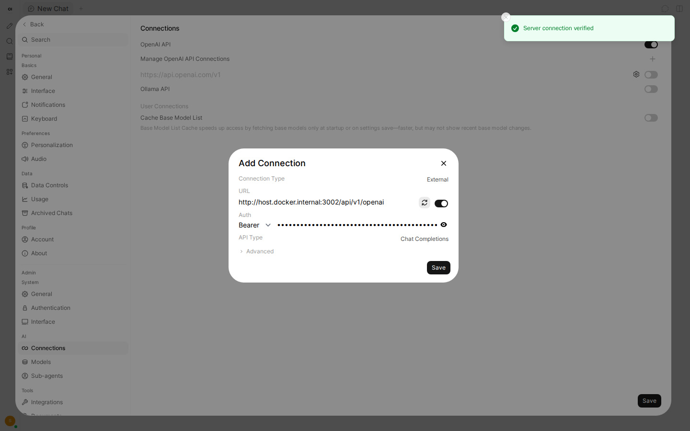
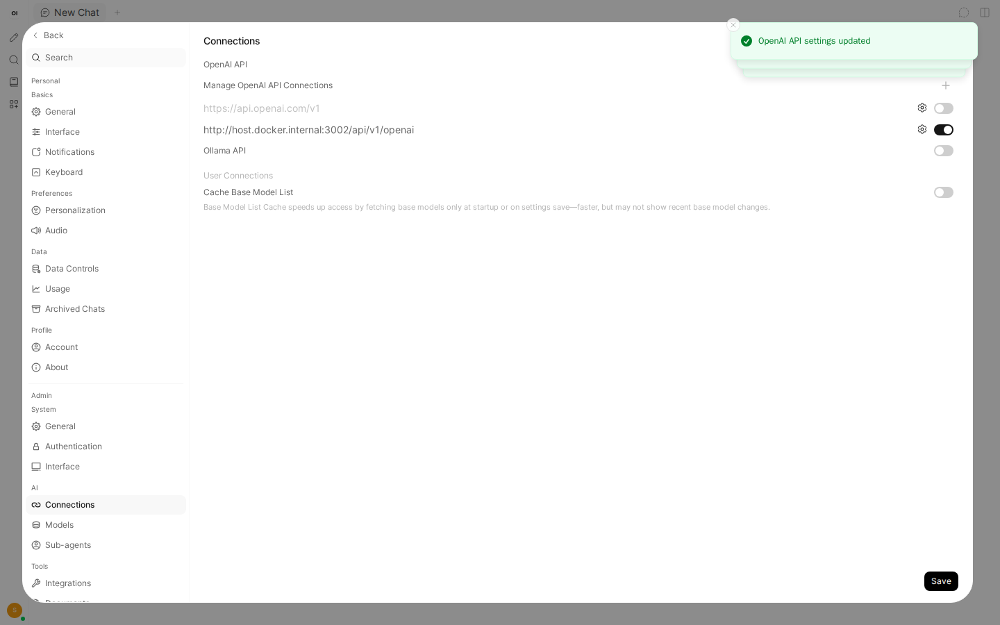
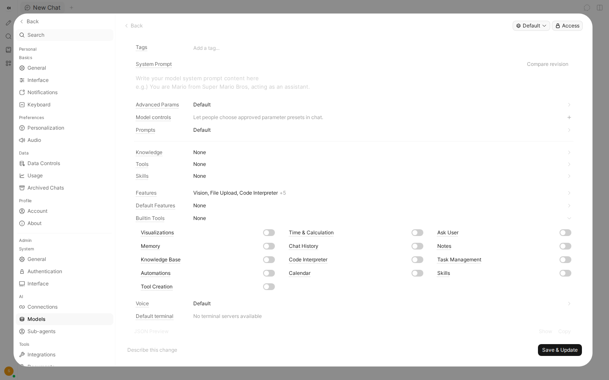
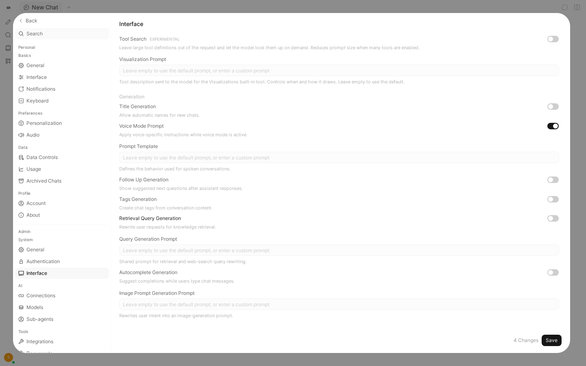
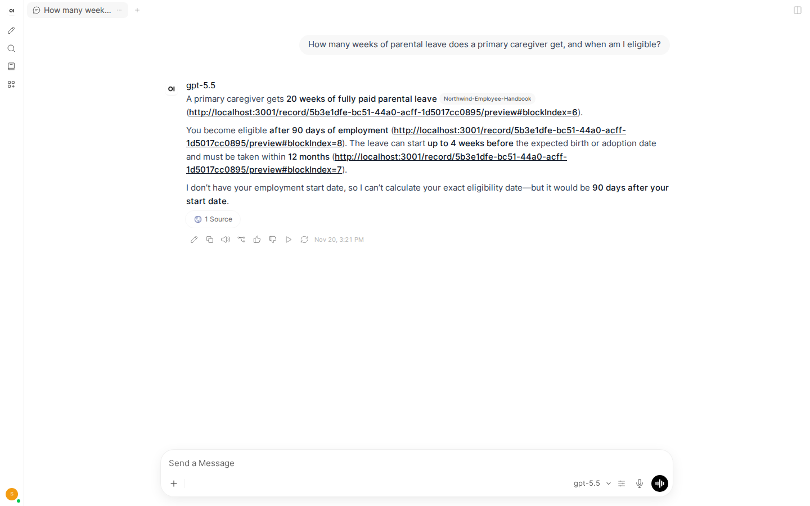

Add PipesHub to Open WebUI as an OpenAI connection. Your organization's PipesHub models then show up in Open WebUI's model picker, and every answer comes from PipesHub's assistant, grounded in what the token's user can see, with citations.

Tested with Open WebUI 0.13.

## Before you start

- A [personal access token](/developer/personal-access-tokens) with the `conversation:chat` scope. Everyone who uses this connection chats as the token's user, so for a shared Open WebUI, each person can add their own connection under **Settings → Connections** instead (if an admin turns on **User Connections**).
- Your PipesHub URL. If Open WebUI runs in Docker on the same machine as PipesHub, use `http://host.docker.internal:<port>` instead of `localhost`.

## Set up

<Steps>
  <Step title="Add the connection">
    Open **Admin Panel → Settings → Connections**. Next to **Manage OpenAI API Connections**, select **+** and fill in:

    - **URL**: `https://your-pipeshub-instance.com/api/v1/openai`
    - **Auth**: **Bearer**, with your token
    - **API Type**: **Chat Completions**

    Select the **Verify Connection** icon next to the URL. Open WebUI shows **Server connection verified**. Select **Save**.

    <Frame>
      
    </Frame>
  </Step>
  <Step title="Save the connections">
    The PipesHub connection appears in the list. Turn off connections you don't use, such as the default `https://api.openai.com/v1`, then select **Save**.

    <Frame>
      
    </Frame>
  </Step>
  <Step title="Turn off built-in tools for the PipesHub models">
    Open **Admin Panel → Settings → Models** and select a PipesHub model. Under **Builtin Tools**, turn every tool off, then select **Save & Update**. Repeat for each PipesHub model.

    PipesHub's assistant uses its own tools and ignores tools sent by the client. Open WebUI's built-in tool definitions also contain text in angle brackets (such as `<id>`), which PipesHub refuses with `400`, so with them on, chats fail.

    <Frame>
      
    </Frame>
  </Step>
  <Step title="Turn off background tasks">
    Open **Admin Panel → Settings → Interface**. Under **Generation**, turn off **Title Generation**, **Follow Up Generation**, **Tags Generation** and **Retrieval Query Generation**, then select **Save**.

    Open WebUI sends these tasks to the chat model after each message. Sent to PipesHub, each one would run the assistant again and save another conversation, and their prompts use angle-bracket tags that PipesHub refuses. If you have another, non-PipesHub model in Open WebUI, you can instead pick it as the **Task Model** in the same section.

    <Frame>
      
    </Frame>
  </Step>
  <Step title="Chat">
    Start a new chat, pick a PipesHub model in the model picker, and ask a question. The answer cites the PipesHub records it used, and the sources are listed under it.

    <Frame>
      
    </Frame>
  </Step>
</Steps>

## Good to know

- **The answer appears all at once**, when the assistant finishes. While it searches, Open WebUI shows the loading state.
- **Each message starts a new PipesHub conversation.** Open WebUI sends the earlier messages along, so the assistant still sees the thread. The conversations are saved to the token user's PipesHub chat history.
- **Open WebUI's own knowledge, web search and file features** run in Open WebUI, not in PipesHub. PipesHub only reads the text of the messages.
