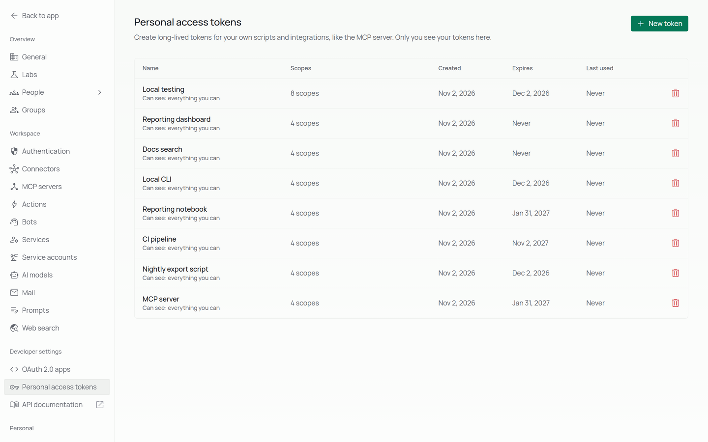
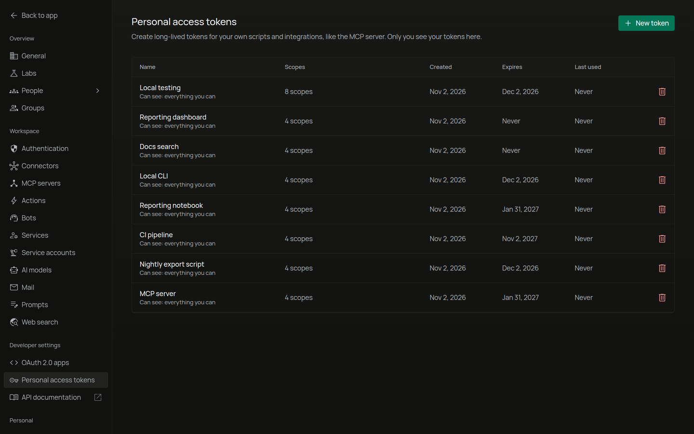
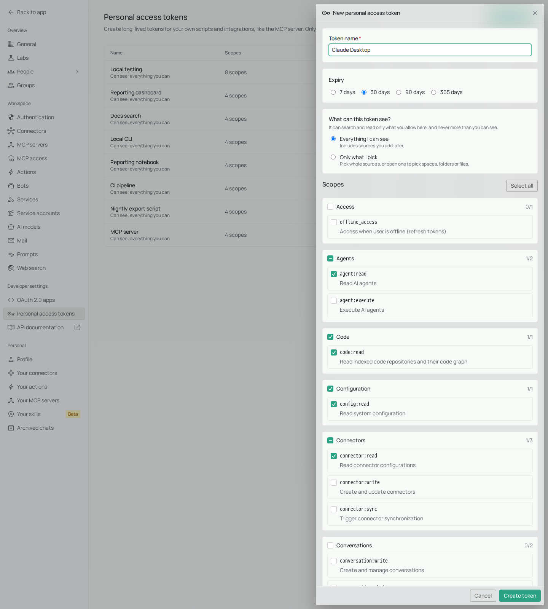
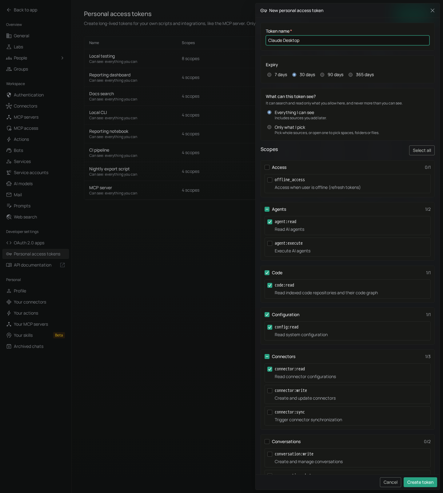
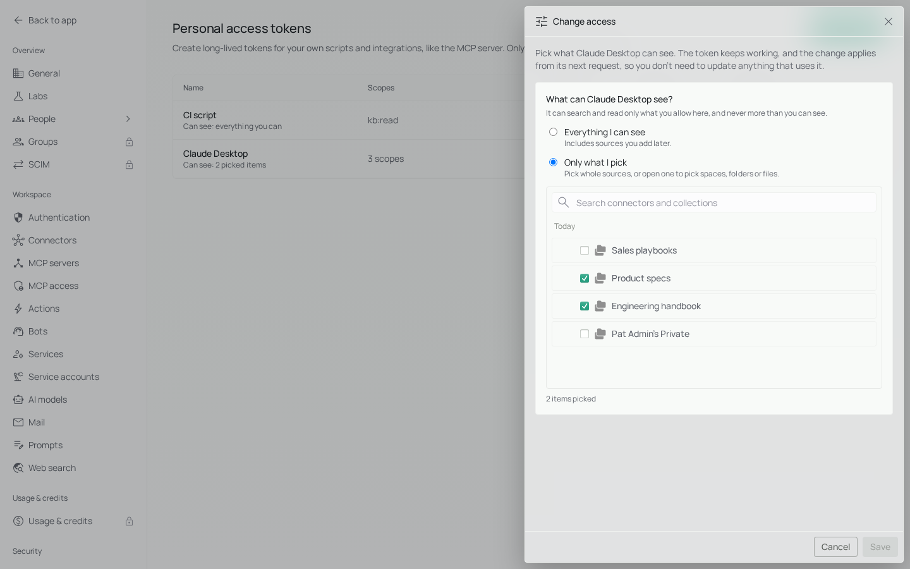
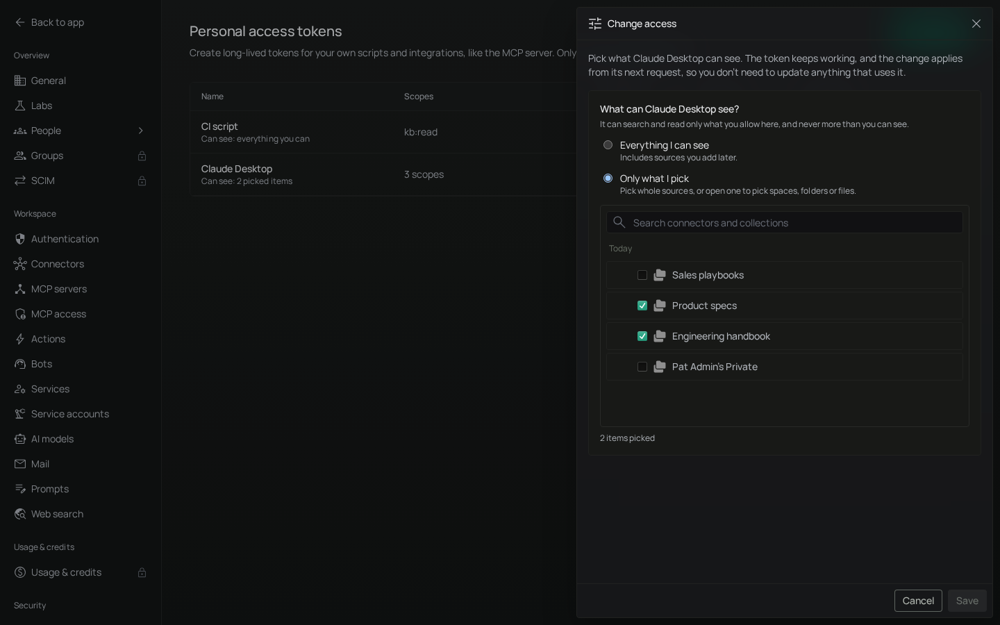

A **personal access token (PAT)** is a long-lived, scoped, revocable credential that you create for yourself. Unlike a session token, it doesn't expire after a day. Unlike an [OAuth 2.0 app](/developer/oauth2), it authenticates as **you**: every request made with it respects your own per-user permissions, not an app's.

Use a PAT when you want to connect something to PipesHub programmatically — most commonly, an MCP client (see [MCP Server Overview](/mcp/overview)) — without setting up an OAuth app or scraping a short-lived session token.

<Note>
  PATs are self-service: **any org member** can create their own, no administrator involvement required.
</Note>

---

## Personal access tokens vs. OAuth apps

| | Personal access token | OAuth 2.0 app |
|---|---|---|
| **Acts as** | You, the creator | With `authorization_code`, the person who approved the app. With `client_credentials`, a **service account** an admin picks when creating the app; the app cannot be saved without one |
| **Who can create one** | Any org member | Any org member. Only an admin can create an app that uses `client_credentials` |
| **Setup** | One click, no redirect URIs | Register an app, configure redirect URIs and grant types |
| **Limit what it can see** | You pick when you create it, and can [change it later](#change-what-a-token-can-see) without replacing the token | The app's creator picks for everyone who connects it |
| **Best for** | Personal scripts, MCP clients, quick integrations | Third-party apps, multi-user integrations, machine-to-machine services |

If you're connecting your own tooling and want it to see exactly what you can see, use a PAT. If you're building something other people in the org will authorize separately, use an [OAuth 2.0 app](/developer/oauth2).

---

## Create a personal access token

### Step 1: Open personal access tokens

1. Sign in to your PipesHub account
2. Open **Workspace settings**
3. Select **Personal access tokens** under **Developer settings**

<Frame>
  
  
</Frame>

### Step 2: Create a new token

Click **New token**. The **New personal access token** panel opens:

<Frame>
  
  
</Frame>

| Field | Required | Description |
|-------|----------|-------------|
| **Token name** | Yes | A label to help you recognize the token later (e.g. `Claude Desktop`, `CI script`), 1–100 characters. |
| **Expiry** | Yes | `7 days`, `30 days`, `90 days` or `365 days`. **30 days** is selected when the panel opens. |
| **What can this token see?** | No | **Everything I can see** (includes sources you add later) or **Only what I pick** (whole sources, or spaces, folders or files inside one). The token never sees more than you can: see [Granular permissions](/developer/granular-permissions). You can [change this later](#change-what-a-token-can-see). |
| **Scopes** | Yes | Which permissions the token carries, grouped by category. Every scope your instance offers (its `MCP_SCOPES` set) is selected when the panel opens; keep at least one. Use **Clear all** / **Select all** to toggle every scope at once. |

<Note>
  Every new token expires. Pick the shortest expiry that fits how you'll use it; you can always create a new token later. Tokens created before expiry became required keep the expiry they were created with.
</Note>

### Step 3: Copy the token

PipesHub generates the token and shows it to you **exactly once**, along with a ready-to-paste block for connecting an MCP client:

```
PIPESHUB_MCP_URL=https://your-pipeshub-instance.com/mcp
PIPESHUB_MCP_TOKEN=phpat_eyJhbGciOiJIUzI1NiIs...
```

<Warning>
  Copy and store the token immediately. Only its hash is stored server-side — if you lose it, you'll need to revoke it and create a new one.
</Warning>

<Tip>
  The `phpat_` prefix is intentional and display-only — it makes personal access tokens easy to recognize in logs, config files, and secret-scanning tools, unlike a bare JWT. It's stripped automatically before the token is verified, so nothing else about how you use the token changes.

  If a `phpat_` token returns 401, your instance predates the prefix-stripping fix — upgrade PipesHub. Until you can, store the token without the `phpat_` prefix and add it back afterwards.
</Tip>

`PIPESHUB_MCP_TOKEN` is the same value you'll pass as `--bearer-auth` or in an `Authorization: Bearer` header below — the paste block just saves you from copying it twice.

<Note>
  This block is for MCP clients and the [local stdio server](/mcp/local-server). **QM expects different names**: the bare token as `PIPESHUB_TOKEN`, and the origin with no `/mcp` path as `PIPESHUB_BASE_URL`, on two personal keychain entries. Pasting this block into QM's keychain fails in a way that looks like a missing environment variable rather than a wrong one.
</Note>

---

## Use a personal access token

Send it as a standard bearer token on PipesHub API requests, including the [MCP endpoint](/mcp/overview). A few account-security actions are the exception (see below):

```bash
curl -X POST https://your-pipeshub-instance.com/mcp \
  -H "Authorization: Bearer phpat_YOUR_TOKEN" \
  -H "Content-Type: application/json" \
  -d '{"jsonrpc":"2.0","id":1,"method":"tools/list"}'
```

For the local stdio MCP server, or any MCP client that takes a bearer token (see [Local Server (Stdio)](/mcp/local-server)), pass the PAT as `YOUR_BEARER_TOKEN`, with `PIPESHUB_API_URL` set to your instance URL followed by `/api/v1`:

```bash
npx -y @pipeshub-ai/mcp start \
  --server-url PIPESHUB_API_URL \
  --bearer-auth phpat_YOUR_TOKEN
```

A PAT is verified the same way as a session token, just with a longer lifetime and no OAuth flow to obtain it.

<Note>
  **Some actions need you signed in yourself.** A PAT, or an access token issued to an OAuth app, is refused with **403 Forbidden** on every personal access token and OAuth app endpoint, including listing, reading, deleting and regenerating a client secret, and on the requests that approve or look up an OAuth or device sign-in. Use a signed-in session for these: the PipesHub web app, or a session token on these APIs, as in the [admin examples](#admin-visibility-and-revocation) below. This stops a token that was granted a few scopes from reading secrets or creating a new token or app with more.
</Note>

It is **not** equivalent to being logged in. Session tokens skip scope checks entirely; PATs are enforced against the scopes you granted. A PAT can only do what you selected when you created it, which is why granting fewer scopes is worth the extra moment.

---

## Manage your tokens

The **Personal access tokens** page lists every active token you've created, with its name, what it can see, scopes, creation date, expiry, and last-used time. An older token created without an expiry shows `Never`.

### Change what a token can see

You can narrow or widen what a token can see at any time. The token keeps working with the same secret, so nothing that uses it needs updating.

<Frame>
  
  
</Frame>

<Steps>
  <Step title="Open Change access">
    On the **Personal access tokens** page, click the **Change access** icon next to the token. On a phone, tap **Change access** on the token's card.
  </Step>
  <Step title="Pick what the token can see">
    Choose **Everything I can see**, or **Only what I pick** and select whole sources, or spaces, folders or files inside one. **Save** turns on once your choice differs from the current one.
  </Step>
  <Step title="Save">
    Click **Save**. The change applies from the token's next request. The confirmation has an **Undo** button if you change your mind.
  </Step>
</Steps>

<Note>
  A token can never change its own access. Only you can, signed in to PipesHub. The token still never sees more than you can: if you lose access to a source, so does the token.
</Note>

### Revoke a token

Click the revoke icon next to a token, then **Revoke** in the **Revoke token?** dialog. Revocation takes effect **immediately**: any request using that token (including one already in flight) is rejected on its next verification.

<Warning>
  Revocation is irreversible. Anything using the revoked token will need a new one.
</Warning>

---

## Admin visibility and revocation

Because a PAT can live for months or years, an org admin needs a way to see and revoke tokens they didn't create themselves — for example, when someone leaves the org or a laptop is compromised. This is available today via the API (no dedicated admin UI page yet):

<CodeGroup>
```bash List every active PAT in the org
curl -X GET "https://your-pipeshub-instance.com/api/v1/personal-access-tokens/admin?page=1&limit=100" \
  -H "Authorization: Bearer YOUR_SESSION_TOKEN"
```

```bash Revoke any user's token by id
curl -X DELETE https://your-pipeshub-instance.com/api/v1/personal-access-tokens/admin/TOKEN_ID \
  -H "Authorization: Bearer YOUR_SESSION_TOKEN" \
  -H "Content-Type: application/json" \
  -d '{"reason": "departed employee"}'
```
</CodeGroup>

Both endpoints are for organization admins only. A non-admin gets `403` with the message "You need admin access to do this. Ask an admin in your organisation." The list is paginated (`page`, `limit`, up to 100 per page) and includes each token's owner — including tokens whose owner has since been removed from the org, which still appear so they can be cleaned up.

<Note>
  **Response shape:** the admin list is **not** the same shape as your own token list. It's wrapped in `data`/`pagination`, and each item carries owner fields the self-service list doesn't:

  ```json
  {
    "data": [
      {
        "id": "665f1a2b3c4d5e6f7a8b9c0d",
        "name": "Claude Desktop",
        "scopes": ["kb:read", "semantic:write"],
        "createdAt": "2026-05-01T12:00:00.000Z",
        "expiresAt": "2026-05-31T12:00:00.000Z",
        "lastUsedAt": "2026-06-10T08:15:00.000Z",
        "userId": "665f0a1b2c3d4e5f6a7b8c9d",
        "ownerEmail": "jane@example.com",
        "ownerFullName": "Jane Doe",
        "ownerDeleted": false
      }
    ],
    "pagination": { "page": 1, "limit": 100, "total": 1, "totalPages": 1 }
  }
  ```

  Your own `GET /api/v1/personal-access-tokens` returns `{ "tokens": [...] }` instead — a flat array with no `userId`/owner fields, since it's implicitly scoped to you. `ownerDeleted: true` means the token's owner has been removed from the org; `ownerEmail`/`ownerFullName` still reflect their last-known values in that case, for auditing.
</Note>

<Note>
  A deleted user's own personal access tokens stop authenticating automatically — this admin flow is for auditing and proactive cleanup, not something you need to remember to do on every offboarding.
</Note>

---

## API endpoints reference

| Endpoint | Method | Description |
|----------|--------|-------------|
| `/api/v1/personal-access-tokens` | `POST` | Create a new personal access token |
| `/api/v1/personal-access-tokens` | `GET` | List your own active tokens |
| `/api/v1/personal-access-tokens/{tokenId}` | `PATCH` | Change what one of your own tokens can see |
| `/api/v1/personal-access-tokens/{tokenId}` | `DELETE` | Revoke one of your own tokens |
| `/api/v1/personal-access-tokens/scopes` | `GET` | List the scopes available to grant, grouped by category |
| `/api/v1/personal-access-tokens/admin` | `GET` | **Admin only.** List every active token in the org, paginated |
| `/api/v1/personal-access-tokens/admin/{tokenId}` | `DELETE` | **Admin only.** Revoke any user's token by id |

Every endpoint in this table needs a signed-in session token. A PAT or OAuth access token gets **403 Forbidden**.

### Request bodies

**`POST /api/v1/personal-access-tokens`**

```json
{
  "name": "Claude Desktop",
  "scopes": ["kb:read", "semantic:write"],
  "expiryDays": 30,
  "knowledgeLimit": {
    "apps": ["3f1c2a4e-9b7d-4c1a-8e2f-5a6b7c8d9e0f"],
    "recordGroups": [],
    "records": []
  }
}
```

| Field | Required | Description |
|-------|----------|--------------|
| `name` | Yes | 1–100 characters |
| `scopes` | No | Defaults to your instance's full configured `MCP_SCOPES` set if omitted |
| `expiryDays` | No | `7`, `30`, `90` or `365`. Defaults to `30` if omitted |
| `knowledgeLimit` | No | What the token can see. `apps` are whole sources and collections, `recordGroups` are spaces, drives or projects, and `records` are folders or files (with everything under them), all by id. Name between 1 and 50 ids in all. Omit it for everything you can see |

**`PATCH /api/v1/personal-access-tokens/{tokenId}`**

```json
{
  "knowledgeLimit": {
    "apps": [],
    "recordGroups": [],
    "records": ["8a7b6c5d-4e3f-4a1b-9c8d-7e6f5a4b3c2d"]
  }
}
```

`knowledgeLimit` is required: send a limit in the same shape as above, or `null` to let the token see everything you can. The response is `{ "token": { ... } }`, the token as it appears in your token list. A token that is revoked, expired or not yours returns `404`.

**`DELETE /api/v1/personal-access-tokens/{tokenId}`** and **`DELETE .../admin/{tokenId}`**

Both accept an optional body:

```json
{ "reason": "rotated" }
```

`reason` is stored alongside the revocation for auditing — it's not required.

---

## Security notes

<CardGroup cols={2}>

<Card title="One-time display" icon="eye-slash">
  The raw token is shown only at creation time. Only its hash is stored — PipesHub can't show it to you again if you lose it.
</Card>

<Card title="Scanner-friendly prefix" icon="magnifying-glass">
  The `phpat_` prefix makes tokens easy to grep for in logs and files, and to catch with secret-scanning tools before they're committed somewhere they shouldn't be.
</Card>

<Card title="Short default expiry" icon="clock">
  New tokens default to 30 days, and every new token expires.
</Card>

<Card title="Limit what it can see" icon="filter">
  Keep a token to the sources it needs. You can narrow or widen it later without replacing it.
</Card>

<Card title="Immediate revocation" icon="ban">
  Revoking a token — by you or an admin — takes effect on the token's next use, not after some delay.
</Card>

</CardGroup>

---

## FAQ

<AccordionGroup>

<Accordion title="What scopes can a personal access token have?">
By default, a PAT gets your instance's full configured `MCP_SCOPES` set — the same scopes exposed to MCP clients (see [Customizing Default Scopes](/mcp/overview#customizing-default-scopes)). You can select a narrower set at creation time via the scope picker.
</Accordion>

<Accordion title="Do I need to update my tools after changing what a token can see?">
No. The token and its secret stay the same. The new access applies from the token's next request, so an MCP client or script keeps working and simply sees the sources you picked. A chat or agent answer that is already being written when you save finishes with the access it started with.
</Accordion>

<Accordion title="How is this different from a session token?">
A session token is issued when you log in and expires after a short, fixed window (24 hours) — it's meant for browser sessions, not long-running integrations. A PAT is created deliberately, can live far longer, and can be revoked independently without logging you out everywhere else.
</Accordion>

<Accordion title="Can I see other users' personal access tokens?">
No, unless you're an org admin. Regular users can only see and revoke tokens they created themselves. Admins can list and revoke any user's token via the [admin API](#admin-visibility-and-revocation) for incident response.
</Accordion>

<Accordion title="What happens to my tokens if I'm removed from the org?">
They stop authenticating immediately — PipesHub rejects a personal access token whose owning user has been deleted, the same way it would reject an expired one.
</Accordion>

<Accordion title="Is there a limit on how many tokens I can create?">
There's no fixed limit on creation, but the list view shows up to 100 of your most recent active tokens.
</Accordion>

</AccordionGroup>
