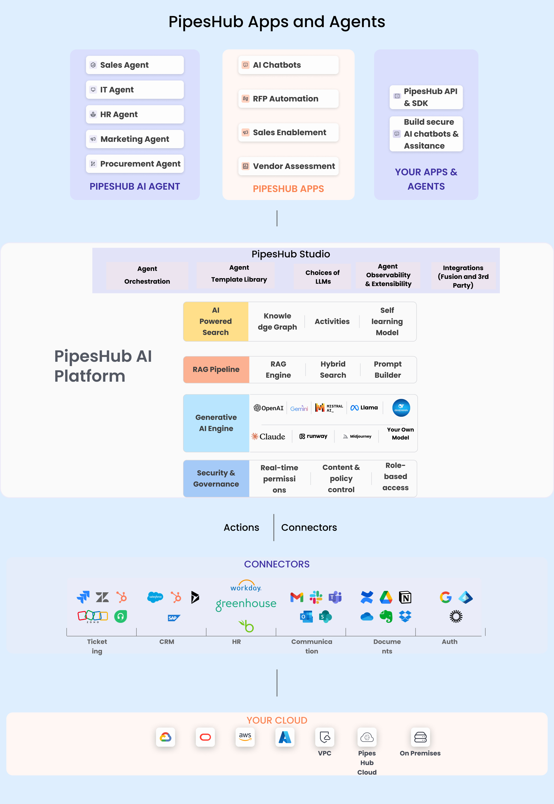

## What is PipesHub

[PipesHub](https://github.com/pipeshub-ai/pipeshub-ai) is an open-source context layer for AI agents and an enterprise search platform.

Company knowledge is spread across Slack, Google Drive, Jira, Confluence, GitHub, Microsoft 365 and dozens of other apps. PipesHub connects to them and indexes their content into a knowledge graph and a search index. Where an app records who can see what, as Slack, Google Drive, Jira, Confluence, GitHub and Microsoft 365 do, PipesHub follows those permissions. Some connectors can't, which widens who can search what they sync: with a team connector for S3-compatible storage, Azure Blob or SMB file shares, everyone in your organization can search the synced files, and the Notion team connector makes synced pages searchable by every member of that Notion workspace. Each [connector's page](/connectors/overview) says exactly who can search what it syncs, including exceptions such as the person who sets up Slack, who can search every channel it syncs.

Your people use it as **enterprise search**: ask in plain language and get answers with citations to the exact source. Your AI agents use the same context through **MCP**, the SDKs and the API, so Claude Code, Cursor or your own agents answer from company knowledge instead of guessing. You can also build agents that act in those apps, without code.

Run it yourself (Apache 2.0) or use [PipesHub Cloud](https://app.pipeshub.com/?ref=docs).

PipesHub Agents are built on top of PipesHub Actions, which connect with enterprise apps to automate any task.

#### See it in action

In two and a half minutes: Claude Code answering from Jira, Slack, GitHub and Drive through PipesHub; the same question asked for two people, where only the one allowed to see the pricing strategy gets it; and cited answers inside PipesHub.

<iframe
  className="w-full aspect-video rounded-xl"
  src="https://www.youtube.com/embed/VgyND38QZ7w"
  title="PipesHub demo: company context for AI agents"
  frameborder="0"
  allow="accelerometer; autoplay; clipboard-write; encrypted-media; gyroscope; web-share; fullscreen; picture-in-picture 'none';"
  allowfullscreen
></iframe>

#### PipesHub High Level Architecture Diagram

<Frame>
  
</Frame>

### **Spotlight Features**

#### Product tour
<iframe
  width="580"
  height="315"
  src="https://www.youtube.com/embed/PJ_b7IFhnsc?si=59K-qYpl4tGESmBj"
  title="PipesHub product tour"
  frameborder="0"
  allow="accelerometer; autoplay; clipboard-write; encrypted-media; gyroscope; picture-in-picture; web-share; fullscreen;"
  allowfullscreen
></iframe>

## Unmatched Value of PipesHub
- **Choose Any Model, Your Way** – Bring your preferred deep learning models for both indexing and inference with total flexibility.
- **Real-Time or Scheduled Indexing** – Index data as it flows or schedule it to run exactly when you need. 
- **Access-Driven Visibility** – Where a source records permissions, PipesHub follows them. Each connector's page says who can search what it syncs, including connectors that can't read source permissions and exceptions such as the person who sets up Slack.
- **Built-In Data Security** – Sensitive information stays secure, always..
- **Deploy Anywhere** – Fully supports both on-premise and cloud-based deployments.
- **Knowledge Graph Backbone** – All data is seamlessly structured into a powerful knowledge graph.
- **Enterprise-Grade Connectors** – Scalable, reliable, and built for secure access across your organization.
- **Modular & Scalable Architecture** – Every service is loosely coupled to scale independently and adapt to your needs.

## Roadmap

We ship in the open. Here is what is done and what is next:

**Shipped**
- **AI agents** — no-code agent builder
- **MCP** — Model Context Protocol, server and client
- **Developer SDKs** — Python, TypeScript, and Go
- **Code search** — [GitHub](/connectors/github/github) and [GitLab](/connectors/gitlab/gitlab)
- **Production Kubernetes** — [Helm chart](https://github.com/pipeshub-ai/pipeshub-ai/blob/main/deployment/helm/pipeshub-ai/README.md) with HA presets (Neo4j Community and Redis stay single-node)

**Next**
- **Personalized search** — based on team, role, and history
- **PageRank-augmented relevance** across the knowledge graph

[Full product roadmap on Notion](https://plum-myrtle-9f7.notion.site/Pipeshub-s-Product-Roadmap-33841c164f54803a9989fd0fdbfdb1ee)


## Deployment

PipesHub can be run locally or on any server with Docker Compose. One command:

```bash
curl -fsSL https://get.pipeshub.com/install | bash
```

See the [Quickstart](/quickstart) for HTTPS notes, installer flags, and the cloned-repo developer path.
