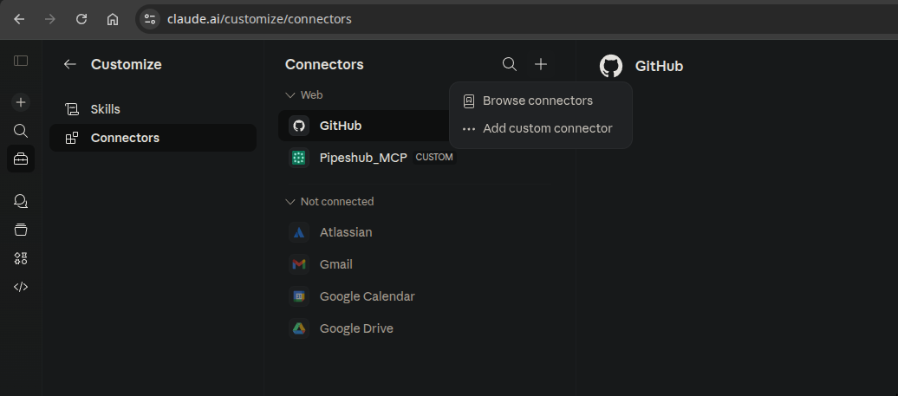

Claude.ai supports custom connectors via remote MCP servers. This lets you use PipesHub tools directly in the Claude.ai web interface without any local setup.

<Note>
  Free plan users are limited to one custom connector.
</Note>

<Warning>
  Claude.ai needs **public HTTPS**. It cannot attach to `http://localhost:.../mcp`. A laptop demo is [Local Docker demo](/for-agents-local-demo) plus Cursor / Claude Code / the stdio bridge — not this page.
</Warning>

## Choose how Claude signs in

The **Add custom connector** dialog asks how Claude authenticates. Pick one:

| Option in the dialog | What you need | Use it when |
|---|---|---|
| **Sign in now** (recommended) | Nothing. Claude registers itself with PipesHub. | Almost always. Each person signs in as themselves, so results follow their own permissions, and tokens refresh on their own. |
| **No sign-in** with a request header | A [personal access token](/developer/personal-access-tokens) | Your own individual Claude account, when you'd rather not sign in through a browser. |
| **Sign in now** with an OAuth app under **Advanced** | An OAuth app's Client ID and Client Secret | Dynamic client registration is turned off on your instance (`PIPESHUB_ENABLE_DCR=false`), or PipesHub is older than 1.2.0. |

**Sign in when needed** adds nothing here: PipesHub asks for sign-in on the first request, so it behaves like **Sign in now**.

## Sign in with your PipesHub account (recommended)

PipesHub 1.2.0 and later let Claude register itself through [dynamic client registration](/developer/oauth2#dynamic-client-registration), so no OAuth app is needed.

### Individual accounts (Free, Pro, Max)

<Frame caption="Claude.ai Connectors settings">
  
</Frame>

<Steps>
  <Step title="Open Connectors">
    Go to [claude.ai](https://claude.ai) and open **Customize > Connectors**.
  </Step>
  <Step title="Add a custom connector">
    Click **+**, then **Add custom connector**. Enter a name (for example `PipesHub`) and the MCP server URL:
    ```text
    PIPESHUB_INSTANCE_URL/mcp
    ```
    Click **Continue** if Claude asks.
  </Step>
  <Step title="Choose Sign in now">
    Under **Authentication**, choose **Sign in now**. Claude usually marks it **Detected**, because PipesHub advertises OAuth sign-in.
  </Step>
  <Step title="Add and sign in">
    Click **Add**. Claude opens PipesHub's sign-in and consent page (if it doesn't, click **Connect** on the connector). Once you approve, the connector is active and PipesHub tools are available in your conversations.
  </Step>
</Steps>

### Team and Enterprise plans

An organization **Owner** adds the connector once:

<Steps>
  <Step title="Open organization Connectors settings">
    Open **Organization settings > Connectors**.
  </Step>
  <Step title="Add a custom connector">
    Click **Add**, then **Custom**. If Claude asks for the connector type, choose **Web**. Enter the name and the MCP server URL: `PIPESHUB_INSTANCE_URL/mcp`.
  </Step>
  <Step title="Choose Sign in now">
    Under **Authentication**, choose **Sign in now**, then click **Add**.
  </Step>
</Steps>

Each **member** then connects with their own PipesHub account:

<Steps>
  <Step title="Open Connectors">
    Open **Customize > Connectors**.
  </Step>
  <Step title="Connect">
    Find the PipesHub connector (marked **Custom**) and click **Connect** to sign in through PipesHub.
  </Step>
</Steps>

## Use a personal access token

For an **individual** Claude account, you can skip the browser sign-in and send a [personal access token](/developer/personal-access-tokens) with every request.

<Warning>
  **Don't use a token on a Team or Enterprise organization connector.** Claude sends the same header for every member of the organization, so everyone would search PipesHub as the token's owner and see what that person can see. Use [Sign in now](#team-and-enterprise-plans) there instead.
</Warning>

<Note>
  Request headers are a beta feature in Claude. If the dialog has no **Request headers** section after you choose **No sign-in**, your account doesn't have it yet; use [Sign in now](#sign-in-with-your-pipeshub-account-recommended).
</Note>

<Steps>
  <Step title="Mint a token">
    In PipesHub, open **Workspace settings**, select **Personal access tokens** under **Developer settings**, and click **New token**. Name it (for example `claude-ai`), pick an expiry and the scopes, and copy the token (`phpat_…`). It is shown only once.
  </Step>
  <Step title="Add the connector">
    In Claude, open **Customize > Connectors**, click **+**, then **Add custom connector**. Enter a name and `PIPESHUB_INSTANCE_URL/mcp`.
  </Step>
  <Step title="Choose No sign-in and add the header">
    Under **Authentication**, choose **No sign-in**. Under **Request headers**, set:
    - **Header**: `authorization`
    - **Value**: `Bearer phpat_YOUR_TOKEN` — the word `Bearer`, one space, then the whole token. Claude sends the value exactly as you type it, and PipesHub ignores an `Authorization` header that doesn't start with `Bearer `.
    - Keep **Required** ticked.

    Claude may show "This server offers OAuth sign-in". That is a suggestion; the token still works.
  </Step>
  <Step title="Add">
    Click **Add**. No PipesHub sign-in page opens: Claude uses the token on every request.
  </Step>
</Steps>

Claude never shows the header value again and doesn't let you edit it. When the token expires or you revoke it, remove the connector and add it again with a new token.

## Use an OAuth app

Use this when dynamic client registration is off on your instance, or PipesHub is older than 1.2.0.

<Steps>
  <Step title="Create an OAuth app">
    Create an OAuth app in PipesHub with the redirect URI `https://claude.ai/api/mcp/auth_callback`, and note its **Client ID** and **Client Secret**. See [MCP Server Overview](/mcp/overview#step-1-create-an-oauth-app).
  </Step>
  <Step title="Enter the credentials">
    Add the custom connector as in [Sign in with your PipesHub account](#sign-in-with-your-pipeshub-account-recommended), choose **Sign in now**, then open **Advanced** and enter the **OAuth Client ID** and **OAuth Client Secret**.
  </Step>
  <Step title="Add and sign in">
    Click **Add**, sign in, and approve the consent page in PipesHub.
  </Step>
</Steps>

## Troubleshooting

<AccordionGroup>
  <Accordion title="Couldn't reach the server">
    Claude connects from Anthropic's servers, not from your browser. Check that the endpoint answers from the internet: `curl -X POST PIPESHUB_INSTANCE_URL/mcp` should return `401`, not a connection error or a challenge page.

    If PipesHub sits behind a firewall, WAF or bot protection (for example Cloudflare), allow Anthropic's outbound range `160.79.104.0/21` for `/mcp`, `/.well-known/*` and `/api/v1/oauth2/*`.
  </Accordion>
  <Accordion title="Sign-in fails before the PipesHub page opens">
    Dynamic client registration may be off on your instance. Ask an administrator to remove `PIPESHUB_ENABLE_DCR=false`, or [use an OAuth app](#use-an-oauth-app).
  </Accordion>
  <Accordion title="Every tool call fails with 401 when using a token">
    Check that the header value starts with `Bearer ` (capital B, one space) and that the token hasn't expired or been revoked. Remove the connector and add it again with the corrected value.
  </Accordion>
</AccordionGroup>

## Security notes

- Only connect to trusted MCP servers.
- Review the permissions requested on the PipesHub consent page.
- With **Sign in now**, Claude.ai acts on your behalf with an OAuth token — your password is never shared.
- A personal access token acts as you everywhere it is used. Give it only the scopes you need, and revoke it from **Personal access tokens** if it leaks.
