

  

    

      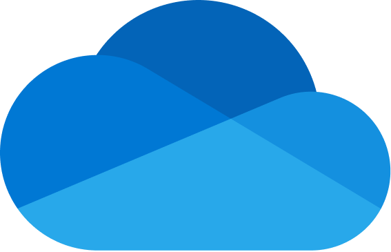
      
OneDrive actions

    

    
Cloud files, sharing, and OneNote notebooks

    

      
        Ready
      
      
        Microsoft 365
      
    

  

## Overview

The OneDrive action lets AI agents work with files in Microsoft OneDrive (and other drives you can access through Microsoft Graph), including shared libraries, downloads, sharing with people, and basic OneNote notebook operations. It uses delegated OAuth (user consent) so actions run as the signed-in user.

### Key Capabilities

- **Drives and browsing** - List drives, open the root folder, list folders and files, and fetch item metadata
- **Search** - Search within a drive by keyword; search across content shared with you
- **Shared with me** - List and search files others have shared with you without needing a drive ID first
- **File and folder actions** - Create folders, rename, move, and copy items (copy may complete asynchronously)
- **Sharing** - Invite specific people by email with read, write, or owner roles
- **Content and links** - Get short-lived download URLs; read file content (parsed text and structured output for many formats, subject to size limits)
- **New Word files** - Create a new `.docx` in a folder, optionally with initial text content
- **OneNote** - Create notebooks, sections, and pages; list notebook sections

Almost every operation that targets a specific drive needs a `drive_id`. Call `get_drives` first when the drive is unknown.

---

## Available Tools

### Drive and navigation

| Tool | Description |
|------|-------------|
| `get_drives` | List drives you can use; call first when `drive_id` is unknown |
| `get_drive` | Get metadata for one drive (for example quota and owner) |
| `get_root_folder` | Get the root drive item for a drive |
| `get_files` | List files and folders under the drive root or a given `folder_id` |
| `get_folder_children` | List items inside a specific folder |
| `get_file` | Get metadata for one file or folder by `item_id` |

### Search and shared content

| Tool | Description |
|------|-------------|
| `search_files` | Search a drive by name, content, or metadata |
| `get_shared_with_me` | List items shared with you (no `drive_id` required) |
| `search_shared_with_me` | Search for a keyword across drives that have shared content with you |

### Organize, copy, and share

| Tool | Description |
|------|-------------|
| `create_folder` | Create a folder under a parent (defaults to root) |
| `rename_item` | Rename a file or folder; preserves the file extension when appropriate |
| `move_item` | Move an item to another folder; optional new name |
| `copy_item` | Copy an item into a destination folder, optionally on another drive or with a new name |
| `share_item` | Share with people by email (`read`, `write`, or `owner`), optional message and invitation options |

### Download and read content

| Tool | Description |
|------|-------------|
| `get_download_url` | Get a short-lived `@microsoft.graph.downloadUrl` for a file |
| `get_file_content` | Download file bytes and return parsed content (many text and Office-like formats; large files are rejected) |

### Create files and OneNote

| Tool | Description |
|------|-------------|
| `create_word_file` | Create a `.docx` under a parent folder (`file_type` must be `word`); optional `content` |
| `create_onenote_notebook` | Create a notebook with a display name |
| `create_onenote_section` | Add a section to a notebook identified by its `web_url` |
| `create_onenote_page` | Add a page to a section by `section_id`, with optional HTML body |
| `get_onenote_sections` | List sections for a notebook `web_url` |

---

## Configuration Guide

<AccordionGroup>

<Accordion title="Setup" icon="gear">

### Step 1: Open App registrations from the Azure portal home

1. Go to [portal.azure.com](https://portal.azure.com) and sign in.
2. On the home page, find **Azure services** and click **App registrations**. You can also search the top bar for **App registrations** or open **Microsoft Entra ID** and choose **App registrations** from there.

  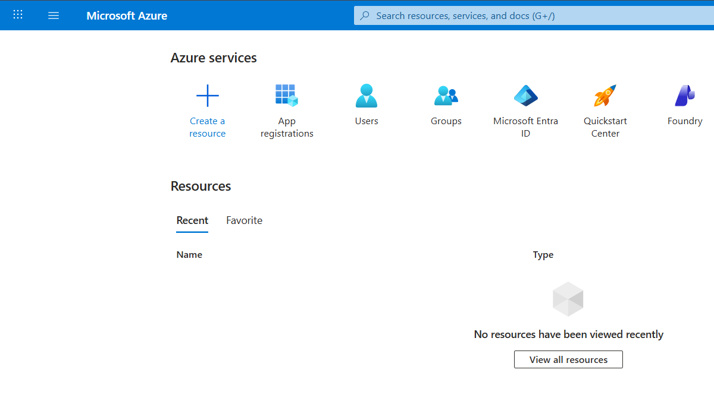

### Step 2: Start a new registration

On the **App registrations** page, click **+ New registration**.

  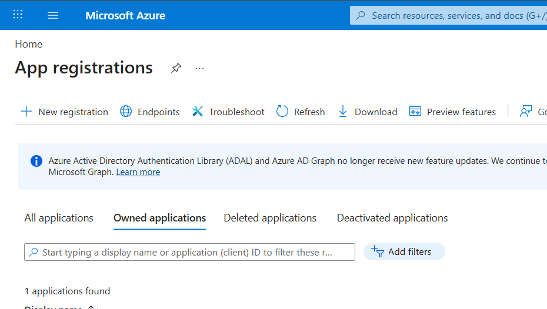

### Step 3: Register the application

1. **Name**: Enter a display name (for example, `PipesHub OneDrive actions`).
2. **Supported account types**: Choose who can sign in—for example **Accounts in any organizational directory and personal Microsoft accounts** for broad support, or a single-tenant option if you only use your organization.
3. **Redirect URI**: Use the **Web** redirect URI from the PipesHub **Action configuration** dialog where OneDrive is set up, for example **Workspace settings → Actions** and **Set up** on the OneDrive action.

<Frame>
  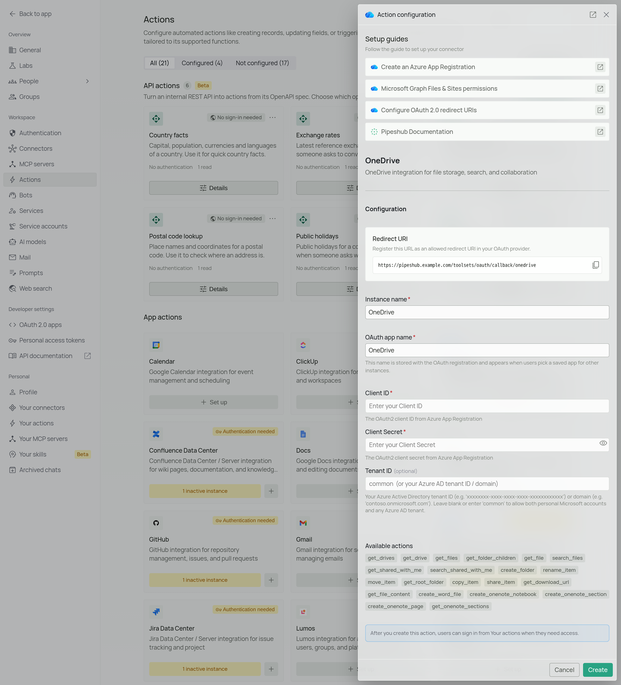
  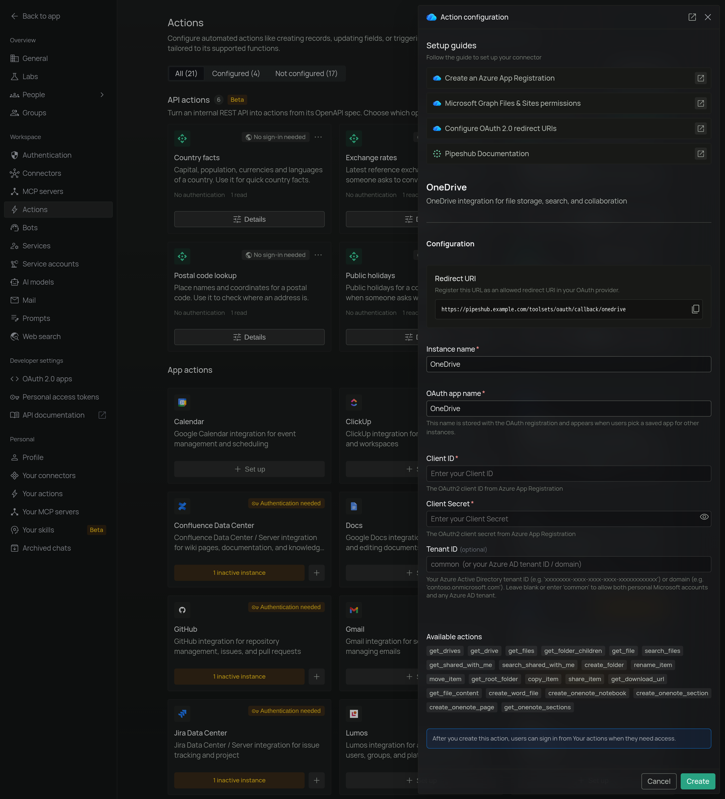
</Frame>

4. Click **Register**.

  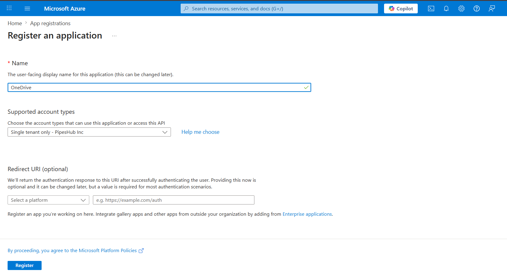

### Step 4: Copy Application (client) ID and Directory (tenant) ID

On the **Overview** page for your app, copy:

- **Application (client) ID** — used as **Client ID** in PipesHub.
- **Directory (tenant) ID**: used as **Tenant ID** in PipesHub (or use `common` / leave blank per the action dialog if you want both work/school and personal accounts).

  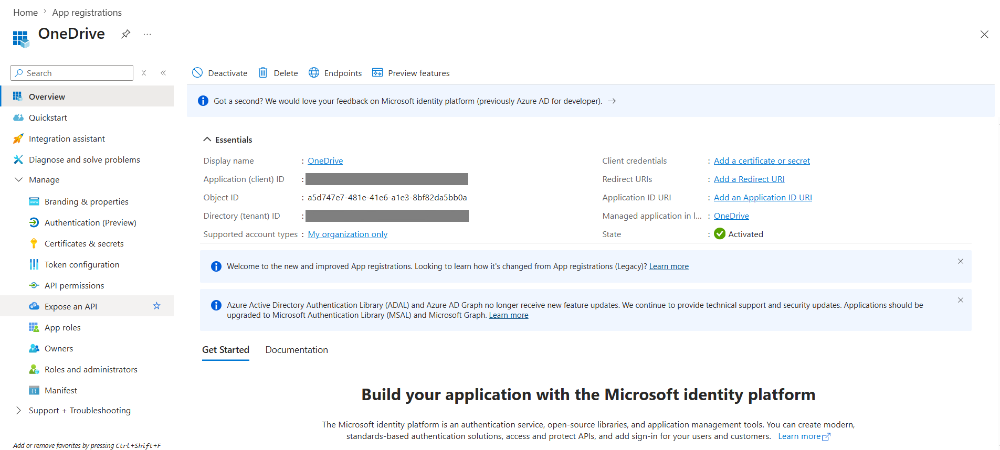

<Warning>
  Use the **Application (client) ID**, not the **Object ID**. They are different values.
</Warning>

### Step 5: Create a client secret

1. In the left sidebar under **Manage**, open **Certificates & secrets**.
2. On the **Client secrets** tab, click **+ New client secret**.
3. Add a description, choose an expiration, then click **Add**.
4. **Copy the secret value immediately** — it is shown only once.

  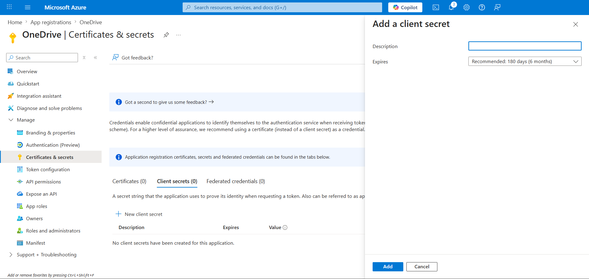

<Warning>
  If you leave this page without copying the secret, you cannot read it again—create a new client secret instead.
</Warning>

### Step 6: Add Microsoft Graph API permissions

1. In the left sidebar, open **API permissions**.
2. Click **+ Add a permission** → **Microsoft Graph** → **Delegated permissions**.
3. Add the delegated permissions PipesHub requests when a user signs in:

| Permission | Description |
|-----------|-------------|
| `Files.Read` | Read the user's files |
| `Files.Read.All` | Read all files the user can reach |
| `Files.ReadWrite` | Read and write the user's files |
| `Files.ReadWrite.All` | Read, write, move, copy, search, and share files the user can reach |
| `Notes.ReadWrite` | Read and update OneNote notebooks, sections, and pages |
| `Sites.Read.All` | Read SharePoint document libraries that appear as drives |
| `User.Read` | Read the signed-in user’s profile |
| `offline_access` | Refresh tokens for ongoing access |

<Info>
  The OneDrive action uses **Delegated** permissions so actions run as the signed-in user, not only as the application.
</Info>

  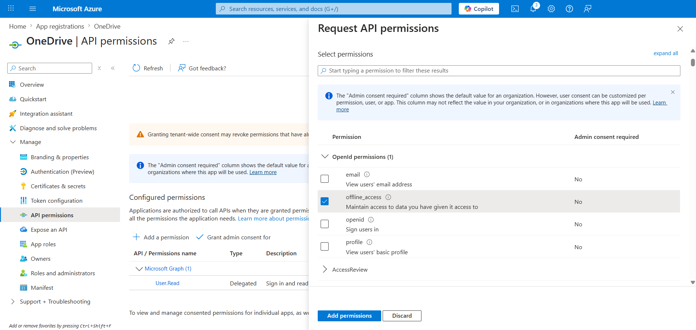

### Step 7: Grant admin consent

Click **Grant admin consent for** your organization (the button includes your tenant name) and confirm, so delegated permissions show as granted for the tenant (especially for permissions that require admin approval).

  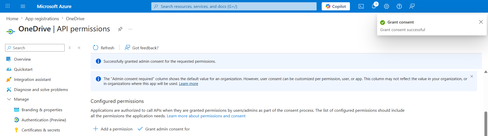

### Step 8: Configure the OneDrive action in PipesHub

1. In PipesHub, go to **Workspace settings** → **Actions**.
2. Find **OneDrive** and click **Set up** to open its setup dialog.
3. Confirm the **Redirect URI** in the dialog matches the **Web** redirect URI you registered in Azure **Step 3**.
4. Enter an **OAuth app name** (or pick a saved app), **Client ID**, **Client Secret**, and optionally **Tenant ID** (`common` or your tenant/domain per the form), then click **Create**.

<Frame>
  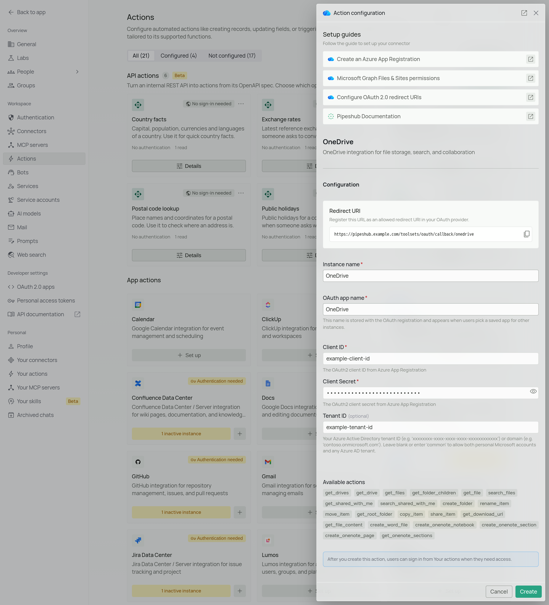
  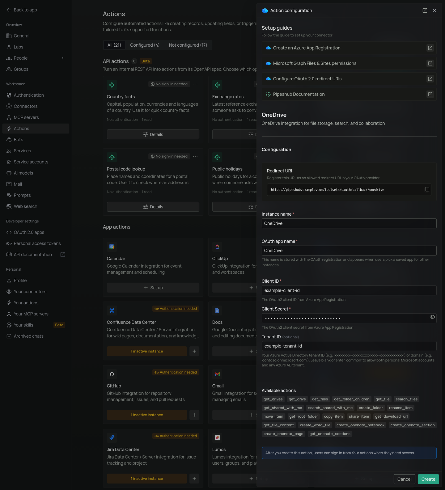
</Frame>

### Step 9: Authenticate the action under Your actions

1. Open **Your actions** (under **Personal** in the sidebar).
2. Select your **OneDrive** instance and complete **Authenticate with OAuth** (Microsoft sign-in, then accept permissions).

<Frame>
  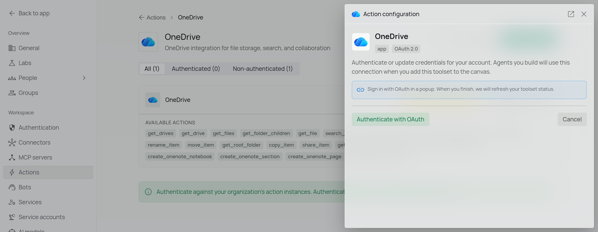
  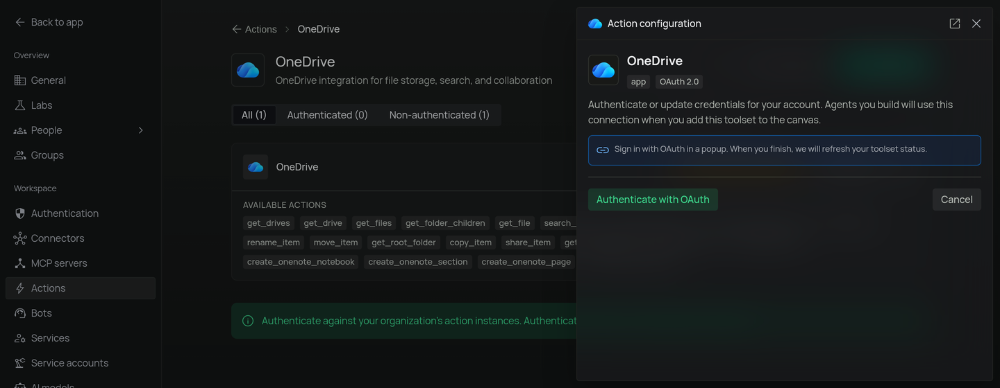
</Frame>

### Step 10: Add OneDrive to an agent

1. In the chat sidebar, click **+** next to **My agents**.
2. Name the agent and click **Create agent**. The **Agent Builder** opens.
3. In the palette, open **Tools** and drag the **OneDrive** action onto the canvas. It connects to the **Agent** node's **Toolsets** input. Click **Save changes**.

<Frame>
  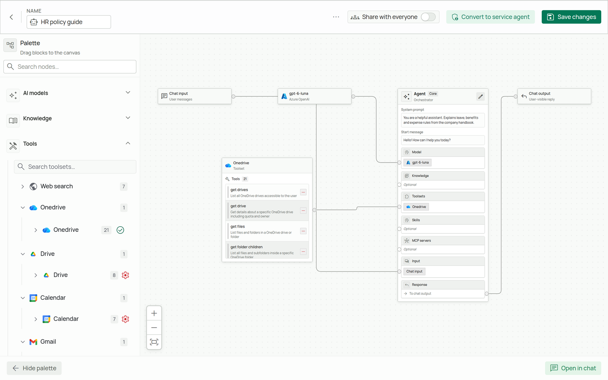
  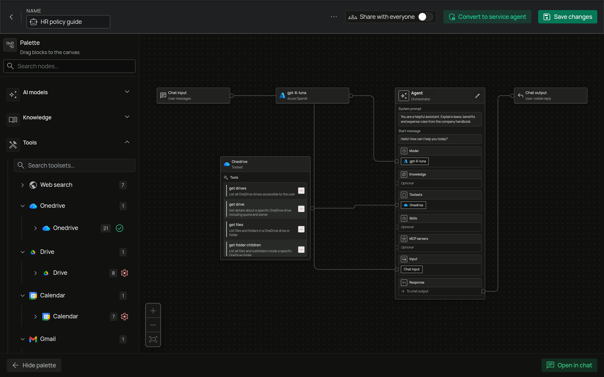
</Frame>

</Accordion>

</AccordionGroup>

---

## FAQ

<AccordionGroup>

<Accordion title="What's the difference between the OneDrive Connector and the OneDrive Action?">

| Aspect | OneDrive Connector | OneDrive Action |
|--------|--------------------|------------------|
| **Purpose** | Sync and index files for search in PipesHub | Let agents browse, search, edit metadata, share, and read content through the API |
| **Data Flow** | One-way import into PipesHub | Two-way actions on live Microsoft 365 content |
| **Auth Type** | Application permissions (admin consent), background sync | Delegated permissions (user consent), per-user session |
| **When to Use** | Enterprise search over file corpora | Interactive tasks such as “find this file,” “move to Archive,” or “share with my team” |

**Example:** Use the **OneDrive Connector** to ingest documents for semantic search. Use the **OneDrive action** when the agent should list folders, search by keyword, copy files, or share a document while the user is signed in.

</Accordion>

</AccordionGroup>

---

## Usage Tips

**Example: Find a document by name**  
Ask the agent to search your OneDrive for “Q3 roadmap” (it should resolve `drive_id`, then run `search_files` or browse folders as needed).

**Example: Move a file into a folder**  
Ask to move “Budget.xlsx” into the “Archive” folder (the agent can search for IDs, then call `move_item`).

**Example: Share read-only with a colleague**  
Ask to share a specific file with `alice@contoso.com` with view access.

