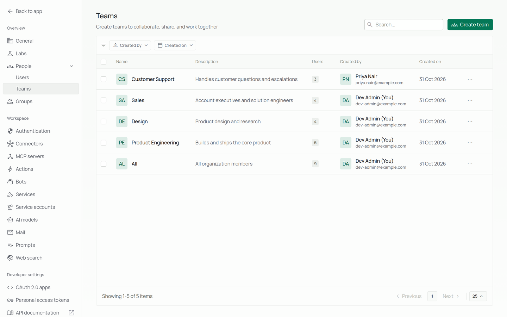
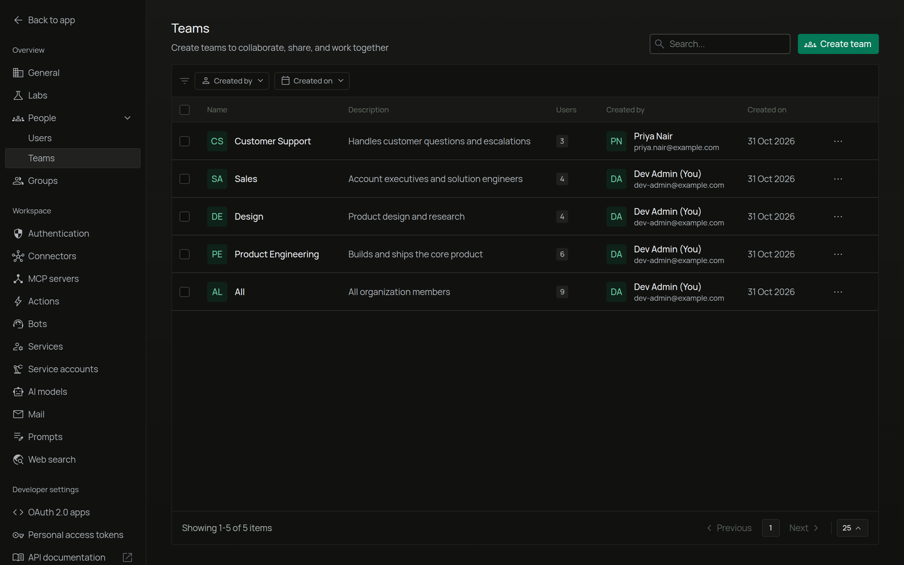
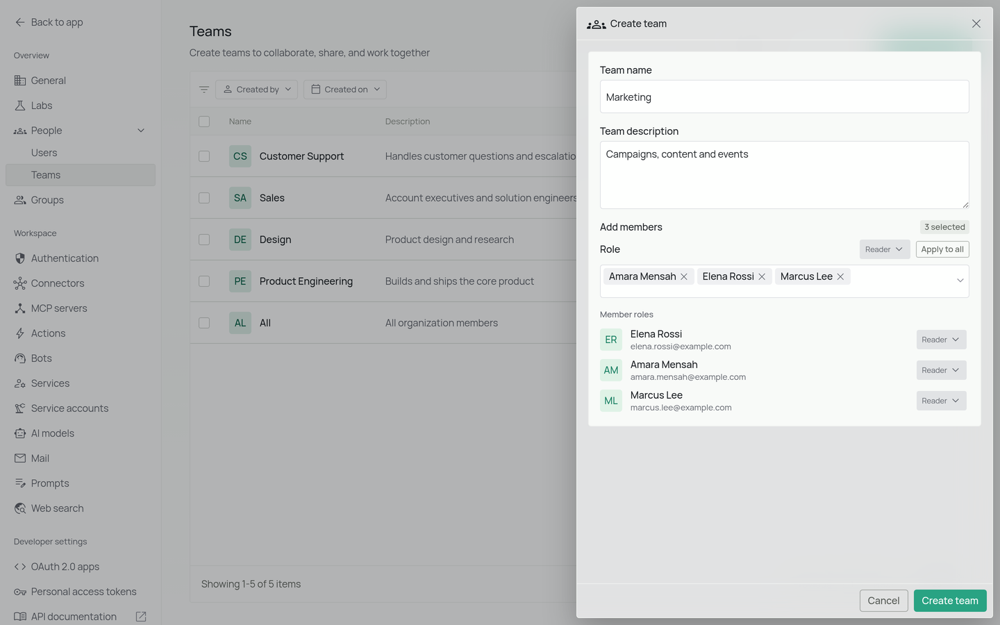
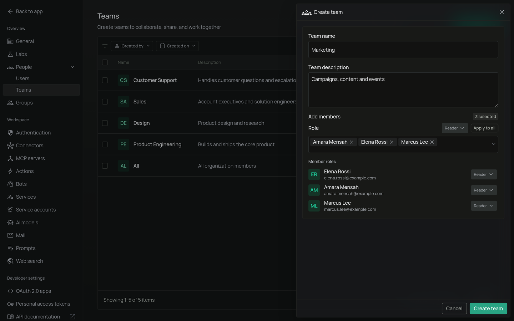
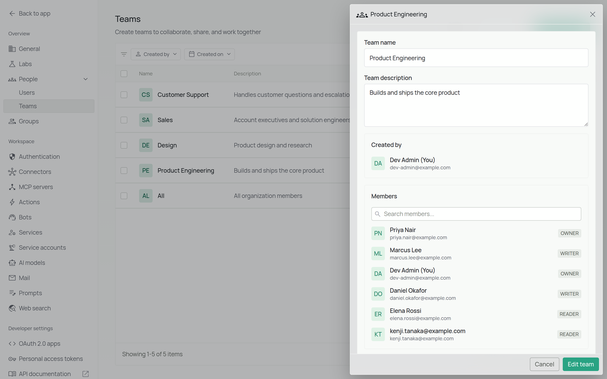
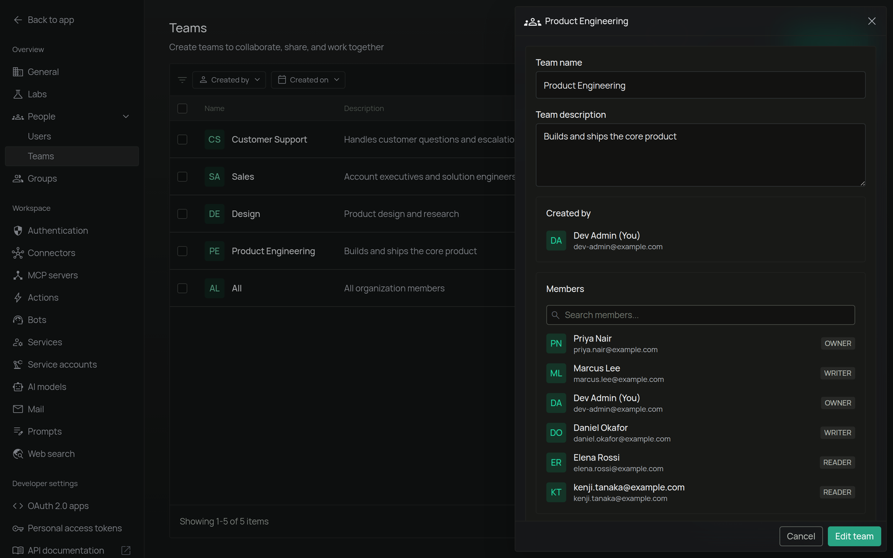
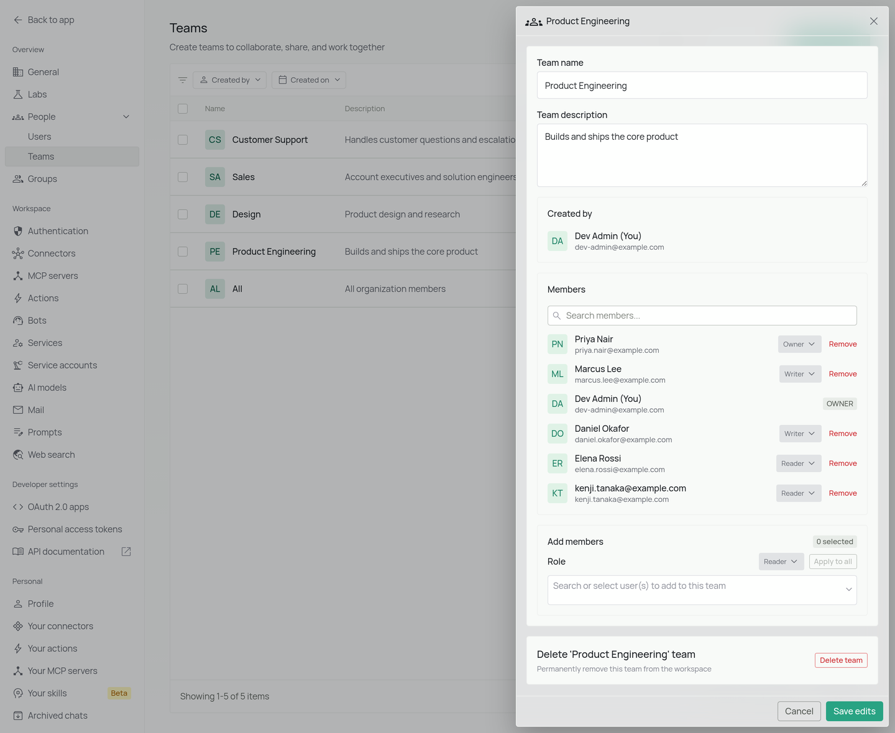
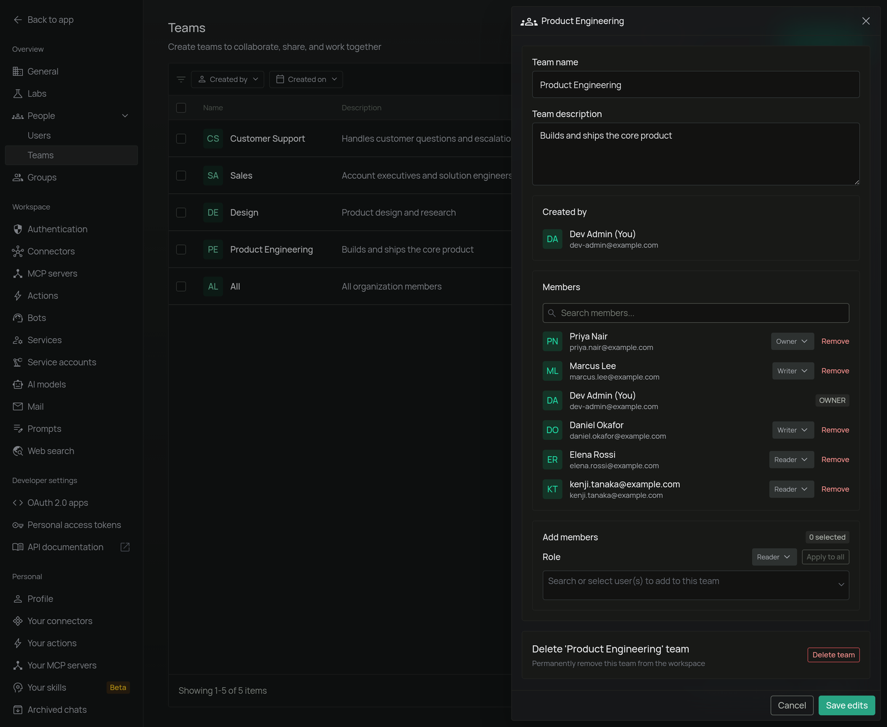

## Overview

Teams let workspace members group themselves around a shared purpose: a project, a product area, or any collaboration unit. Teams are available to every workspace member. A user can belong to any number of teams, and within each team members are assigned a role that determines what they can do with team resources.

## Team Member Roles

Every member of a team has one of three roles:

| Role | Description |
|------|-------------|
| **Owner** | Full control over the team and its resources. Can add or remove members, change roles, and delete the team. |
| **Writer** | Can view and edit team resources. |
| **Reader** | Can view team resources. |

## Navigating to Teams

1. Sign in to your PipesHub account
2. Open the user menu and click **Workspace settings**
3. In the workspace sidebar, expand the **People** section and select **Teams**

The page shows a table of all teams you can see, with columns for **Name**, **Description**, **Users** (count), **Created by**, and **Created on**. Use the **Search** field to look up teams by name and the **Created by** and **Created on** filters to narrow the list. Clicking any row opens that team's detail panel on the right.

<Frame>
  
  
</Frame>

## Creating a Team

1. From the **Teams** page, click **Create team** in the top-right corner
2. The **Create team** panel opens on the right
3. Enter the **Team name** (required), for example, `Product Engineering`
4. (Optional) Enter a **Team description** describing the team's purpose
5. (Optional) Under **Add members**, choose a **Role** (`Reader`, `Writer`, or `Owner`) for the members you're about to select
6. Search for and select the users to add to the team
7. To change a specific member's role after adding them, use the role dropdown next to their name in the **Member roles** list. Click **Apply to all** to reset every selected member to the default role
8. Click **Create team**

<Frame>
  
  
</Frame>

## Viewing a Team

Click a team's row on the **Teams** page, or choose **View team** from the row actions menu (**⋯**), to open the detail panel. The panel shows:

- The team's **Name** and **Description**
- **Created by**: the user who created the team
- **Members** — a paginated list of members with their roles

<Frame>
  
  
</Frame>

## Editing a Team

1. Open the team detail panel
2. Click **Edit team**
3. Update any of the following, then click **Save edits**:
   - **Team name** or **Team description**
   - **Add members**: search and select additional users, with an optional default role and per-user role overrides
   - Member roles — change a current member's role using the role dropdown next to their name
   - Remove members — click **Remove** next to a member; click **Undo** before saving to cancel the removal

Role changes, additions, and removals are applied together when you click **Save edits**.

<Frame>
  
  
</Frame>

## Deleting a Team

A team's **Owner** or a workspace admin can delete it. Members with the **Writer** or **Reader** role cannot, and the default **All** team can never be deleted. If you can delete the team:

1. Open the row actions menu (**⋯**) on the Teams page, or open the team's detail panel and click **Edit team**
2. Click **Delete** in the row actions menu, or **Delete team** at the bottom of the panel
3. Confirm the action

<Warning>
  Deleting a team is irreversible. The team and its membership are removed, though individual users remain in the workspace.
</Warning>
